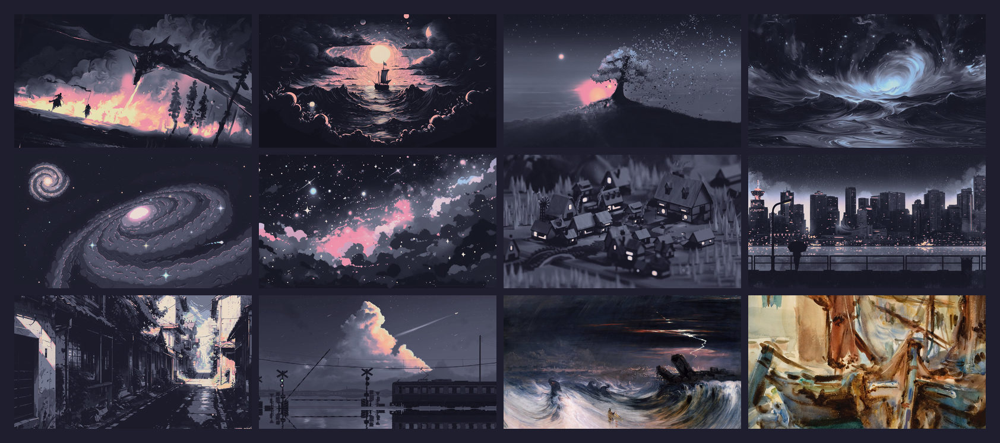
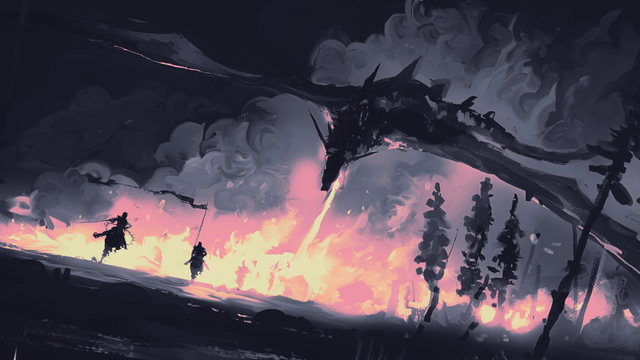
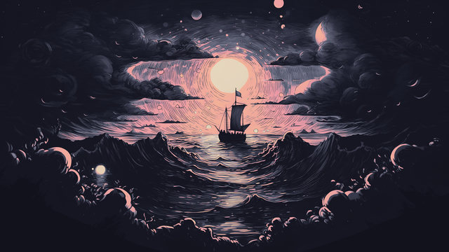
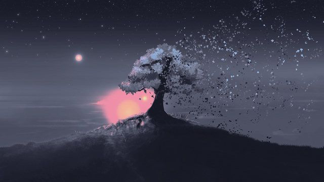
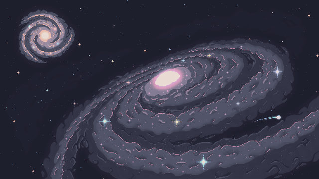
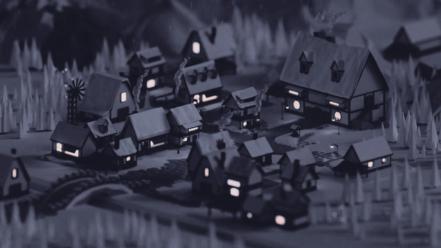
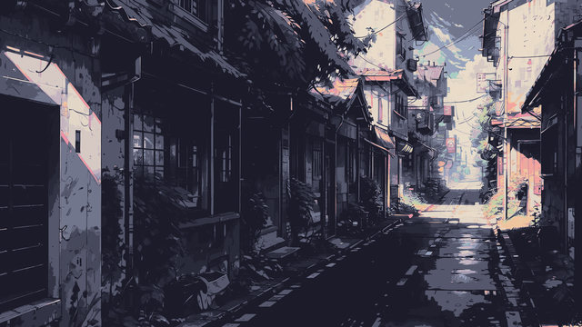
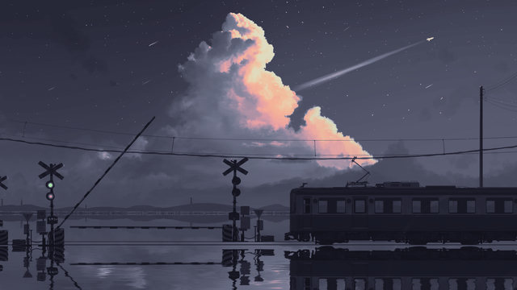
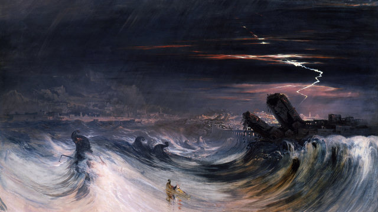
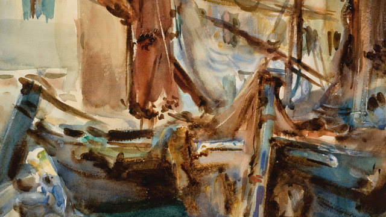

<!-- Generated by `gallery render` from wallpapers.tsv. Do not edit. -->

# Catppuccin

<a href="https://justcarlson.github.io/omarchy-wallpapers/#catppuccin"></a>

12 wallpapers picked for Catppuccin by how closely Aether's palette for each image matches the theme's colours.

Install just this set:

```sh
curl -fsSL https://raw.githubusercontent.com/justcarlson/omarchy-wallpapers/main/install.sh | bash -s -- catppuccin
```

Then press <kbd>Super</kbd> <kbd>Ctrl</kbd> <kbd>Space</kbd> to pick one. To build a whole new theme from a wallpaper instead, import its Aether blueprint:

```sh
aether --import-blueprint https://raw.githubusercontent.com/justcarlson/omarchy-wallpapers/main/blueprints/catppuccin/<name>.json --auto-apply
```

<table>
<tr>
<td width="50%" valign="top"><a href="https://raw.githubusercontent.com/orangci/walls-catppuccin-mocha/7bfdf10d16ad3a689f9f0cf3a0930da3d1a245a8/dominik-mayer-7.jpg"></a><br><b>Dominik Mayer 7</b><br><sub><a href="https://github.com/orangci/walls-catppuccin-mocha/blob/7bfdf10d16ad3a689f9f0cf3a0930da3d1a245a8/dominik-mayer-7.jpg">orangci/walls-catppuccin-mocha</a> · <a href="../blueprints/catppuccin/orangci-dominik-mayer-7.json">Aether blueprint</a></sub></td>
<td width="50%" valign="top"><a href="https://raw.githubusercontent.com/orangci/walls-catppuccin-mocha/7bfdf10d16ad3a689f9f0cf3a0930da3d1a245a8/yohoho.jpg"></a><br><b>Yohoho</b><br><sub><a href="https://github.com/orangci/walls-catppuccin-mocha/blob/7bfdf10d16ad3a689f9f0cf3a0930da3d1a245a8/yohoho.jpg">orangci/walls-catppuccin-mocha</a> · <a href="../blueprints/catppuccin/orangci-yohoho.json">Aether blueprint</a></sub></td>
</tr>
<tr>
<td width="50%" valign="top"><a href="https://raw.githubusercontent.com/orangci/walls-catppuccin-mocha/7bfdf10d16ad3a689f9f0cf3a0930da3d1a245a8/tree.jpg"></a><br><b>Tree</b><br><sub><a href="https://github.com/orangci/walls-catppuccin-mocha/blob/7bfdf10d16ad3a689f9f0cf3a0930da3d1a245a8/tree.jpg">orangci/walls-catppuccin-mocha</a> · <a href="../blueprints/catppuccin/orangci-tree.json">Aether blueprint</a></sub></td>
<td width="50%" valign="top"><a href="https://raw.githubusercontent.com/orangci/walls-catppuccin-mocha/7bfdf10d16ad3a689f9f0cf3a0930da3d1a245a8/galaxy-waves.jpg"></a><br><b>Galaxy Waves</b><br><sub><a href="https://github.com/orangci/walls-catppuccin-mocha/blob/7bfdf10d16ad3a689f9f0cf3a0930da3d1a245a8/galaxy-waves.jpg">orangci/walls-catppuccin-mocha</a> · <a href="../blueprints/catppuccin/orangci-galaxy-waves.json">Aether blueprint</a></sub></td>
</tr>
<tr>
<td width="50%" valign="top"><a href="https://raw.githubusercontent.com/orangci/walls-catppuccin-mocha/7bfdf10d16ad3a689f9f0cf3a0930da3d1a245a8/pixel-galaxy.png"></a><br><b>Pixel Galaxy</b><br><sub><a href="https://github.com/orangci/walls-catppuccin-mocha/blob/7bfdf10d16ad3a689f9f0cf3a0930da3d1a245a8/pixel-galaxy.png">orangci/walls-catppuccin-mocha</a> · <a href="../blueprints/catppuccin/orangci-pixel-galaxy.json">Aether blueprint</a></sub></td>
<td width="50%" valign="top"><a href="https://raw.githubusercontent.com/orangci/walls-catppuccin-mocha/7bfdf10d16ad3a689f9f0cf3a0930da3d1a245a8/puffy-stars.jpg"></a><br><b>Puffy Stars</b><br><sub><a href="https://github.com/orangci/walls-catppuccin-mocha/blob/7bfdf10d16ad3a689f9f0cf3a0930da3d1a245a8/puffy-stars.jpg">orangci/walls-catppuccin-mocha</a> · <a href="../blueprints/catppuccin/orangci-puffy-stars.json">Aether blueprint</a></sub></td>
</tr>
<tr>
<td width="50%" valign="top"><a href="https://raw.githubusercontent.com/orangci/walls-catppuccin-mocha/7bfdf10d16ad3a689f9f0cf3a0930da3d1a245a8/voxel-houses-monochrome.png"></a><br><b>Voxel Houses Monochrome</b><br><sub><a href="https://github.com/orangci/walls-catppuccin-mocha/blob/7bfdf10d16ad3a689f9f0cf3a0930da3d1a245a8/voxel-houses-monochrome.png">orangci/walls-catppuccin-mocha</a> · <a href="../blueprints/catppuccin/orangci-voxel-houses-monochrome.json">Aether blueprint</a></sub></td>
<td width="50%" valign="top"><a href="https://raw.githubusercontent.com/orangci/walls-catppuccin-mocha/7bfdf10d16ad3a689f9f0cf3a0930da3d1a245a8/river-city.jpg"></a><br><b>River City</b><br><sub><a href="https://github.com/orangci/walls-catppuccin-mocha/blob/7bfdf10d16ad3a689f9f0cf3a0930da3d1a245a8/river-city.jpg">orangci/walls-catppuccin-mocha</a> · <a href="../blueprints/catppuccin/orangci-river-city.json">Aether blueprint</a></sub></td>
</tr>
<tr>
<td width="50%" valign="top"><a href="https://raw.githubusercontent.com/orangci/walls-catppuccin-mocha/7bfdf10d16ad3a689f9f0cf3a0930da3d1a245a8/japan-alley.png"></a><br><b>Japan Alley</b><br><sub><a href="https://github.com/orangci/walls-catppuccin-mocha/blob/7bfdf10d16ad3a689f9f0cf3a0930da3d1a245a8/japan-alley.png">orangci/walls-catppuccin-mocha</a> · <a href="../blueprints/catppuccin/orangci-japan-alley.json">Aether blueprint</a></sub></td>
<td width="50%" valign="top"><a href="https://raw.githubusercontent.com/orangci/walls-catppuccin-mocha/7bfdf10d16ad3a689f9f0cf3a0930da3d1a245a8/train-sideview.png"></a><br><b>Train Sideview</b><br><sub><a href="https://github.com/orangci/walls-catppuccin-mocha/blob/7bfdf10d16ad3a689f9f0cf3a0930da3d1a245a8/train-sideview.png">orangci/walls-catppuccin-mocha</a> · <a href="../blueprints/catppuccin/orangci-train-sideview.json">Aether blueprint</a></sub></td>
</tr>
<tr>
<td width="50%" valign="top"><a href="https://upload.wikimedia.org/wikipedia/commons/thumb/0/04/John_Martin_-_Destruction_of_Tyre_-_Google_Art_Project.jpg/3840px-John_Martin_-_Destruction_of_Tyre_-_Google_Art_Project.jpg"></a><br><b>Destruction of Tyre</b><br><sub><a href="https://commons.wikimedia.org/wiki/File:John_Martin_-_Destruction_of_Tyre_-_Google_Art_Project.jpg">John Martin, Wikimedia Commons</a> · <a href="../blueprints/catppuccin/john-martin-destruction-of-tyre.json">Aether blueprint</a></sub></td>
<td width="50%" valign="top"><a href="https://upload.wikimedia.org/wikipedia/commons/a/ad/John_S._Sargent_-_At_Chioggia_%28c._1903%29_-_Mint_Museum.jpg"></a><br><b>At Chioggia</b><br><sub><a href="https://commons.wikimedia.org/wiki/File:John_S._Sargent_-_At_Chioggia_%28c._1903%29_-_Mint_Museum.jpg">John Singer Sargent, Wikimedia Commons</a> · <a href="../blueprints/catppuccin/sargent-at-chioggia.json">Aether blueprint</a></sub></td>
</tr>
</table>

[All themes](../README.md#the-collection)
