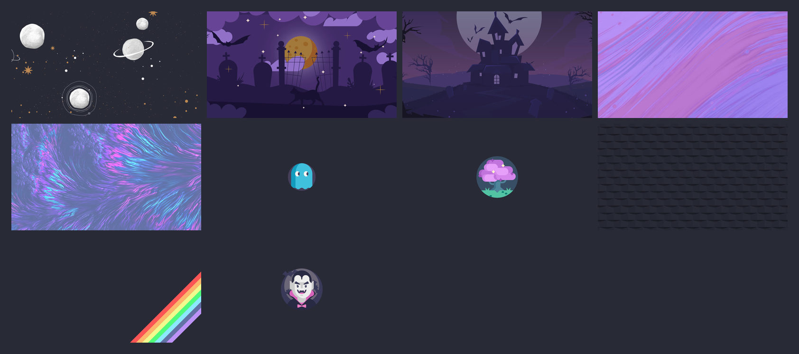
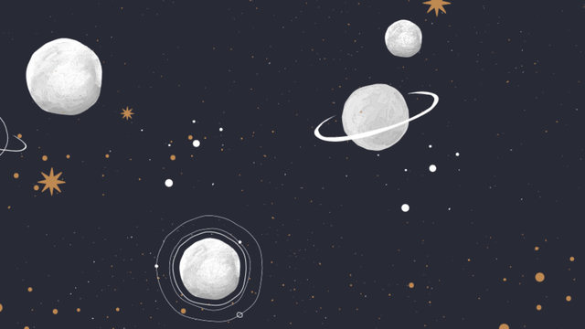

<!-- Generated by `gallery render` from wallpapers.tsv. Do not edit. -->

# Dracula

<a href="https://justcarlson.github.io/omarchy-wallpapers/#dracula"></a>

10 wallpapers picked for Dracula by how closely Aether's palette for each image matches the theme's colours.

Install just this set:

```sh
curl -fsSL https://raw.githubusercontent.com/justcarlson/omarchy-wallpapers/main/install.sh | bash -s -- dracula
```

Then press <kbd>Super</kbd> <kbd>Ctrl</kbd> <kbd>Space</kbd> to pick one. To build a whole new theme from a wallpaper instead, import its Aether blueprint:

```sh
aether --import-blueprint https://raw.githubusercontent.com/justcarlson/omarchy-wallpapers/main/blueprints/dracula/<name>.json --auto-apply
```

<table>
<tr>
<td width="50%" valign="top"><a href="https://raw.githubusercontent.com/dracula/wallpaper/f2b8cc4223bcc2dfd5f165ab80f701bbb84e3303/second-collection/illustrations/galaxy/dracula-galaxy-282a36.png"></a><br><b>Galaxy</b><br><sub><a href="https://github.com/dracula/wallpaper/blob/f2b8cc4223bcc2dfd5f165ab80f701bbb84e3303/second-collection/illustrations/galaxy/dracula-galaxy-282a36.png">dracula/wallpaper</a> · <a href="../blueprints/dracula/dracula-galaxy.json">Aether blueprint</a></sub></td>
<td width="50%" valign="top"><a href="https://raw.githubusercontent.com/dracula/wallpaper/f2b8cc4223bcc2dfd5f165ab80f701bbb84e3303/second-collection/illustrations/cat-and-bats/dracula-cat-282a36.png"></a><br><b>Cat and Bats</b><br><sub><a href="https://github.com/dracula/wallpaper/blob/f2b8cc4223bcc2dfd5f165ab80f701bbb84e3303/second-collection/illustrations/cat-and-bats/dracula-cat-282a36.png">dracula/wallpaper</a> · <a href="../blueprints/dracula/dracula-cat-and-bats.json">Aether blueprint</a></sub></td>
</tr>
<tr>
<td width="50%" valign="top"><a href="https://raw.githubusercontent.com/dracula/wallpaper/f2b8cc4223bcc2dfd5f165ab80f701bbb84e3303/second-collection/spooky-minimal/dracula-spooky-44475a.png"></a><br><b>Spooky Minimal</b><br><sub><a href="https://github.com/dracula/wallpaper/blob/f2b8cc4223bcc2dfd5f165ab80f701bbb84e3303/second-collection/spooky-minimal/dracula-spooky-44475a.png">dracula/wallpaper</a> · <a href="../blueprints/dracula/dracula-spooky-minimal.json">Aether blueprint</a></sub></td>
<td width="50%" valign="top"><a href="https://raw.githubusercontent.com/dracula/wallpaper/f2b8cc4223bcc2dfd5f165ab80f701bbb84e3303/second-collection/soft-waves/dracula-soft-waves-bd93f9.png"></a><br><b>Soft Waves</b><br><sub><a href="https://github.com/dracula/wallpaper/blob/f2b8cc4223bcc2dfd5f165ab80f701bbb84e3303/second-collection/soft-waves/dracula-soft-waves-bd93f9.png">dracula/wallpaper</a> · <a href="../blueprints/dracula/dracula-soft-waves.json">Aether blueprint</a></sub></td>
</tr>
<tr>
<td width="50%" valign="top"><a href="https://raw.githubusercontent.com/dracula/wallpaper/f2b8cc4223bcc2dfd5f165ab80f701bbb84e3303/second-collection/waves/dracula-waves-6272a4.png"></a><br><b>Ocean Waves</b><br><sub><a href="https://github.com/dracula/wallpaper/blob/f2b8cc4223bcc2dfd5f165ab80f701bbb84e3303/second-collection/waves/dracula-waves-6272a4.png">dracula/wallpaper</a> · <a href="../blueprints/dracula/dracula-ocean-waves.json">Aether blueprint</a></sub></td>
<td width="50%" valign="top"><a href="https://raw.githubusercontent.com/aynp/dracula-wallpapers/b74123cab099b9fa6d83b5c2041a9030b58f3eb8/Art/4k/Ghost.png"></a><br><b>Dracula Ghost</b><br><sub><a href="https://github.com/aynp/dracula-wallpapers/blob/b74123cab099b9fa6d83b5c2041a9030b58f3eb8/Art/4k/Ghost.png">aynp/dracula-wallpapers</a> · <a href="../blueprints/dracula/dracula-ghost.json">Aether blueprint</a></sub></td>
</tr>
<tr>
<td width="50%" valign="top"><a href="https://raw.githubusercontent.com/aynp/dracula-wallpapers/b74123cab099b9fa6d83b5c2041a9030b58f3eb8/Art/4k/Tree.png"></a><br><b>Dracula Tree</b><br><sub><a href="https://github.com/aynp/dracula-wallpapers/blob/b74123cab099b9fa6d83b5c2041a9030b58f3eb8/Art/4k/Tree.png">aynp/dracula-wallpapers</a> · <a href="../blueprints/dracula/dracula-tree.json">Aether blueprint</a></sub></td>
<td width="50%" valign="top"><a href="https://raw.githubusercontent.com/aynp/dracula-wallpapers/b74123cab099b9fa6d83b5c2041a9030b58f3eb8/Art/4k/Protruding%20Squares.png"></a><br><b>Dracula Protruding Squares</b><br><sub><a href="https://github.com/aynp/dracula-wallpapers/blob/b74123cab099b9fa6d83b5c2041a9030b58f3eb8/Art/4k/Protruding%20Squares.png">aynp/dracula-wallpapers</a> · <a href="../blueprints/dracula/dracula-protruding-squares.json">Aether blueprint</a></sub></td>
</tr>
<tr>
<td width="50%" valign="top"><a href="https://raw.githubusercontent.com/aynp/dracula-wallpapers/b74123cab099b9fa6d83b5c2041a9030b58f3eb8/Art/4k/Rainbow%201.png"></a><br><b>Dracula Rainbow</b><br><sub><a href="https://github.com/aynp/dracula-wallpapers/blob/b74123cab099b9fa6d83b5c2041a9030b58f3eb8/Art/4k/Rainbow%201.png">aynp/dracula-wallpapers</a> · <a href="../blueprints/dracula/dracula-rainbow.json">Aether blueprint</a></sub></td>
<td width="50%" valign="top"><a href="https://raw.githubusercontent.com/aynp/dracula-wallpapers/b74123cab099b9fa6d83b5c2041a9030b58f3eb8/Art/4k/Dracula.png"></a><br><b>Dracula Portrait</b><br><sub><a href="https://github.com/aynp/dracula-wallpapers/blob/b74123cab099b9fa6d83b5c2041a9030b58f3eb8/Art/4k/Dracula.png">aynp/dracula-wallpapers</a> · <a href="../blueprints/dracula/dracula-portrait.json">Aether blueprint</a></sub></td>
</tr>
</table>

[All themes](../README.md#the-collection)
