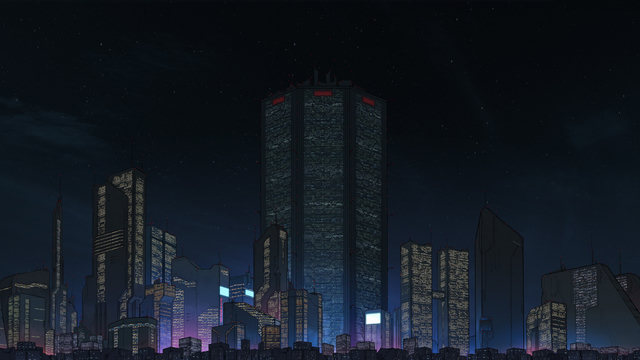
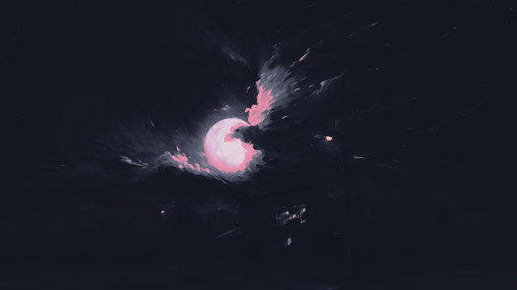

<!-- Generated by `gallery render` from wallpapers.tsv. Do not edit. -->

# Ethereal

<a href="https://justcarlson.github.io/omarchy-wallpapers/#ethereal"></a>

11 wallpapers picked for Ethereal by how closely Aether's palette for each image matches the theme's colours.

Install just this set:

```sh
curl -fsSL https://raw.githubusercontent.com/justcarlson/omarchy-wallpapers/main/install.sh | bash -s -- ethereal
```

Then press <kbd>Super</kbd> <kbd>Ctrl</kbd> <kbd>Space</kbd> to pick one. To build a whole new theme from a wallpaper instead, import its Aether blueprint:

```sh
aether --import-blueprint https://raw.githubusercontent.com/justcarlson/omarchy-wallpapers/main/blueprints/ethereal/<name>.json --auto-apply
```

<table>
<tr>
<td width="50%" valign="top"><a href="https://raw.githubusercontent.com/rose-pine/wallpapers/ee39a37b24ab7700cc4d52f50b01a5d13df6a865/photography/single-celled/through-the-branches.jpg"></a><br><b>Through the Branches</b><br><sub><a href="https://github.com/rose-pine/wallpapers/blob/ee39a37b24ab7700cc4d52f50b01a5d13df6a865/photography/single-celled/through-the-branches.jpg">rose-pine/wallpapers</a> · <a href="../blueprints/ethereal/rose-pine-through-the-branches.json">Aether blueprint</a></sub></td>
<td width="50%" valign="top"><a href="https://raw.githubusercontent.com/dharmx/walls/6bf4d733ebf2b484a37c17d742eb47e5139e6a14/aerial/a_close_up_of_water_01.jpg"></a><br><b>A Close Up of Water 01</b><br><sub><a href="https://github.com/dharmx/walls/blob/6bf4d733ebf2b484a37c17d742eb47e5139e6a14/aerial/a_close_up_of_water_01.jpg">dharmx/walls</a> · <a href="../blueprints/ethereal/dharmx-a-close-up-of-water-01.json">Aether blueprint</a></sub></td>
</tr>
<tr>
<td width="50%" valign="top"><a href="https://raw.githubusercontent.com/orangci/walls-catppuccin-mocha/7bfdf10d16ad3a689f9f0cf3a0930da3d1a245a8/flowers-13.jpg"></a><br><b>Flowers 13</b><br><sub><a href="https://github.com/orangci/walls-catppuccin-mocha/blob/7bfdf10d16ad3a689f9f0cf3a0930da3d1a245a8/flowers-13.jpg">orangci/walls-catppuccin-mocha</a> · <a href="../blueprints/ethereal/orangci-flowers-13.json">Aether blueprint</a></sub></td>
<td width="50%" valign="top"><a href="https://raw.githubusercontent.com/krishna4a6av/Wallpapers/aa01193c864a1c175d3c44d1c0f4c4f62f3c61de/Catppuccin/catp-leaves.png"></a><br><b>Catp Leaves</b><br><sub><a href="https://github.com/krishna4a6av/Wallpapers/blob/aa01193c864a1c175d3c44d1c0f4c4f62f3c61de/Catppuccin/catp-leaves.png">krishna4a6av/Wallpapers</a> · <a href="../blueprints/ethereal/krishna4a6av-catp-leaves.json">Aether blueprint</a></sub></td>
</tr>
<tr>
<td width="50%" valign="top"><a href="https://raw.githubusercontent.com/krishna4a6av/Wallpapers/aa01193c864a1c175d3c44d1c0f4c4f62f3c61de/.homeless/cls-window.jpg"></a><br><b>Cls Window</b><br><sub><a href="https://github.com/krishna4a6av/Wallpapers/blob/aa01193c864a1c175d3c44d1c0f4c4f62f3c61de/.homeless/cls-window.jpg">krishna4a6av/Wallpapers</a> · <a href="../blueprints/ethereal/krishna4a6av-cls-window.json">Aether blueprint</a></sub></td>
<td width="50%" valign="top"><a href="https://raw.githubusercontent.com/AngelJumbo/gruvbox-wallpapers/6aa74cbd65973e1a2a8695e83a58ce3ea634dd5e/wallpapers/pixelart/urban_architecture.jpg"></a><br><b>Urban Architecture</b><br><sub><a href="https://github.com/AngelJumbo/gruvbox-wallpapers/blob/6aa74cbd65973e1a2a8695e83a58ce3ea634dd5e/wallpapers/pixelart/urban_architecture.jpg">AngelJumbo/gruvbox-wallpapers</a> · <a href="../blueprints/ethereal/angeljumbo-urban-architecture.json">Aether blueprint</a></sub></td>
</tr>
<tr>
<td width="50%" valign="top"><a href="https://raw.githubusercontent.com/orangci/walls-catppuccin-mocha/7bfdf10d16ad3a689f9f0cf3a0930da3d1a245a8/haunted-house.jpg"></a><br><b>Haunted House</b><br><sub><a href="https://github.com/orangci/walls-catppuccin-mocha/blob/7bfdf10d16ad3a689f9f0cf3a0930da3d1a245a8/haunted-house.jpg">orangci/walls-catppuccin-mocha</a> · <a href="../blueprints/ethereal/orangci-haunted-house.json">Aether blueprint</a></sub></td>
<td width="50%" valign="top"><a href="https://raw.githubusercontent.com/orangci/walls-catppuccin-mocha/7bfdf10d16ad3a689f9f0cf3a0930da3d1a245a8/flowers-1.jpg"></a><br><b>Flowers 1</b><br><sub><a href="https://github.com/orangci/walls-catppuccin-mocha/blob/7bfdf10d16ad3a689f9f0cf3a0930da3d1a245a8/flowers-1.jpg">orangci/walls-catppuccin-mocha</a> · <a href="../blueprints/ethereal/orangci-flowers-1.json">Aether blueprint</a></sub></td>
</tr>
<tr>
<td width="50%" valign="top"><a href="https://raw.githubusercontent.com/dharmx/walls/6bf4d733ebf2b484a37c17d742eb47e5139e6a14/flowers/a_close_up_of_purple_flowers.jpg"></a><br><b>A Close Up of Purple Flowers</b><br><sub><a href="https://github.com/dharmx/walls/blob/6bf4d733ebf2b484a37c17d742eb47e5139e6a14/flowers/a_close_up_of_purple_flowers.jpg">dharmx/walls</a> · <a href="../blueprints/ethereal/dharmx-a-close-up-of-purple-flowers.json">Aether blueprint</a></sub></td>
<td width="50%" valign="top"><a href="https://raw.githubusercontent.com/orangci/walls-catppuccin-mocha/7bfdf10d16ad3a689f9f0cf3a0930da3d1a245a8/cool.jpg"></a><br><b>Cool</b><br><sub><a href="https://github.com/orangci/walls-catppuccin-mocha/blob/7bfdf10d16ad3a689f9f0cf3a0930da3d1a245a8/cool.jpg">orangci/walls-catppuccin-mocha</a> · <a href="../blueprints/ethereal/orangci-cool.json">Aether blueprint</a></sub></td>
</tr>
<tr>
<td width="50%" valign="top"><a href="https://upload.wikimedia.org/wikipedia/commons/thumb/0/04/John_Martin_-_Destruction_of_Tyre_-_Google_Art_Project.jpg/3840px-John_Martin_-_Destruction_of_Tyre_-_Google_Art_Project.jpg"></a><br><b>Destruction of Tyre</b><br><sub><a href="https://commons.wikimedia.org/wiki/File:John_Martin_-_Destruction_of_Tyre_-_Google_Art_Project.jpg">John Martin, Wikimedia Commons</a> · <a href="../blueprints/ethereal/john-martin-destruction-of-tyre.json">Aether blueprint</a></sub></td>
</tr>
</table>

[All themes](../README.md#the-collection)
