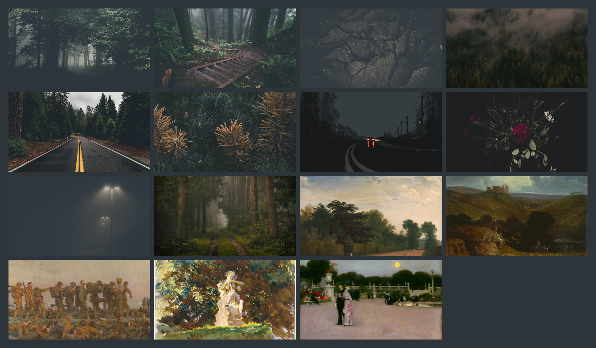
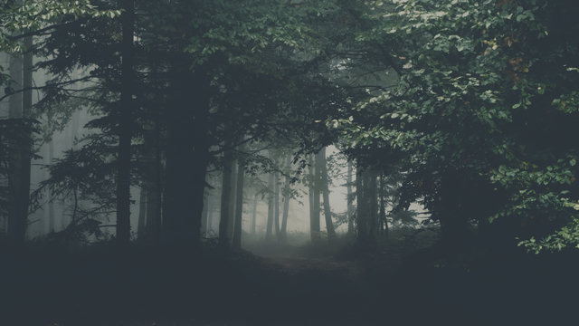
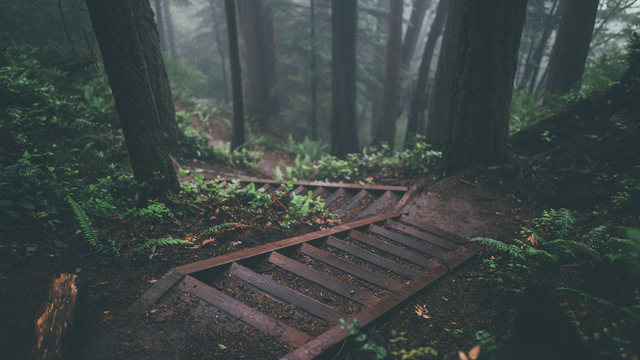
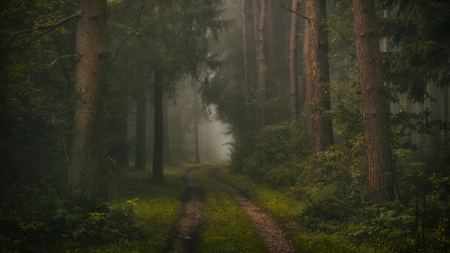
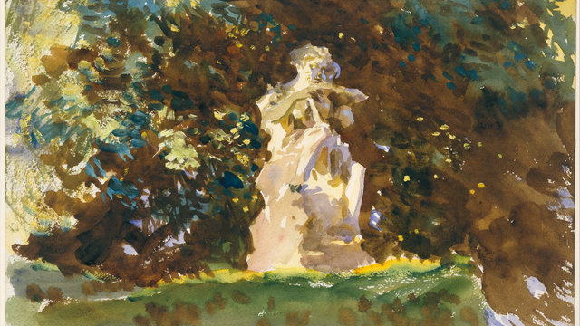

<!-- Generated by `gallery render` from wallpapers.tsv. Do not edit. -->

# Everforest

<a href="https://justcarlson.github.io/omarchy-wallpapers/#everforest"></a>

15 wallpapers picked for Everforest by how closely Aether's palette for each image matches the theme's colours.

Install just this set:

```sh
curl -fsSL https://raw.githubusercontent.com/justcarlson/omarchy-wallpapers/main/install.sh | bash -s -- everforest
```

Then press <kbd>Super</kbd> <kbd>Ctrl</kbd> <kbd>Space</kbd> to pick one. To build a whole new theme from a wallpaper instead, import its Aether blueprint:

```sh
aether --import-blueprint https://raw.githubusercontent.com/justcarlson/omarchy-wallpapers/main/blueprints/everforest/<name>.json --auto-apply
```

<table>
<tr>
<td width="50%" valign="top"><a href="https://raw.githubusercontent.com/Apeiros-46B/everforest-walls/8f538b4e34a880748a471dc4c7aade6e29982417/nature/mist_forest_1.png"></a><br><b>Mist Forest 1</b><br><sub><a href="https://github.com/Apeiros-46B/everforest-walls/blob/8f538b4e34a880748a471dc4c7aade6e29982417/nature/mist_forest_1.png">Apeiros-46B/everforest-walls</a> · <a href="../blueprints/everforest/apeiros-46b-mist-forest-1.json">Aether blueprint</a></sub></td>
<td width="50%" valign="top"><a href="https://raw.githubusercontent.com/krishna4a6av/Wallpapers/aa01193c864a1c175d3c44d1c0f4c4f62f3c61de/Everforest/stairs.jpg"></a><br><b>Stairs</b><br><sub><a href="https://github.com/krishna4a6av/Wallpapers/blob/aa01193c864a1c175d3c44d1c0f4c4f62f3c61de/Everforest/stairs.jpg">krishna4a6av/Wallpapers</a> · <a href="../blueprints/everforest/krishna4a6av-stairs.json">Aether blueprint</a></sub></td>
</tr>
<tr>
<td width="50%" valign="top"><a href="https://raw.githubusercontent.com/Apeiros-46B/everforest-walls/8f538b4e34a880748a471dc4c7aade6e29982417/close_up/rocks_1.png"></a><br><b>Rocks 1</b><br><sub><a href="https://github.com/Apeiros-46B/everforest-walls/blob/8f538b4e34a880748a471dc4c7aade6e29982417/close_up/rocks_1.png">Apeiros-46B/everforest-walls</a> · <a href="../blueprints/everforest/apeiros-46b-rocks-1.json">Aether blueprint</a></sub></td>
<td width="50%" valign="top"><a href="https://raw.githubusercontent.com/krishna4a6av/Wallpapers/aa01193c864a1c175d3c44d1c0f4c4f62f3c61de/Everforest/forest.jpg"></a><br><b>Forest</b><br><sub><a href="https://github.com/krishna4a6av/Wallpapers/blob/aa01193c864a1c175d3c44d1c0f4c4f62f3c61de/Everforest/forest.jpg">krishna4a6av/Wallpapers</a> · <a href="../blueprints/everforest/krishna4a6av-forest.json">Aether blueprint</a></sub></td>
</tr>
<tr>
<td width="50%" valign="top"><a href="https://raw.githubusercontent.com/krishna4a6av/Wallpapers/aa01193c864a1c175d3c44d1c0f4c4f62f3c61de/Everforest/forest_road.jpg"></a><br><b>Forest Road</b><br><sub><a href="https://github.com/krishna4a6av/Wallpapers/blob/aa01193c864a1c175d3c44d1c0f4c4f62f3c61de/Everforest/forest_road.jpg">krishna4a6av/Wallpapers</a> · <a href="../blueprints/everforest/krishna4a6av-forest-road.json">Aether blueprint</a></sub></td>
<td width="50%" valign="top"><a href="https://raw.githubusercontent.com/krishna4a6av/Wallpapers/aa01193c864a1c175d3c44d1c0f4c4f62f3c61de/Everforest/treecov.png"></a><br><b>Treecov</b><br><sub><a href="https://github.com/krishna4a6av/Wallpapers/blob/aa01193c864a1c175d3c44d1c0f4c4f62f3c61de/Everforest/treecov.png">krishna4a6av/Wallpapers</a> · <a href="../blueprints/everforest/krishna4a6av-treecov.json">Aether blueprint</a></sub></td>
</tr>
<tr>
<td width="50%" valign="top"><a href="https://raw.githubusercontent.com/krishna4a6av/Wallpapers/aa01193c864a1c175d3c44d1c0f4c4f62f3c61de/Graphite/road.jpg"></a><br><b>Road</b><br><sub><a href="https://github.com/krishna4a6av/Wallpapers/blob/aa01193c864a1c175d3c44d1c0f4c4f62f3c61de/Graphite/road.jpg">krishna4a6av/Wallpapers</a> · <a href="../blueprints/everforest/krishna4a6av-road.json">Aether blueprint</a></sub></td>
<td width="50%" valign="top"><a href="https://raw.githubusercontent.com/dharmx/walls/6bf4d733ebf2b484a37c17d742eb47e5139e6a14/flowers/a_bouquet_of_flowers_and_leaves.jpg"></a><br><b>A Bouquet of Flowers and Leaves</b><br><sub><a href="https://github.com/dharmx/walls/blob/6bf4d733ebf2b484a37c17d742eb47e5139e6a14/flowers/a_bouquet_of_flowers_and_leaves.jpg">dharmx/walls</a> · <a href="../blueprints/everforest/dharmx-a-bouquet-of-flowers-and-leaves.json">Aether blueprint</a></sub></td>
</tr>
<tr>
<td width="50%" valign="top"><a href="https://raw.githubusercontent.com/Apeiros-46B/everforest-walls/8f538b4e34a880748a471dc4c7aade6e29982417/other/streetlights_1.png"></a><br><b>Streetlights 1</b><br><sub><a href="https://github.com/Apeiros-46B/everforest-walls/blob/8f538b4e34a880748a471dc4c7aade6e29982417/other/streetlights_1.png">Apeiros-46B/everforest-walls</a> · <a href="../blueprints/everforest/apeiros-46b-streetlights-1.json">Aether blueprint</a></sub></td>
<td width="50%" valign="top"><a href="https://raw.githubusercontent.com/krishna4a6av/Wallpapers/aa01193c864a1c175d3c44d1c0f4c4f62f3c61de/Everforest/forestpath.jpg"></a><br><b>Forestpath</b><br><sub><a href="https://github.com/krishna4a6av/Wallpapers/blob/aa01193c864a1c175d3c44d1c0f4c4f62f3c61de/Everforest/forestpath.jpg">krishna4a6av/Wallpapers</a> · <a href="../blueprints/everforest/krishna4a6av-forestpath.json">Aether blueprint</a></sub></td>
</tr>
<tr>
<td width="50%" valign="top"><a href="https://upload.wikimedia.org/wikipedia/commons/thumb/2/2a/John_Martin_-_Kensington_Gardens_-_Google_Art_Project_%282334653%29.jpg/3840px-John_Martin_-_Kensington_Gardens_-_Google_Art_Project_%282334653%29.jpg"></a><br><b>Kensington Gardens</b><br><sub><a href="https://commons.wikimedia.org/wiki/File:John_Martin_-_Kensington_Gardens_-_Google_Art_Project_%282334653%29.jpg">John Martin, Wikimedia Commons</a> · <a href="../blueprints/everforest/john-martin-kensington-gardens.json">Aether blueprint</a></sub></td>
<td width="50%" valign="top"><a href="https://upload.wikimedia.org/wikipedia/commons/thumb/f/fc/John_Martin_-_Landscape_with_a_Castle_-_Google_Art_Project.jpg/3840px-John_Martin_-_Landscape_with_a_Castle_-_Google_Art_Project.jpg"></a><br><b>Landscape with a Castle</b><br><sub><a href="https://commons.wikimedia.org/wiki/File:John_Martin_-_Landscape_with_a_Castle_-_Google_Art_Project.jpg">John Martin, Wikimedia Commons</a> · <a href="../blueprints/everforest/john-martin-landscape-with-a-castle.json">Aether blueprint</a></sub></td>
</tr>
<tr>
<td width="50%" valign="top"><a href="https://upload.wikimedia.org/wikipedia/commons/thumb/d/d3/John_Singer_Sargent_-_Gassed_%281919%29.jpg/3840px-John_Singer_Sargent_-_Gassed_%281919%29.jpg"></a><br><b>Gassed</b><br><sub><a href="https://commons.wikimedia.org/wiki/File:John_Singer_Sargent_-_Gassed_%281919%29.jpg">John Singer Sargent, Wikimedia Commons</a> · <a href="../blueprints/everforest/sargent-gassed.json">Aether blueprint</a></sub></td>
<td width="50%" valign="top"><a href="https://raw.githubusercontent.com/justcarlson/omarchy-wallpapers/main/images/sargent-boboli-garden-florence.jpg"></a><br><b>Boboli Garden Florence</b><br><sub><a href="https://commons.wikimedia.org/wiki/File:Boboli_Garden%2C_Florence_MET_DT4568.jpg">John Singer Sargent, Wikimedia Commons</a> · <a href="../blueprints/everforest/sargent-boboli-garden-florence.json">Aether blueprint</a></sub></td>
</tr>
<tr>
<td width="50%" valign="top"><a href="https://upload.wikimedia.org/wikipedia/commons/thumb/8/85/John_Singer_Sargent%2C_American_%28active_London%2C_Florence%2C_and_Paris%29_-_In_the_Luxembourg_Gardens_-_Google_Art_Project.jpg/3840px-John_Singer_Sargent%2C_American_%28active_London%2C_Florence%2C_and_Paris%29_-_In_the_Luxembourg_Gardens_-_Google_Art_Project.jpg"></a><br><b>In the Luxembourg Gardens</b><br><sub><a href="https://commons.wikimedia.org/wiki/File:John_Singer_Sargent%2C_American_%28active_London%2C_Florence%2C_and_Paris%29_-_In_the_Luxembourg_Gardens_-_Google_Art_Project.jpg">John Singer Sargent, Wikimedia Commons</a> · <a href="../blueprints/everforest/sargent-in-the-luxembourg-gardens.json">Aether blueprint</a></sub></td>
</tr>
</table>

[All themes](../README.md#the-collection)
