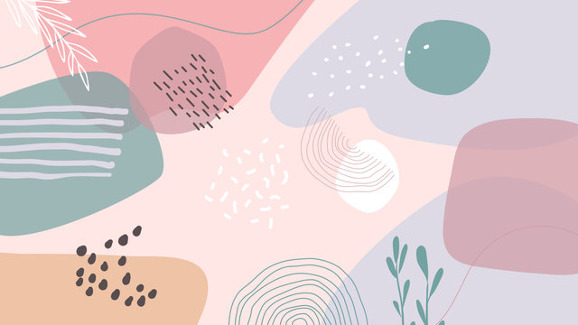
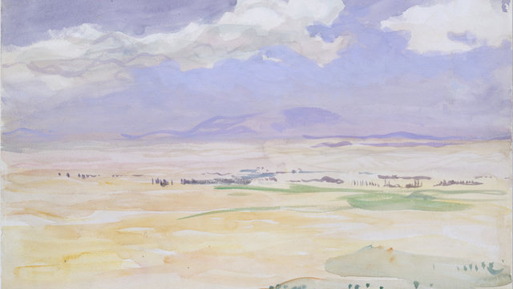

<!-- Generated by `gallery render` from wallpapers.tsv. Do not edit. -->

# Flexoki Light

<a href="https://justcarlson.github.io/omarchy-wallpapers/#flexoki-light"></a>

13 wallpapers picked for Flexoki Light by how closely Aether's palette for each image matches the theme's colours.

Install just this set:

```sh
curl -fsSL https://raw.githubusercontent.com/justcarlson/omarchy-wallpapers/main/install.sh | bash -s -- flexoki-light
```

Then press <kbd>Super</kbd> <kbd>Ctrl</kbd> <kbd>Space</kbd> to pick one. To build a whole new theme from a wallpaper instead, import its Aether blueprint:

```sh
aether --import-blueprint https://raw.githubusercontent.com/justcarlson/omarchy-wallpapers/main/blueprints/flexoki-light/<name>.json --auto-apply
```

<table>
<tr>
<td width="50%" valign="top"><a href="https://raw.githubusercontent.com/rose-pine/wallpapers/ee39a37b24ab7700cc4d52f50b01a5d13df6a865/illustration/leafy-dawn.png"></a><br><b>Leafy Dawn</b><br><sub><a href="https://github.com/rose-pine/wallpapers/blob/ee39a37b24ab7700cc4d52f50b01a5d13df6a865/illustration/leafy-dawn.png">rose-pine/wallpapers</a> · <a href="../blueprints/flexoki-light/rose-pine-leafy-dawn.json">Aether blueprint</a></sub></td>
<td width="50%" valign="top"><a href="https://raw.githubusercontent.com/krishna4a6av/Wallpapers/aa01193c864a1c175d3c44d1c0f4c4f62f3c61de/Flexoki/abstract109.png"></a><br><b>Abstract109</b><br><sub><a href="https://github.com/krishna4a6av/Wallpapers/blob/aa01193c864a1c175d3c44d1c0f4c4f62f3c61de/Flexoki/abstract109.png">krishna4a6av/Wallpapers</a> · <a href="../blueprints/flexoki-light/krishna4a6av-abstract109.json">Aether blueprint</a></sub></td>
</tr>
<tr>
<td width="50%" valign="top"><a href="https://raw.githubusercontent.com/dharmx/walls/6bf4d733ebf2b484a37c17d742eb47e5139e6a14/nature/a_close_up_of_pink_flowers.jpg"></a><br><b>A Close Up of Pink Flowers</b><br><sub><a href="https://github.com/dharmx/walls/blob/6bf4d733ebf2b484a37c17d742eb47e5139e6a14/nature/a_close_up_of_pink_flowers.jpg">dharmx/walls</a> · <a href="../blueprints/flexoki-light/dharmx-a-close-up-of-pink-flowers.json">Aether blueprint</a></sub></td>
<td width="50%" valign="top"><a href="https://raw.githubusercontent.com/dharmx/walls/6bf4d733ebf2b484a37c17d742eb47e5139e6a14/architecture/a_lighthouse_in_front_of_a_building.jpg"></a><br><b>A Lighthouse in Front of a Building</b><br><sub><a href="https://github.com/dharmx/walls/blob/6bf4d733ebf2b484a37c17d742eb47e5139e6a14/architecture/a_lighthouse_in_front_of_a_building.jpg">dharmx/walls</a> · <a href="../blueprints/flexoki-light/dharmx-a-lighthouse-in-front-of-a-building.json">Aether blueprint</a></sub></td>
</tr>
<tr>
<td width="50%" valign="top"><a href="https://raw.githubusercontent.com/dharmx/walls/6bf4d733ebf2b484a37c17d742eb47e5139e6a14/flowers/a_close_up_of_a_flower_09.jpg"></a><br><b>A Close Up of a Flower 09</b><br><sub><a href="https://github.com/dharmx/walls/blob/6bf4d733ebf2b484a37c17d742eb47e5139e6a14/flowers/a_close_up_of_a_flower_09.jpg">dharmx/walls</a> · <a href="../blueprints/flexoki-light/dharmx-a-close-up-of-a-flower-09.json">Aether blueprint</a></sub></td>
<td width="50%" valign="top"><a href="https://raw.githubusercontent.com/dharmx/walls/6bf4d733ebf2b484a37c17d742eb47e5139e6a14/minimal/a_cartoon_of_trees_and_clouds.png"></a><br><b>A Cartoon of Trees and Clouds</b><br><sub><a href="https://github.com/dharmx/walls/blob/6bf4d733ebf2b484a37c17d742eb47e5139e6a14/minimal/a_cartoon_of_trees_and_clouds.png">dharmx/walls</a> · <a href="../blueprints/flexoki-light/dharmx-a-cartoon-of-trees-and-clouds.json">Aether blueprint</a></sub></td>
</tr>
<tr>
<td width="50%" valign="top"><a href="https://raw.githubusercontent.com/dharmx/walls/6bf4d733ebf2b484a37c17d742eb47e5139e6a14/abstract/a_colorful_background_with_different_shapes_and_patterns.png"></a><br><b>A Colorful Background with Different Shapes and Patterns</b><br><sub><a href="https://github.com/dharmx/walls/blob/6bf4d733ebf2b484a37c17d742eb47e5139e6a14/abstract/a_colorful_background_with_different_shapes_and_patterns.png">dharmx/walls</a> · <a href="../blueprints/flexoki-light/dharmx-a-colorful-background-with-different-shapes-and-patterns.json">Aether blueprint</a></sub></td>
<td width="50%" valign="top"><a href="https://raw.githubusercontent.com/orangci/walls-catppuccin-mocha/7bfdf10d16ad3a689f9f0cf3a0930da3d1a245a8/flower-field.jpg"></a><br><b>Flower Field</b><br><sub><a href="https://github.com/orangci/walls-catppuccin-mocha/blob/7bfdf10d16ad3a689f9f0cf3a0930da3d1a245a8/flower-field.jpg">orangci/walls-catppuccin-mocha</a> · <a href="../blueprints/flexoki-light/orangci-flower-field.json">Aether blueprint</a></sub></td>
</tr>
<tr>
<td width="50%" valign="top"><a href="https://raw.githubusercontent.com/D3Ext/aesthetic-wallpapers/e34f05935c5b768f4c016b0893924d18ec1dba61/images/autumn_leaves.jpg"></a><br><b>Autumn Leaves</b><br><sub><a href="https://github.com/D3Ext/aesthetic-wallpapers/blob/e34f05935c5b768f4c016b0893924d18ec1dba61/images/autumn_leaves.jpg">D3Ext/aesthetic-wallpapers</a> · <a href="../blueprints/flexoki-light/d3ext-autumn-leaves.json">Aether blueprint</a></sub></td>
<td width="50%" valign="top"><a href="https://raw.githubusercontent.com/orangci/walls-catppuccin-mocha/7bfdf10d16ad3a689f9f0cf3a0930da3d1a245a8/sakura-trees-over-river.jpg"></a><br><b>Sakura Trees Over River</b><br><sub><a href="https://github.com/orangci/walls-catppuccin-mocha/blob/7bfdf10d16ad3a689f9f0cf3a0930da3d1a245a8/sakura-trees-over-river.jpg">orangci/walls-catppuccin-mocha</a> · <a href="../blueprints/flexoki-light/orangci-sakura-trees-over-river.json">Aether blueprint</a></sub></td>
</tr>
<tr>
<td width="50%" valign="top"><a href="https://upload.wikimedia.org/wikipedia/commons/c/c3/From_%C3%81vila_MET_DT235917.jpg"></a><br><b>From Avila</b><br><sub><a href="https://commons.wikimedia.org/wiki/File:From_%C3%81vila_MET_DT235917.jpg">John Singer Sargent, Wikimedia Commons</a> · <a href="../blueprints/flexoki-light/sargent-from-avila.json">Aether blueprint</a></sub></td>
<td width="50%" valign="top"><a href="https://upload.wikimedia.org/wikipedia/commons/8/89/Sunset_at_Sea_MET_DT235919.jpg"></a><br><b>Sunset at Sea</b><br><sub><a href="https://commons.wikimedia.org/wiki/File:Sunset_at_Sea_MET_DT235919.jpg">John Singer Sargent, Wikimedia Commons</a> · <a href="../blueprints/flexoki-light/sargent-sunset-at-sea.json">Aether blueprint</a></sub></td>
</tr>
<tr>
<td width="50%" valign="top"><a href="https://upload.wikimedia.org/wikipedia/commons/e/ee/From_Jerusalem_MET_DT235915.jpg"></a><br><b>From Jerusalem</b><br><sub><a href="https://commons.wikimedia.org/wiki/File:From_Jerusalem_MET_DT235915.jpg">John Singer Sargent, Wikimedia Commons</a> · <a href="../blueprints/flexoki-light/sargent-from-jerusalem.json">Aether blueprint</a></sub></td>
</tr>
</table>

[All themes](../README.md#the-collection)
