<!-- Generated by `gallery render` from wallpapers.tsv. Do not edit. -->

# Gruvbox

<a href="https://justcarlson.github.io/omarchy-wallpapers/#gruvbox">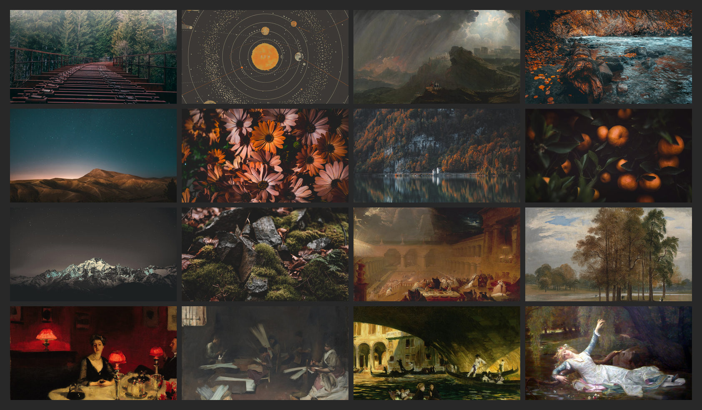</a>

16 wallpapers picked for Gruvbox by how closely Aether's palette for each image matches the theme's colours.

Install just this set:

```sh
curl -fsSL https://raw.githubusercontent.com/justcarlson/omarchy-wallpapers/main/install.sh | bash -s -- gruvbox
```

Then press <kbd>Super</kbd> <kbd>Ctrl</kbd> <kbd>Space</kbd> to pick one. To build a whole new theme from a wallpaper instead, import its Aether blueprint:

```sh
aether --import-blueprint https://raw.githubusercontent.com/justcarlson/omarchy-wallpapers/main/blueprints/gruvbox/<name>.json --auto-apply
```

<table>
<tr>
<td width="50%" valign="top"><a href="https://raw.githubusercontent.com/AngelJumbo/gruvbox-wallpapers/6aa74cbd65973e1a2a8695e83a58ce3ea634dd5e/wallpapers/photography/rails.jpg">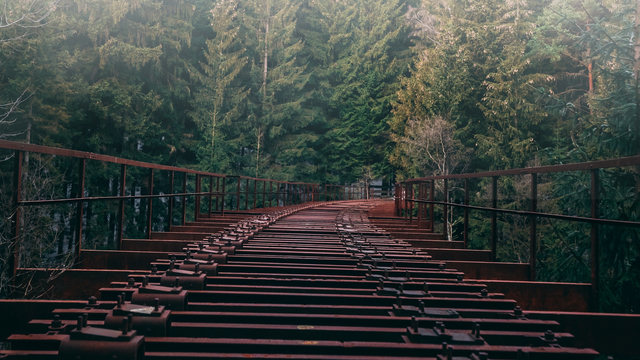</a><br><b>Rails</b><br><sub><a href="https://github.com/AngelJumbo/gruvbox-wallpapers/blob/6aa74cbd65973e1a2a8695e83a58ce3ea634dd5e/wallpapers/photography/rails.jpg">AngelJumbo/gruvbox-wallpapers</a> · <a href="../blueprints/gruvbox/angeljumbo-rails.json">Aether blueprint</a></sub></td>
<td width="50%" valign="top"><a href="https://raw.githubusercontent.com/krishna4a6av/Wallpapers/aa01193c864a1c175d3c44d1c0f4c4f62f3c61de/Gruvbox/upscaled-ss.png">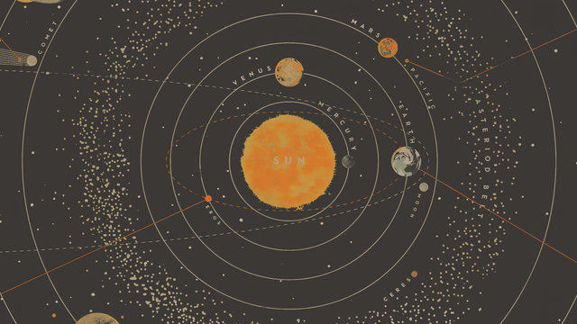</a><br><b>Upscaled Ss</b><br><sub><a href="https://github.com/krishna4a6av/Wallpapers/blob/aa01193c864a1c175d3c44d1c0f4c4f62f3c61de/Gruvbox/upscaled-ss.png">krishna4a6av/Wallpapers</a> · <a href="../blueprints/gruvbox/krishna4a6av-upscaled-ss.json">Aether blueprint</a></sub></td>
</tr>
<tr>
<td width="50%" valign="top"><a href="https://raw.githubusercontent.com/AngelJumbo/gruvbox-wallpapers/6aa74cbd65973e1a2a8695e83a58ce3ea634dd5e/wallpapers/mix/wall.jpg">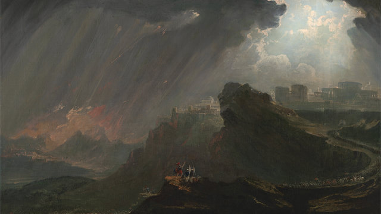</a><br><b>Wall</b><br><sub><a href="https://github.com/AngelJumbo/gruvbox-wallpapers/blob/6aa74cbd65973e1a2a8695e83a58ce3ea634dd5e/wallpapers/mix/wall.jpg">AngelJumbo/gruvbox-wallpapers</a> · <a href="../blueprints/gruvbox/angeljumbo-wall.json">Aether blueprint</a></sub></td>
<td width="50%" valign="top"><a href="https://raw.githubusercontent.com/AngelJumbo/gruvbox-wallpapers/6aa74cbd65973e1a2a8695e83a58ce3ea634dd5e/wallpapers/photography/jake-weirick-EsvpmQ4zp5Y.jpg">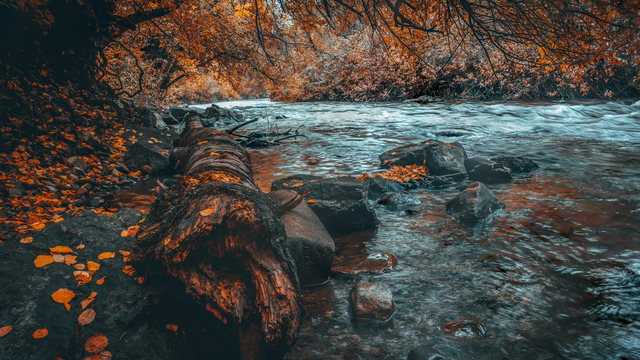</a><br><b>Jake Weirick Esvpmq4zp5y</b><br><sub><a href="https://github.com/AngelJumbo/gruvbox-wallpapers/blob/6aa74cbd65973e1a2a8695e83a58ce3ea634dd5e/wallpapers/photography/jake-weirick-EsvpmQ4zp5Y.jpg">AngelJumbo/gruvbox-wallpapers</a> · <a href="../blueprints/gruvbox/angeljumbo-jake-weirick-esvpmq4zp5y.json">Aether blueprint</a></sub></td>
</tr>
<tr>
<td width="50%" valign="top"><a href="https://raw.githubusercontent.com/AngelJumbo/gruvbox-wallpapers/6aa74cbd65973e1a2a8695e83a58ce3ea634dd5e/wallpapers/photography/mohammad-alizade-4wzRuAb-KWs.jpg">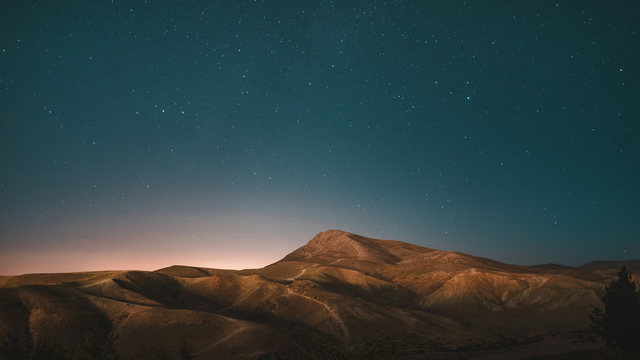</a><br><b>Mohammad Alizade 4wzruab Kws</b><br><sub><a href="https://github.com/AngelJumbo/gruvbox-wallpapers/blob/6aa74cbd65973e1a2a8695e83a58ce3ea634dd5e/wallpapers/photography/mohammad-alizade-4wzRuAb-KWs.jpg">AngelJumbo/gruvbox-wallpapers</a> · <a href="../blueprints/gruvbox/angeljumbo-mohammad-alizade-4wzruab-kws.json">Aether blueprint</a></sub></td>
<td width="50%" valign="top"><a href="https://raw.githubusercontent.com/krishna4a6av/Wallpapers/aa01193c864a1c175d3c44d1c0f4c4f62f3c61de/Gruvbox/flowers.jpg">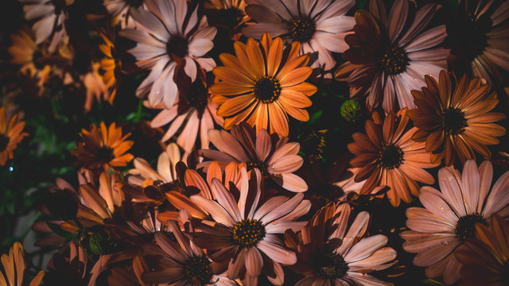</a><br><b>Flowers</b><br><sub><a href="https://github.com/krishna4a6av/Wallpapers/blob/aa01193c864a1c175d3c44d1c0f4c4f62f3c61de/Gruvbox/flowers.jpg">krishna4a6av/Wallpapers</a> · <a href="../blueprints/gruvbox/krishna4a6av-flowers.json">Aether blueprint</a></sub></td>
</tr>
<tr>
<td width="50%" valign="top"><a href="https://raw.githubusercontent.com/AngelJumbo/gruvbox-wallpapers/6aa74cbd65973e1a2a8695e83a58ce3ea634dd5e/wallpapers/photography/houseonthesideofalake.jpg">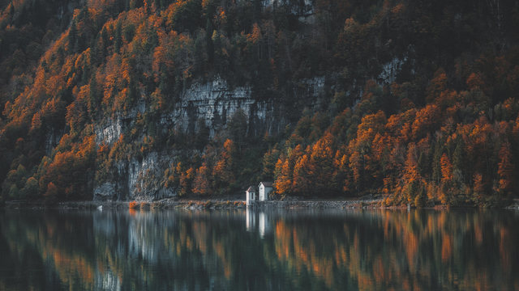</a><br><b>Houseonthesideofalake</b><br><sub><a href="https://github.com/AngelJumbo/gruvbox-wallpapers/blob/6aa74cbd65973e1a2a8695e83a58ce3ea634dd5e/wallpapers/photography/houseonthesideofalake.jpg">AngelJumbo/gruvbox-wallpapers</a> · <a href="../blueprints/gruvbox/angeljumbo-houseonthesideofalake.json">Aether blueprint</a></sub></td>
<td width="50%" valign="top"><a href="https://raw.githubusercontent.com/AngelJumbo/gruvbox-wallpapers/6aa74cbd65973e1a2a8695e83a58ce3ea634dd5e/wallpapers/photography/tangerines.jpg">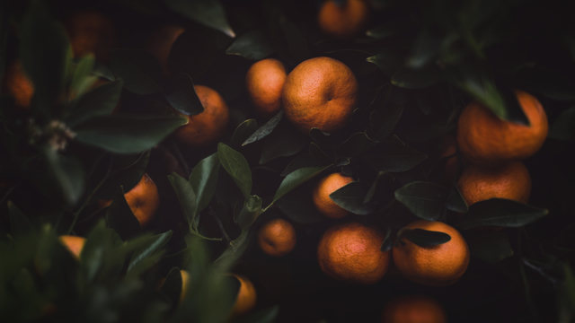</a><br><b>Tangerines</b><br><sub><a href="https://github.com/AngelJumbo/gruvbox-wallpapers/blob/6aa74cbd65973e1a2a8695e83a58ce3ea634dd5e/wallpapers/photography/tangerines.jpg">AngelJumbo/gruvbox-wallpapers</a> · <a href="../blueprints/gruvbox/angeljumbo-tangerines.json">Aether blueprint</a></sub></td>
</tr>
<tr>
<td width="50%" valign="top"><a href="https://raw.githubusercontent.com/AngelJumbo/gruvbox-wallpapers/6aa74cbd65973e1a2a8695e83a58ce3ea634dd5e/wallpapers/photography/White-Mountain.jpg">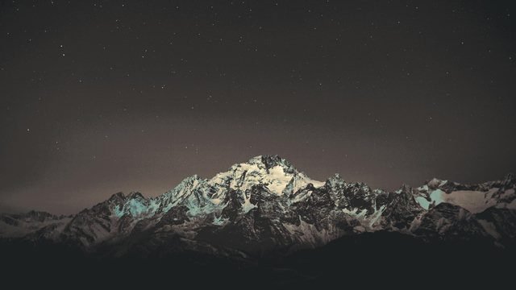</a><br><b>White Mountain</b><br><sub><a href="https://github.com/AngelJumbo/gruvbox-wallpapers/blob/6aa74cbd65973e1a2a8695e83a58ce3ea634dd5e/wallpapers/photography/White-Mountain.jpg">AngelJumbo/gruvbox-wallpapers</a> · <a href="../blueprints/gruvbox/angeljumbo-white-mountain.json">Aether blueprint</a></sub></td>
<td width="50%" valign="top"><a href="https://raw.githubusercontent.com/AngelJumbo/gruvbox-wallpapers/6aa74cbd65973e1a2a8695e83a58ce3ea634dd5e/wallpapers/photography/moss.jpg">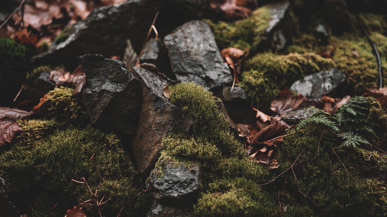</a><br><b>Moss</b><br><sub><a href="https://github.com/AngelJumbo/gruvbox-wallpapers/blob/6aa74cbd65973e1a2a8695e83a58ce3ea634dd5e/wallpapers/photography/moss.jpg">AngelJumbo/gruvbox-wallpapers</a> · <a href="../blueprints/gruvbox/angeljumbo-moss.json">Aether blueprint</a></sub></td>
</tr>
<tr>
<td width="50%" valign="top"><a href="https://upload.wikimedia.org/wikipedia/commons/thumb/e/ec/John_Martin_-_Belshazzar%27s_Feast_-_Google_Art_Project.jpg/3840px-John_Martin_-_Belshazzar%27s_Feast_-_Google_Art_Project.jpg">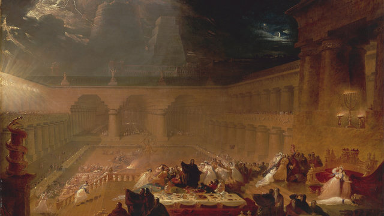</a><br><b>Belshazzars Feast</b><br><sub><a href="https://commons.wikimedia.org/wiki/File:John_Martin_-_Belshazzar%27s_Feast_-_Google_Art_Project.jpg">John Martin, Wikimedia Commons</a> · <a href="../blueprints/gruvbox/john-martin-belshazzars-feast.json">Aether blueprint</a></sub></td>
<td width="50%" valign="top"><a href="https://upload.wikimedia.org/wikipedia/commons/thumb/d/db/John_Martin_-_Hyde_Park_-_Google_Art_Project.jpg/3840px-John_Martin_-_Hyde_Park_-_Google_Art_Project.jpg">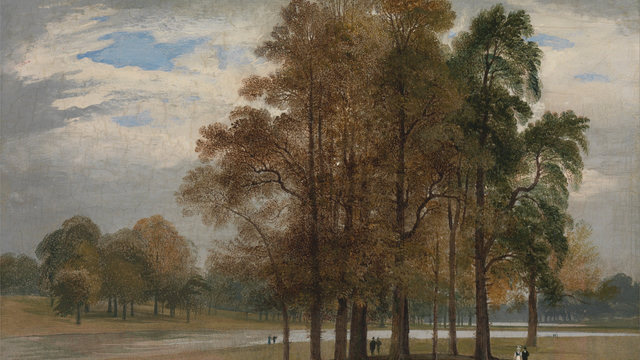</a><br><b>Hyde Park</b><br><sub><a href="https://commons.wikimedia.org/wiki/File:John_Martin_-_Hyde_Park_-_Google_Art_Project.jpg">John Martin, Wikimedia Commons</a> · <a href="../blueprints/gruvbox/john-martin-hyde-park.json">Aether blueprint</a></sub></td>
</tr>
<tr>
<td width="50%" valign="top"><a href="https://upload.wikimedia.org/wikipedia/commons/thumb/d/d9/John_Singer_Sargent_-_Le_verre_de_porto_%28A_Dinner_Table_at_Night%29_-_Google_Art_Project.jpg/3840px-John_Singer_Sargent_-_Le_verre_de_porto_%28A_Dinner_Table_at_Night%29_-_Google_Art_Project.jpg"></a><br><b>The Glass of Porto</b><br><sub><a href="https://commons.wikimedia.org/wiki/File:John_Singer_Sargent_-_Le_verre_de_porto_%28A_Dinner_Table_at_Night%29_-_Google_Art_Project.jpg">John Singer Sargent, Wikimedia Commons</a> · <a href="../blueprints/gruvbox/sargent-the-glass-of-porto.json">Aether blueprint</a></sub></td>
<td width="50%" valign="top"><a href="https://upload.wikimedia.org/wikipedia/commons/thumb/7/71/John_Singer_Sargent_-_Venetian_Glass_Workers_-_Google_Art_Project.jpg/3840px-John_Singer_Sargent_-_Venetian_Glass_Workers_-_Google_Art_Project.jpg">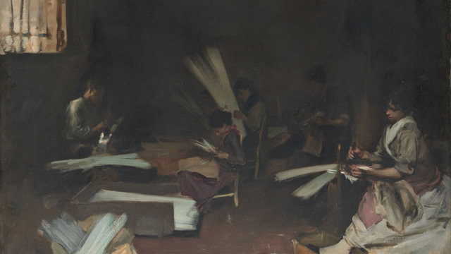</a><br><b>Venetian Glass Workers</b><br><sub><a href="https://commons.wikimedia.org/wiki/File:John_Singer_Sargent_-_Venetian_Glass_Workers_-_Google_Art_Project.jpg">John Singer Sargent, Wikimedia Commons</a> · <a href="../blueprints/gruvbox/sargent-venetian-glass-workers.json">Aether blueprint</a></sub></td>
</tr>
<tr>
<td width="50%" valign="top"><a href="https://raw.githubusercontent.com/justcarlson/omarchy-wallpapers/main/images/sargent-the-rialto-venice.jpg">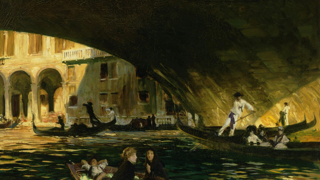</a><br><b>The Rialto Venice</b><br><sub><a href="https://commons.wikimedia.org/wiki/File:John_Singer_Sargent_-_The_Rialto%2C_Venice_%281911%29.jpg">John Singer Sargent, Wikimedia Commons</a> · <a href="../blueprints/gruvbox/sargent-the-rialto-venice.json">Aether blueprint</a></sub></td>
<td width="50%" valign="top"><a href="https://raw.githubusercontent.com/justcarlson/omarchy-wallpapers/main/images/alexandre-cabanel-ophelia.jpg"></a><br><b>Ophelia</b><br><sub><a href="https://github.com/justcarlson/omarchy-wallpapers/blob/main/images/alexandre-cabanel-ophelia.jpg">Alexandre Cabanel, restored here</a> · <a href="../blueprints/gruvbox/alexandre-cabanel-ophelia.json">Aether blueprint</a></sub></td>
</tr>
</table>

[All themes](../README.md#the-collection)
