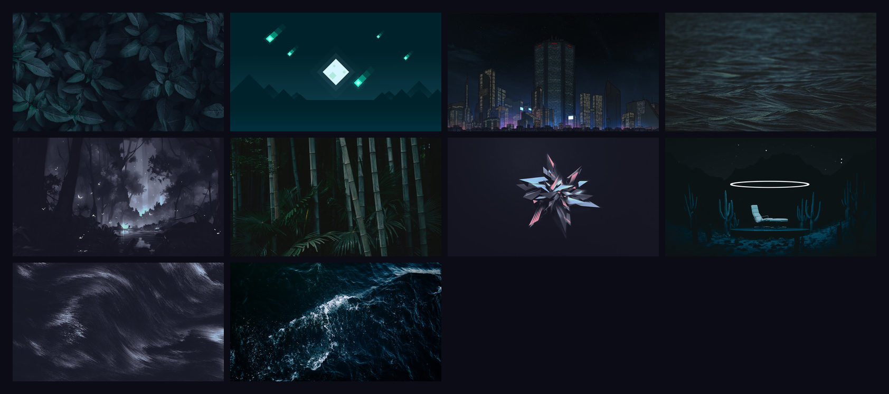
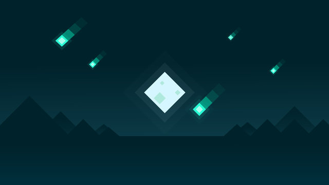
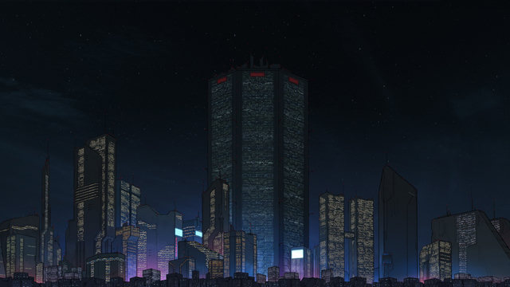
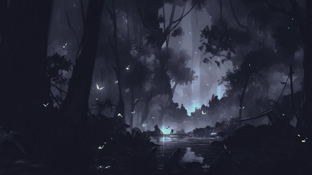
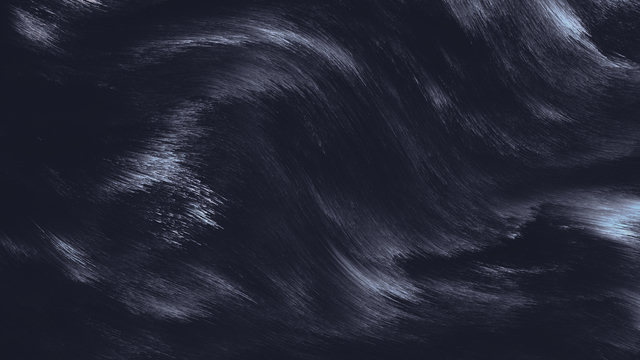

<!-- Generated by `gallery render` from wallpapers.tsv. Do not edit. -->

# Hackerman

<a href="https://justcarlson.github.io/omarchy-wallpapers/#hackerman"></a>

10 wallpapers picked for Hackerman by how closely Aether's palette for each image matches the theme's colours.

Install just this set:

```sh
curl -fsSL https://raw.githubusercontent.com/justcarlson/omarchy-wallpapers/main/install.sh | bash -s -- hackerman
```

Then press <kbd>Super</kbd> <kbd>Ctrl</kbd> <kbd>Space</kbd> to pick one. To build a whole new theme from a wallpaper instead, import its Aether blueprint:

```sh
aether --import-blueprint https://raw.githubusercontent.com/justcarlson/omarchy-wallpapers/main/blueprints/hackerman/<name>.json --auto-apply
```

<table>
<tr>
<td width="50%" valign="top"><a href="https://raw.githubusercontent.com/krishna4a6av/Wallpapers/aa01193c864a1c175d3c44d1c0f4c4f62f3c61de/Everforest/leaves.png"></a><br><b>Leaves</b><br><sub><a href="https://github.com/krishna4a6av/Wallpapers/blob/aa01193c864a1c175d3c44d1c0f4c4f62f3c61de/Everforest/leaves.png">krishna4a6av/Wallpapers</a> · <a href="../blueprints/hackerman/krishna4a6av-leaves.json">Aether blueprint</a></sub></td>
<td width="50%" valign="top"><a href="https://raw.githubusercontent.com/dharmx/walls/6bf4d733ebf2b484a37c17d742eb47e5139e6a14/poly/a_video_game_screen_with_a_diamond_and_green_lights.png"></a><br><b>A Video Game Screen with a Diamond and Green Lights</b><br><sub><a href="https://github.com/dharmx/walls/blob/6bf4d733ebf2b484a37c17d742eb47e5139e6a14/poly/a_video_game_screen_with_a_diamond_and_green_lights.png">dharmx/walls</a> · <a href="../blueprints/hackerman/dharmx-a-video-game-screen-with-a-diamond-and-green-lights.json">Aether blueprint</a></sub></td>
</tr>
<tr>
<td width="50%" valign="top"><a href="https://raw.githubusercontent.com/AngelJumbo/gruvbox-wallpapers/6aa74cbd65973e1a2a8695e83a58ce3ea634dd5e/wallpapers/pixelart/urban_architecture.jpg"></a><br><b>Urban Architecture</b><br><sub><a href="https://github.com/AngelJumbo/gruvbox-wallpapers/blob/6aa74cbd65973e1a2a8695e83a58ce3ea634dd5e/wallpapers/pixelart/urban_architecture.jpg">AngelJumbo/gruvbox-wallpapers</a> · <a href="../blueprints/hackerman/angeljumbo-urban-architecture.json">Aether blueprint</a></sub></td>
<td width="50%" valign="top"><a href="https://raw.githubusercontent.com/AngelJumbo/gruvbox-wallpapers/6aa74cbd65973e1a2a8695e83a58ce3ea634dd5e/wallpapers/photography/wave.jpg"></a><br><b>Wave</b><br><sub><a href="https://github.com/AngelJumbo/gruvbox-wallpapers/blob/6aa74cbd65973e1a2a8695e83a58ce3ea634dd5e/wallpapers/photography/wave.jpg">AngelJumbo/gruvbox-wallpapers</a> · <a href="../blueprints/hackerman/angeljumbo-wave.json">Aether blueprint</a></sub></td>
</tr>
<tr>
<td width="50%" valign="top"><a href="https://raw.githubusercontent.com/orangci/walls-catppuccin-mocha/7bfdf10d16ad3a689f9f0cf3a0930da3d1a245a8/dark-forest.jpg"></a><br><b>Dark Forest</b><br><sub><a href="https://github.com/orangci/walls-catppuccin-mocha/blob/7bfdf10d16ad3a689f9f0cf3a0930da3d1a245a8/dark-forest.jpg">orangci/walls-catppuccin-mocha</a> · <a href="../blueprints/hackerman/orangci-dark-forest.json">Aether blueprint</a></sub></td>
<td width="50%" valign="top"><a href="https://raw.githubusercontent.com/dharmx/walls/6bf4d733ebf2b484a37c17d742eb47e5139e6a14/nature/a_group_of_bamboo_trees_01.jpg"></a><br><b>A Group of Bamboo Trees 01</b><br><sub><a href="https://github.com/dharmx/walls/blob/6bf4d733ebf2b484a37c17d742eb47e5139e6a14/nature/a_group_of_bamboo_trees_01.jpg">dharmx/walls</a> · <a href="../blueprints/hackerman/dharmx-a-group-of-bamboo-trees-01.json">Aether blueprint</a></sub></td>
</tr>
<tr>
<td width="50%" valign="top"><a href="https://raw.githubusercontent.com/orangci/walls-catppuccin-mocha/7bfdf10d16ad3a689f9f0cf3a0930da3d1a245a8/dark-star.jpg"></a><br><b>Dark Star</b><br><sub><a href="https://github.com/orangci/walls-catppuccin-mocha/blob/7bfdf10d16ad3a689f9f0cf3a0930da3d1a245a8/dark-star.jpg">orangci/walls-catppuccin-mocha</a> · <a href="../blueprints/hackerman/orangci-dark-star.json">Aether blueprint</a></sub></td>
<td width="50%" valign="top"><a href="https://raw.githubusercontent.com/dharmx/walls/6bf4d733ebf2b484a37c17d742eb47e5139e6a14/abstract/a_chair_on_a_platform_with_a_halo_above_it.jpg"></a><br><b>A Chair on a Platform with a Halo Above It</b><br><sub><a href="https://github.com/dharmx/walls/blob/6bf4d733ebf2b484a37c17d742eb47e5139e6a14/abstract/a_chair_on_a_platform_with_a_halo_above_it.jpg">dharmx/walls</a> · <a href="../blueprints/hackerman/dharmx-a-chair-on-a-platform-with-a-halo-above-it.json">Aether blueprint</a></sub></td>
</tr>
<tr>
<td width="50%" valign="top"><a href="https://raw.githubusercontent.com/orangci/walls-catppuccin-mocha/7bfdf10d16ad3a689f9f0cf3a0930da3d1a245a8/dark-waves.jpg"></a><br><b>Dark Waves</b><br><sub><a href="https://github.com/orangci/walls-catppuccin-mocha/blob/7bfdf10d16ad3a689f9f0cf3a0930da3d1a245a8/dark-waves.jpg">orangci/walls-catppuccin-mocha</a> · <a href="../blueprints/hackerman/orangci-dark-waves.json">Aether blueprint</a></sub></td>
<td width="50%" valign="top"><a href="https://raw.githubusercontent.com/dharmx/walls/6bf4d733ebf2b484a37c17d742eb47e5139e6a14/aerial/a_close_up_of_water_01.jpg"></a><br><b>A Close Up of Water 01</b><br><sub><a href="https://github.com/dharmx/walls/blob/6bf4d733ebf2b484a37c17d742eb47e5139e6a14/aerial/a_close_up_of_water_01.jpg">dharmx/walls</a> · <a href="../blueprints/hackerman/dharmx-a-close-up-of-water-01.json">Aether blueprint</a></sub></td>
</tr>
</table>

[All themes](../README.md#the-collection)
