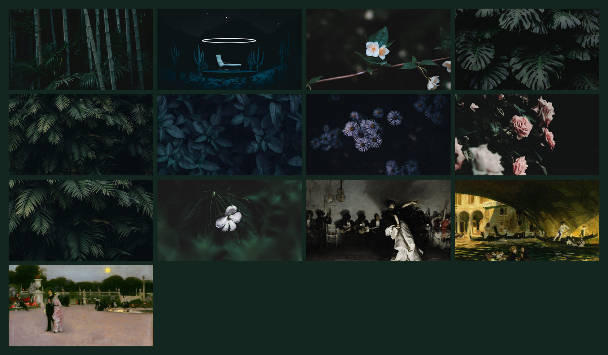

<!-- Generated by `gallery render` from wallpapers.tsv. Do not edit. -->

# Jade Horse

<a href="https://justcarlson.github.io/omarchy-wallpapers/#jade-horse"></a>

13 wallpapers picked for Jade Horse by how closely Aether's palette for each image matches the theme's colours.

Install just this set:

```sh
curl -fsSL https://raw.githubusercontent.com/justcarlson/omarchy-wallpapers/main/install.sh | bash -s -- jade-horse
```

Then press <kbd>Super</kbd> <kbd>Ctrl</kbd> <kbd>Space</kbd> to pick one. To build a whole new theme from a wallpaper instead, import its Aether blueprint:

```sh
aether --import-blueprint https://raw.githubusercontent.com/justcarlson/omarchy-wallpapers/main/blueprints/jade-horse/<name>.json --auto-apply
```

<table>
<tr>
<td width="50%" valign="top"><a href="https://raw.githubusercontent.com/dharmx/walls/6bf4d733ebf2b484a37c17d742eb47e5139e6a14/nature/a_group_of_bamboo_trees_01.jpg"></a><br><b>A Group of Bamboo Trees 01</b><br><sub><a href="https://github.com/dharmx/walls/blob/6bf4d733ebf2b484a37c17d742eb47e5139e6a14/nature/a_group_of_bamboo_trees_01.jpg">dharmx/walls</a> · <a href="../blueprints/jade-horse/dharmx-a-group-of-bamboo-trees-01.json">Aether blueprint</a></sub></td>
<td width="50%" valign="top"><a href="https://raw.githubusercontent.com/dharmx/walls/6bf4d733ebf2b484a37c17d742eb47e5139e6a14/abstract/a_chair_on_a_platform_with_a_halo_above_it.jpg"></a><br><b>A Chair on a Platform with a Halo Above It</b><br><sub><a href="https://github.com/dharmx/walls/blob/6bf4d733ebf2b484a37c17d742eb47e5139e6a14/abstract/a_chair_on_a_platform_with_a_halo_above_it.jpg">dharmx/walls</a> · <a href="../blueprints/jade-horse/dharmx-a-chair-on-a-platform-with-a-halo-above-it.json">Aether blueprint</a></sub></td>
</tr>
<tr>
<td width="50%" valign="top"><a href="https://raw.githubusercontent.com/dharmx/walls/6bf4d733ebf2b484a37c17d742eb47e5139e6a14/flowers/a_white_flowers_on_a_branch.jpg"></a><br><b>A White Flowers on a Branch</b><br><sub><a href="https://github.com/dharmx/walls/blob/6bf4d733ebf2b484a37c17d742eb47e5139e6a14/flowers/a_white_flowers_on_a_branch.jpg">dharmx/walls</a> · <a href="../blueprints/jade-horse/dharmx-a-white-flowers-on-a-branch.json">Aether blueprint</a></sub></td>
<td width="50%" valign="top"><a href="https://raw.githubusercontent.com/dharmx/walls/6bf4d733ebf2b484a37c17d742eb47e5139e6a14/nature/a_group_of_dark_leaves.jpg"></a><br><b>A Group of Dark Leaves</b><br><sub><a href="https://github.com/dharmx/walls/blob/6bf4d733ebf2b484a37c17d742eb47e5139e6a14/nature/a_group_of_dark_leaves.jpg">dharmx/walls</a> · <a href="../blueprints/jade-horse/dharmx-a-group-of-dark-leaves.json">Aether blueprint</a></sub></td>
</tr>
<tr>
<td width="50%" valign="top"><a href="https://raw.githubusercontent.com/AngelJumbo/gruvbox-wallpapers/6aa74cbd65973e1a2a8695e83a58ce3ea634dd5e/wallpapers/photography/cactus.png"></a><br><b>Cactus</b><br><sub><a href="https://github.com/AngelJumbo/gruvbox-wallpapers/blob/6aa74cbd65973e1a2a8695e83a58ce3ea634dd5e/wallpapers/photography/cactus.png">AngelJumbo/gruvbox-wallpapers</a> · <a href="../blueprints/jade-horse/angeljumbo-cactus.json">Aether blueprint</a></sub></td>
<td width="50%" valign="top"><a href="https://raw.githubusercontent.com/krishna4a6av/Wallpapers/aa01193c864a1c175d3c44d1c0f4c4f62f3c61de/Everforest/leaves.png"></a><br><b>Leaves</b><br><sub><a href="https://github.com/krishna4a6av/Wallpapers/blob/aa01193c864a1c175d3c44d1c0f4c4f62f3c61de/Everforest/leaves.png">krishna4a6av/Wallpapers</a> · <a href="../blueprints/jade-horse/krishna4a6av-leaves.json">Aether blueprint</a></sub></td>
</tr>
<tr>
<td width="50%" valign="top"><a href="https://raw.githubusercontent.com/dharmx/walls/6bf4d733ebf2b484a37c17d742eb47e5139e6a14/flowers/a_group_of_purple_flowers.jpg"></a><br><b>A Group of Purple Flowers</b><br><sub><a href="https://github.com/dharmx/walls/blob/6bf4d733ebf2b484a37c17d742eb47e5139e6a14/flowers/a_group_of_purple_flowers.jpg">dharmx/walls</a> · <a href="../blueprints/jade-horse/dharmx-a-group-of-purple-flowers.json">Aether blueprint</a></sub></td>
<td width="50%" valign="top"><a href="https://raw.githubusercontent.com/dharmx/walls/6bf4d733ebf2b484a37c17d742eb47e5139e6a14/flowers/a_close_up_of_pink_flowers.jpg"></a><br><b>A Close Up of Pink Flowers</b><br><sub><a href="https://github.com/dharmx/walls/blob/6bf4d733ebf2b484a37c17d742eb47e5139e6a14/flowers/a_close_up_of_pink_flowers.jpg">dharmx/walls</a> · <a href="../blueprints/jade-horse/dharmx-a-close-up-of-pink-flowers.json">Aether blueprint</a></sub></td>
</tr>
<tr>
<td width="50%" valign="top"><a href="https://raw.githubusercontent.com/dharmx/walls/6bf4d733ebf2b484a37c17d742eb47e5139e6a14/nature/a_group_of_green_leaves.jpg"></a><br><b>A Group of Green Leaves</b><br><sub><a href="https://github.com/dharmx/walls/blob/6bf4d733ebf2b484a37c17d742eb47e5139e6a14/nature/a_group_of_green_leaves.jpg">dharmx/walls</a> · <a href="../blueprints/jade-horse/dharmx-a-group-of-green-leaves.json">Aether blueprint</a></sub></td>
<td width="50%" valign="top"><a href="https://raw.githubusercontent.com/dharmx/walls/6bf4d733ebf2b484a37c17d742eb47e5139e6a14/flowers/a_white_flower_on_a_plant.jpg"></a><br><b>A White Flower on a Plant</b><br><sub><a href="https://github.com/dharmx/walls/blob/6bf4d733ebf2b484a37c17d742eb47e5139e6a14/flowers/a_white_flower_on_a_plant.jpg">dharmx/walls</a> · <a href="../blueprints/jade-horse/dharmx-a-white-flower-on-a-plant.json">Aether blueprint</a></sub></td>
</tr>
<tr>
<td width="50%" valign="top"><a href="https://raw.githubusercontent.com/justcarlson/omarchy-wallpapers/main/images/sargent-el-jaleo.jpg"></a><br><b>El Jaleo</b><br><sub><a href="https://commons.wikimedia.org/wiki/File:EL_JALEO-SINGER.jpg">John Singer Sargent, Wikimedia Commons</a> · <a href="../blueprints/jade-horse/sargent-el-jaleo.json">Aether blueprint</a></sub></td>
<td width="50%" valign="top"><a href="https://raw.githubusercontent.com/justcarlson/omarchy-wallpapers/main/images/sargent-the-rialto-venice.jpg"></a><br><b>The Rialto Venice</b><br><sub><a href="https://commons.wikimedia.org/wiki/File:John_Singer_Sargent_-_The_Rialto%2C_Venice_%281911%29.jpg">John Singer Sargent, Wikimedia Commons</a> · <a href="../blueprints/jade-horse/sargent-the-rialto-venice.json">Aether blueprint</a></sub></td>
</tr>
<tr>
<td width="50%" valign="top"><a href="https://upload.wikimedia.org/wikipedia/commons/thumb/8/85/John_Singer_Sargent%2C_American_%28active_London%2C_Florence%2C_and_Paris%29_-_In_the_Luxembourg_Gardens_-_Google_Art_Project.jpg/3840px-John_Singer_Sargent%2C_American_%28active_London%2C_Florence%2C_and_Paris%29_-_In_the_Luxembourg_Gardens_-_Google_Art_Project.jpg"></a><br><b>In the Luxembourg Gardens</b><br><sub><a href="https://commons.wikimedia.org/wiki/File:John_Singer_Sargent%2C_American_%28active_London%2C_Florence%2C_and_Paris%29_-_In_the_Luxembourg_Gardens_-_Google_Art_Project.jpg">John Singer Sargent, Wikimedia Commons</a> · <a href="../blueprints/jade-horse/sargent-in-the-luxembourg-gardens.json">Aether blueprint</a></sub></td>
</tr>
</table>

[All themes](../README.md#the-collection)
