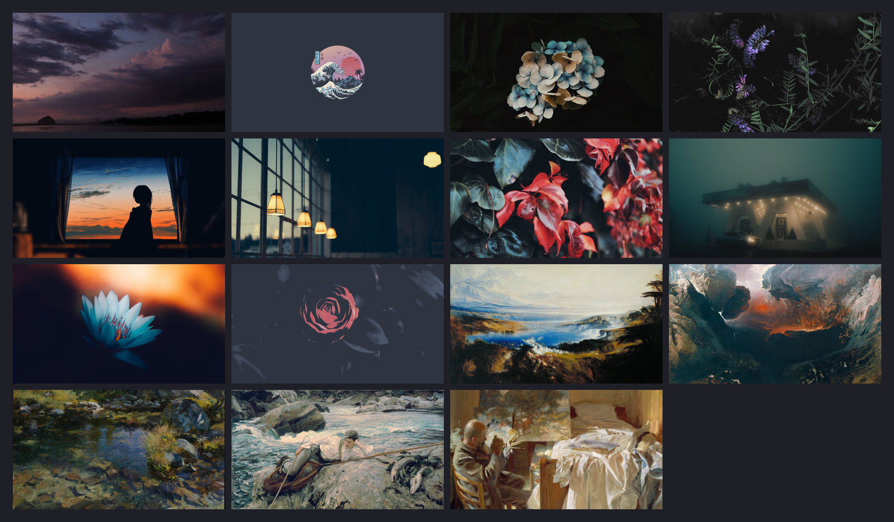
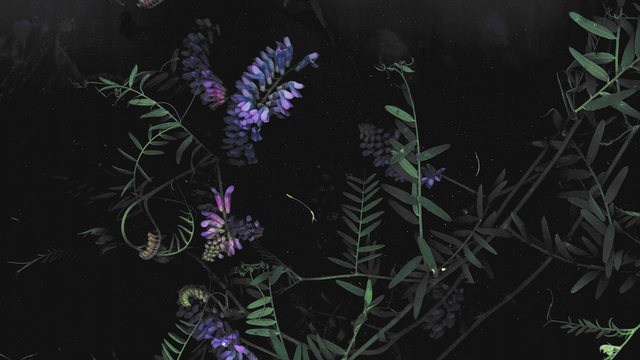
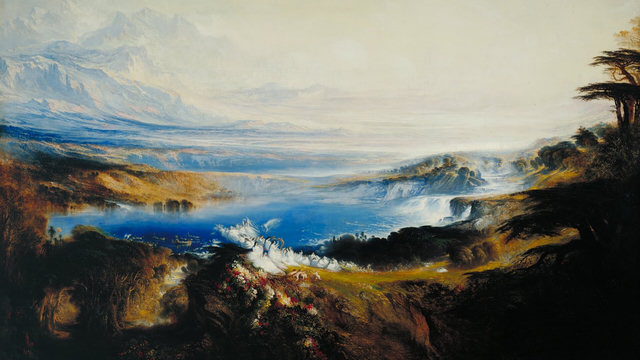
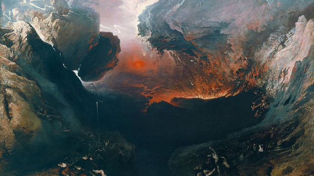
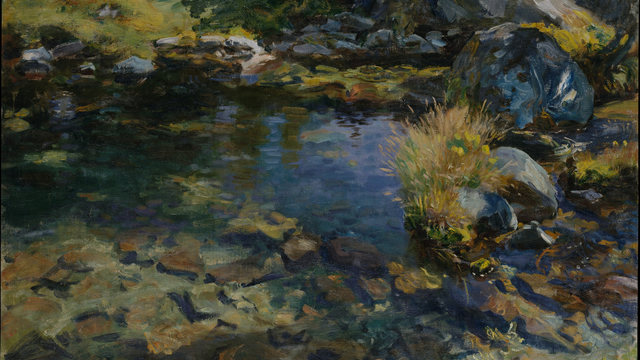

<!-- Generated by `gallery render` from wallpapers.tsv. Do not edit. -->

# Kanagawa

<a href="https://justcarlson.github.io/omarchy-wallpapers/#kanagawa"></a>

15 wallpapers picked for Kanagawa by how closely Aether's palette for each image matches the theme's colours.

Install just this set:

```sh
curl -fsSL https://raw.githubusercontent.com/justcarlson/omarchy-wallpapers/main/install.sh | bash -s -- kanagawa
```

Then press <kbd>Super</kbd> <kbd>Ctrl</kbd> <kbd>Space</kbd> to pick one. To build a whole new theme from a wallpaper instead, import its Aether blueprint:

```sh
aether --import-blueprint https://raw.githubusercontent.com/justcarlson/omarchy-wallpapers/main/blueprints/kanagawa/<name>.json --auto-apply
```

<table>
<tr>
<td width="50%" valign="top"><a href="https://raw.githubusercontent.com/rose-pine/wallpapers/ee39a37b24ab7700cc4d52f50b01a5d13df6a865/photography/kainoa-kanter/bay.jpg"></a><br><b>Bay</b><br><sub><a href="https://github.com/rose-pine/wallpapers/blob/ee39a37b24ab7700cc4d52f50b01a5d13df6a865/photography/kainoa-kanter/bay.jpg">rose-pine/wallpapers</a> · <a href="../blueprints/kanagawa/rose-pine-bay.json">Aether blueprint</a></sub></td>
<td width="50%" valign="top"><a href="https://raw.githubusercontent.com/krishna4a6av/Wallpapers/aa01193c864a1c175d3c44d1c0f4c4f62f3c61de/Kanagawa/vapor-wave.png"></a><br><b>Vapor Wave</b><br><sub><a href="https://github.com/krishna4a6av/Wallpapers/blob/aa01193c864a1c175d3c44d1c0f4c4f62f3c61de/Kanagawa/vapor-wave.png">krishna4a6av/Wallpapers</a> · <a href="../blueprints/kanagawa/krishna4a6av-vapor-wave.json">Aether blueprint</a></sub></td>
</tr>
<tr>
<td width="50%" valign="top"><a href="https://raw.githubusercontent.com/krishna4a6av/Wallpapers/aa01193c864a1c175d3c44d1c0f4c4f62f3c61de/.homeless/closeflower.jpg"></a><br><b>Closeflower</b><br><sub><a href="https://github.com/krishna4a6av/Wallpapers/blob/aa01193c864a1c175d3c44d1c0f4c4f62f3c61de/.homeless/closeflower.jpg">krishna4a6av/Wallpapers</a> · <a href="../blueprints/kanagawa/krishna4a6av-closeflower.json">Aether blueprint</a></sub></td>
<td width="50%" valign="top"><a href="https://raw.githubusercontent.com/dharmx/walls/6bf4d733ebf2b484a37c17d742eb47e5139e6a14/flowers/purple_flowers_on_a_black_background.png"></a><br><b>Purple Flowers on a Black Background</b><br><sub><a href="https://github.com/dharmx/walls/blob/6bf4d733ebf2b484a37c17d742eb47e5139e6a14/flowers/purple_flowers_on_a_black_background.png">dharmx/walls</a> · <a href="../blueprints/kanagawa/dharmx-purple-flowers-on-a-black-background.json">Aether blueprint</a></sub></td>
</tr>
<tr>
<td width="50%" valign="top"><a href="https://raw.githubusercontent.com/krishna4a6av/Wallpapers/aa01193c864a1c175d3c44d1c0f4c4f62f3c61de/.homeless/cls-window.jpg"></a><br><b>Cls Window</b><br><sub><a href="https://github.com/krishna4a6av/Wallpapers/blob/aa01193c864a1c175d3c44d1c0f4c4f62f3c61de/.homeless/cls-window.jpg">krishna4a6av/Wallpapers</a> · <a href="../blueprints/kanagawa/krishna4a6av-cls-window.json">Aether blueprint</a></sub></td>
<td width="50%" valign="top"><a href="https://raw.githubusercontent.com/dharmx/walls/6bf4d733ebf2b484a37c17d742eb47e5139e6a14/lightbulb/a_row_of_lights.jpg"></a><br><b>A Row of Lights</b><br><sub><a href="https://github.com/dharmx/walls/blob/6bf4d733ebf2b484a37c17d742eb47e5139e6a14/lightbulb/a_row_of_lights.jpg">dharmx/walls</a> · <a href="../blueprints/kanagawa/dharmx-a-row-of-lights.json">Aether blueprint</a></sub></td>
</tr>
<tr>
<td width="50%" valign="top"><a href="https://raw.githubusercontent.com/dharmx/walls/6bf4d733ebf2b484a37c17d742eb47e5139e6a14/nature/a_close_up_of_red_leaves.jpg"></a><br><b>A Close Up of Red Leaves</b><br><sub><a href="https://github.com/dharmx/walls/blob/6bf4d733ebf2b484a37c17d742eb47e5139e6a14/nature/a_close_up_of_red_leaves.jpg">dharmx/walls</a> · <a href="../blueprints/kanagawa/dharmx-a-close-up-of-red-leaves.json">Aether blueprint</a></sub></td>
<td width="50%" valign="top"><a href="https://raw.githubusercontent.com/dharmx/walls/6bf4d733ebf2b484a37c17d742eb47e5139e6a14/dreamcore/a_gas_station_with_lights_on_the_front_and_a_car_parked_in_the_front.jpg"></a><br><b>A Gas Station with Lights on the Front and a Car Parked in the Front</b><br><sub><a href="https://github.com/dharmx/walls/blob/6bf4d733ebf2b484a37c17d742eb47e5139e6a14/dreamcore/a_gas_station_with_lights_on_the_front_and_a_car_parked_in_the_front.jpg">dharmx/walls</a> · <a href="../blueprints/kanagawa/dharmx-a-gas-station-with-lights-on-the-front-and-a-car-parked-in-the-front.json">Aether blueprint</a></sub></td>
</tr>
<tr>
<td width="50%" valign="top"><a href="https://raw.githubusercontent.com/AngelJumbo/gruvbox-wallpapers/6aa74cbd65973e1a2a8695e83a58ce3ea634dd5e/wallpapers/photography/ameenfahmy-mXpTl4jNKiA.jpg"></a><br><b>Ameenfahmy Mxptl4jnkia</b><br><sub><a href="https://github.com/AngelJumbo/gruvbox-wallpapers/blob/6aa74cbd65973e1a2a8695e83a58ce3ea634dd5e/wallpapers/photography/ameenfahmy-mXpTl4jNKiA.jpg">AngelJumbo/gruvbox-wallpapers</a> · <a href="../blueprints/kanagawa/angeljumbo-ameenfahmy-mxptl4jnkia.json">Aether blueprint</a></sub></td>
<td width="50%" valign="top"><a href="https://raw.githubusercontent.com/dharmx/walls/6bf4d733ebf2b484a37c17d742eb47e5139e6a14/nord/a_close_up_of_a_rose.png"></a><br><b>A Close Up of a Rose</b><br><sub><a href="https://github.com/dharmx/walls/blob/6bf4d733ebf2b484a37c17d742eb47e5139e6a14/nord/a_close_up_of_a_rose.png">dharmx/walls</a> · <a href="../blueprints/kanagawa/dharmx-a-close-up-of-a-rose.json">Aether blueprint</a></sub></td>
</tr>
<tr>
<td width="50%" valign="top"><a href="https://upload.wikimedia.org/wikipedia/commons/thumb/7/79/John_Martin_-_The_Plains_of_Heaven_-_Google_Art_Project.jpg/1920px-John_Martin_-_The_Plains_of_Heaven_-_Google_Art_Project.jpg"></a><br><b>Plains of Heaven</b><br><sub><a href="https://commons.wikimedia.org/wiki/File:John_Martin_-_The_Plains_of_Heaven_-_Google_Art_Project.jpg">John Martin, Wikimedia Commons</a> · <a href="../blueprints/kanagawa/john-martin-plains-of-heaven.json">Aether blueprint</a></sub></td>
<td width="50%" valign="top"><a href="https://upload.wikimedia.org/wikipedia/commons/thumb/5/50/John_Martin_-_The_Great_Day_of_His_Wrath_-_Google_Art_Project.jpg/1920px-John_Martin_-_The_Great_Day_of_His_Wrath_-_Google_Art_Project.jpg"></a><br><b>Great Day of His Wrath</b><br><sub><a href="https://commons.wikimedia.org/wiki/File:John_Martin_-_The_Great_Day_of_His_Wrath_-_Google_Art_Project.jpg">John Martin, Wikimedia Commons</a> · <a href="../blueprints/kanagawa/john-martin-great-day-of-his-wrath.json">Aether blueprint</a></sub></td>
</tr>
<tr>
<td width="50%" valign="top"><a href="https://raw.githubusercontent.com/justcarlson/omarchy-wallpapers/main/images/sargent-alpine-pool.jpg"></a><br><b>Alpine Pool</b><br><sub><a href="https://commons.wikimedia.org/wiki/File:Alpine_Pool_MET_DT5585.jpg">John Singer Sargent, Wikimedia Commons</a> · <a href="../blueprints/kanagawa/sargent-alpine-pool.json">Aether blueprint</a></sub></td>
<td width="50%" valign="top"><a href="https://upload.wikimedia.org/wikipedia/commons/thumb/1/19/John_Singer_Sargent_-_On_his_Holidays%2C_Norway_%281901%29.jpg/3840px-John_Singer_Sargent_-_On_his_Holidays%2C_Norway_%281901%29.jpg"></a><br><b>On His Holidays Norway</b><br><sub><a href="https://commons.wikimedia.org/wiki/File:John_Singer_Sargent_-_On_his_Holidays%2C_Norway_%281901%29.jpg">John Singer Sargent, Wikimedia Commons</a> · <a href="../blueprints/kanagawa/sargent-on-his-holidays-norway.json">Aether blueprint</a></sub></td>
</tr>
<tr>
<td width="50%" valign="top"><a href="https://upload.wikimedia.org/wikipedia/commons/thumb/3/35/John_Singer_Sargent_-_An_Artist_in_His_Studio_-_Google_Art_Project.jpg/3840px-John_Singer_Sargent_-_An_Artist_in_His_Studio_-_Google_Art_Project.jpg"></a><br><b>An Artist in His Studio</b><br><sub><a href="https://commons.wikimedia.org/wiki/File:John_Singer_Sargent_-_An_Artist_in_His_Studio_-_Google_Art_Project.jpg">John Singer Sargent, Wikimedia Commons</a> · <a href="../blueprints/kanagawa/sargent-an-artist-in-his-studio.json">Aether blueprint</a></sub></td>
</tr>
</table>

[All themes](../README.md#the-collection)
