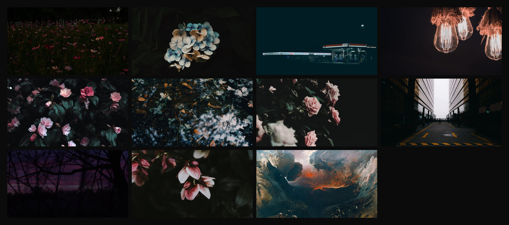
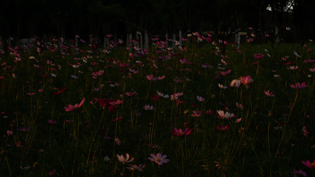
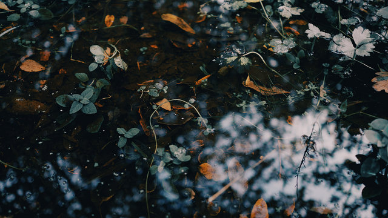

<!-- Generated by `gallery render` from wallpapers.tsv. Do not edit. -->

# Last Horizon

<a href="https://justcarlson.github.io/omarchy-wallpapers/#last-horizon"></a>

11 wallpapers picked for Last Horizon by how closely Aether's palette for each image matches the theme's colours.

Install just this set:

```sh
curl -fsSL https://raw.githubusercontent.com/justcarlson/omarchy-wallpapers/main/install.sh | bash -s -- last-horizon
```

Then press <kbd>Super</kbd> <kbd>Ctrl</kbd> <kbd>Space</kbd> to pick one. To build a whole new theme from a wallpaper instead, import its Aether blueprint:

```sh
aether --import-blueprint https://raw.githubusercontent.com/justcarlson/omarchy-wallpapers/main/blueprints/last-horizon/<name>.json --auto-apply
```

<table>
<tr>
<td width="50%" valign="top"><a href="https://raw.githubusercontent.com/krishna4a6av/Wallpapers/aa01193c864a1c175d3c44d1c0f4c4f62f3c61de/Oxocarbon/sml-flowers.jpg"></a><br><b>Sml Flowers</b><br><sub><a href="https://github.com/krishna4a6av/Wallpapers/blob/aa01193c864a1c175d3c44d1c0f4c4f62f3c61de/Oxocarbon/sml-flowers.jpg">krishna4a6av/Wallpapers</a> · <a href="../blueprints/last-horizon/krishna4a6av-sml-flowers.json">Aether blueprint</a></sub></td>
<td width="50%" valign="top"><a href="https://raw.githubusercontent.com/dharmx/walls/6bf4d733ebf2b484a37c17d742eb47e5139e6a14/flowers/a_close_up_of_a_flower_12.jpg"></a><br><b>A Close Up of a Flower 12</b><br><sub><a href="https://github.com/dharmx/walls/blob/6bf4d733ebf2b484a37c17d742eb47e5139e6a14/flowers/a_close_up_of_a_flower_12.jpg">dharmx/walls</a> · <a href="../blueprints/last-horizon/dharmx-a-close-up-of-a-flower-12.json">Aether blueprint</a></sub></td>
</tr>
<tr>
<td width="50%" valign="top"><a href="https://raw.githubusercontent.com/D3Ext/aesthetic-wallpapers/e34f05935c5b768f4c016b0893924d18ec1dba61/images/gas-station.jpg"></a><br><b>Gas Station</b><br><sub><a href="https://github.com/D3Ext/aesthetic-wallpapers/blob/e34f05935c5b768f4c016b0893924d18ec1dba61/images/gas-station.jpg">D3Ext/aesthetic-wallpapers</a> · <a href="../blueprints/last-horizon/d3ext-gas-station.json">Aether blueprint</a></sub></td>
<td width="50%" valign="top"><a href="https://raw.githubusercontent.com/dharmx/walls/6bf4d733ebf2b484a37c17d742eb47e5139e6a14/lightbulb/a_group_of_light_bulbs.jpg"></a><br><b>A Group of Light Bulbs</b><br><sub><a href="https://github.com/dharmx/walls/blob/6bf4d733ebf2b484a37c17d742eb47e5139e6a14/lightbulb/a_group_of_light_bulbs.jpg">dharmx/walls</a> · <a href="../blueprints/last-horizon/dharmx-a-group-of-light-bulbs.json">Aether blueprint</a></sub></td>
</tr>
<tr>
<td width="50%" valign="top"><a href="https://raw.githubusercontent.com/dharmx/walls/6bf4d733ebf2b484a37c17d742eb47e5139e6a14/flowers/a_group_of_pink_flowers_on_a_bush.jpg"></a><br><b>A Group of Pink Flowers on a Bush</b><br><sub><a href="https://github.com/dharmx/walls/blob/6bf4d733ebf2b484a37c17d742eb47e5139e6a14/flowers/a_group_of_pink_flowers_on_a_bush.jpg">dharmx/walls</a> · <a href="../blueprints/last-horizon/dharmx-a-group-of-pink-flowers-on-a-bush.json">Aether blueprint</a></sub></td>
<td width="50%" valign="top"><a href="https://raw.githubusercontent.com/dharmx/walls/6bf4d733ebf2b484a37c17d742eb47e5139e6a14/nature/plants_leaves_in_the_water.jpg"></a><br><b>Plants Leaves in the Water</b><br><sub><a href="https://github.com/dharmx/walls/blob/6bf4d733ebf2b484a37c17d742eb47e5139e6a14/nature/plants_leaves_in_the_water.jpg">dharmx/walls</a> · <a href="../blueprints/last-horizon/dharmx-plants-leaves-in-the-water.json">Aether blueprint</a></sub></td>
</tr>
<tr>
<td width="50%" valign="top"><a href="https://raw.githubusercontent.com/dharmx/walls/6bf4d733ebf2b484a37c17d742eb47e5139e6a14/flowers/a_close_up_of_pink_flowers.jpg"></a><br><b>A Close Up of Pink Flowers</b><br><sub><a href="https://github.com/dharmx/walls/blob/6bf4d733ebf2b484a37c17d742eb47e5139e6a14/flowers/a_close_up_of_pink_flowers.jpg">dharmx/walls</a> · <a href="../blueprints/last-horizon/dharmx-a-close-up-of-pink-flowers.json">Aether blueprint</a></sub></td>
<td width="50%" valign="top"><a href="https://raw.githubusercontent.com/dharmx/walls/6bf4d733ebf2b484a37c17d742eb47e5139e6a14/architecture/a_person_walking_on_a_street_between_two_tall_buildings.jpg"></a><br><b>A Person Walking on a Street Between Two Tall Buildings</b><br><sub><a href="https://github.com/dharmx/walls/blob/6bf4d733ebf2b484a37c17d742eb47e5139e6a14/architecture/a_person_walking_on_a_street_between_two_tall_buildings.jpg">dharmx/walls</a> · <a href="../blueprints/last-horizon/dharmx-a-person-walking-on-a-street-between-two-tall-buildings.json">Aether blueprint</a></sub></td>
</tr>
<tr>
<td width="50%" valign="top"><a href="https://raw.githubusercontent.com/rose-pine/wallpapers/ee39a37b24ab7700cc4d52f50b01a5d13df6a865/photography/single-celled/through-the-branches.jpg"></a><br><b>Through the Branches</b><br><sub><a href="https://github.com/rose-pine/wallpapers/blob/ee39a37b24ab7700cc4d52f50b01a5d13df6a865/photography/single-celled/through-the-branches.jpg">rose-pine/wallpapers</a> · <a href="../blueprints/last-horizon/rose-pine-through-the-branches.json">Aether blueprint</a></sub></td>
<td width="50%" valign="top"><a href="https://raw.githubusercontent.com/dharmx/walls/6bf4d733ebf2b484a37c17d742eb47e5139e6a14/flowers/a_close_up_of_flowers_02.jpg"></a><br><b>A Close Up of Flowers 02</b><br><sub><a href="https://github.com/dharmx/walls/blob/6bf4d733ebf2b484a37c17d742eb47e5139e6a14/flowers/a_close_up_of_flowers_02.jpg">dharmx/walls</a> · <a href="../blueprints/last-horizon/dharmx-a-close-up-of-flowers-02.json">Aether blueprint</a></sub></td>
</tr>
<tr>
<td width="50%" valign="top"><a href="https://upload.wikimedia.org/wikipedia/commons/thumb/5/50/John_Martin_-_The_Great_Day_of_His_Wrath_-_Google_Art_Project.jpg/1920px-John_Martin_-_The_Great_Day_of_His_Wrath_-_Google_Art_Project.jpg"></a><br><b>Great Day of His Wrath</b><br><sub><a href="https://commons.wikimedia.org/wiki/File:John_Martin_-_The_Great_Day_of_His_Wrath_-_Google_Art_Project.jpg">John Martin, Wikimedia Commons</a> · <a href="../blueprints/last-horizon/john-martin-great-day-of-his-wrath.json">Aether blueprint</a></sub></td>
</tr>
</table>

[All themes](../README.md#the-collection)
