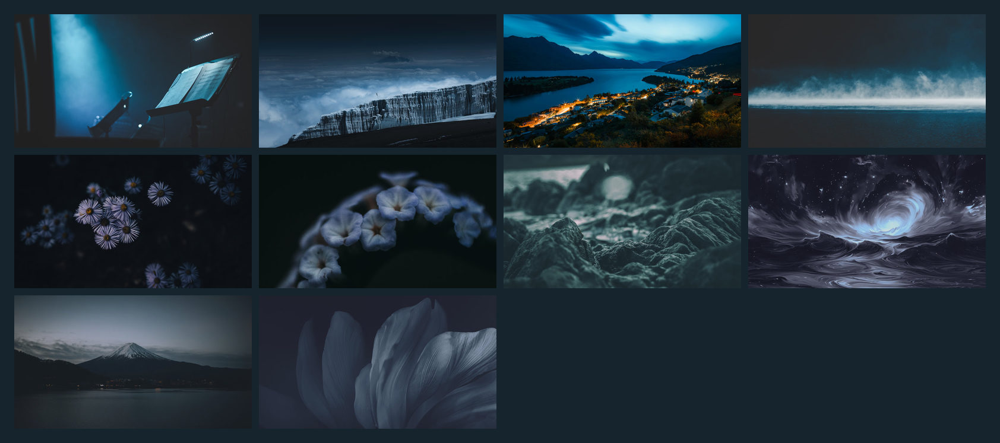

<!-- Generated by `gallery render` from wallpapers.tsv. Do not edit. -->

# Lumon

<a href="https://justcarlson.github.io/omarchy-wallpapers/#lumon"></a>

10 wallpapers picked for Lumon by how closely Aether's palette for each image matches the theme's colours.

Install just this set:

```sh
curl -fsSL https://raw.githubusercontent.com/justcarlson/omarchy-wallpapers/main/install.sh | bash -s -- lumon
```

Then press <kbd>Super</kbd> <kbd>Ctrl</kbd> <kbd>Space</kbd> to pick one. To build a whole new theme from a wallpaper instead, import its Aether blueprint:

```sh
aether --import-blueprint https://raw.githubusercontent.com/justcarlson/omarchy-wallpapers/main/blueprints/lumon/<name>.json --auto-apply
```

<table>
<tr>
<td width="50%" valign="top"><a href="https://raw.githubusercontent.com/dharmx/walls/6bf4d733ebf2b484a37c17d742eb47e5139e6a14/cold/a_music_stand_with_a_book_on_it.jpg"></a><br><b>A Music Stand with a Book on It</b><br><sub><a href="https://github.com/dharmx/walls/blob/6bf4d733ebf2b484a37c17d742eb47e5139e6a14/cold/a_music_stand_with_a_book_on_it.jpg">dharmx/walls</a> · <a href="../blueprints/lumon/dharmx-a-music-stand-with-a-book-on-it.json">Aether blueprint</a></sub></td>
<td width="50%" valign="top"><a href="https://raw.githubusercontent.com/dharmx/walls/6bf4d733ebf2b484a37c17d742eb47e5139e6a14/mountain/a_person_on_a_cliff.jpg"></a><br><b>A Person on a Cliff</b><br><sub><a href="https://github.com/dharmx/walls/blob/6bf4d733ebf2b484a37c17d742eb47e5139e6a14/mountain/a_person_on_a_cliff.jpg">dharmx/walls</a> · <a href="../blueprints/lumon/dharmx-a-person-on-a-cliff.json">Aether blueprint</a></sub></td>
</tr>
<tr>
<td width="50%" valign="top"><a href="https://raw.githubusercontent.com/krishna4a6av/Wallpapers/aa01193c864a1c175d3c44d1c0f4c4f62f3c61de/Autmn/wide-city-shot.jpg"></a><br><b>Wide City Shot</b><br><sub><a href="https://github.com/krishna4a6av/Wallpapers/blob/aa01193c864a1c175d3c44d1c0f4c4f62f3c61de/Autmn/wide-city-shot.jpg">krishna4a6av/Wallpapers</a> · <a href="../blueprints/lumon/krishna4a6av-wide-city-shot.json">Aether blueprint</a></sub></td>
<td width="50%" valign="top"><a href="https://raw.githubusercontent.com/dharmx/walls/6bf4d733ebf2b484a37c17d742eb47e5139e6a14/nature/a_fog_over_water_with_a_black_background.jpg"></a><br><b>A Fog Over Water with a Black Background</b><br><sub><a href="https://github.com/dharmx/walls/blob/6bf4d733ebf2b484a37c17d742eb47e5139e6a14/nature/a_fog_over_water_with_a_black_background.jpg">dharmx/walls</a> · <a href="../blueprints/lumon/dharmx-a-fog-over-water-with-a-black-background.json">Aether blueprint</a></sub></td>
</tr>
<tr>
<td width="50%" valign="top"><a href="https://raw.githubusercontent.com/dharmx/walls/6bf4d733ebf2b484a37c17d742eb47e5139e6a14/flowers/a_group_of_purple_flowers.jpg"></a><br><b>A Group of Purple Flowers</b><br><sub><a href="https://github.com/dharmx/walls/blob/6bf4d733ebf2b484a37c17d742eb47e5139e6a14/flowers/a_group_of_purple_flowers.jpg">dharmx/walls</a> · <a href="../blueprints/lumon/dharmx-a-group-of-purple-flowers.json">Aether blueprint</a></sub></td>
<td width="50%" valign="top"><a href="https://raw.githubusercontent.com/dharmx/walls/6bf4d733ebf2b484a37c17d742eb47e5139e6a14/flowers/a_group_of_flowers_on_a_black_background.jpg"></a><br><b>A Group of Flowers on a Black Background</b><br><sub><a href="https://github.com/dharmx/walls/blob/6bf4d733ebf2b484a37c17d742eb47e5139e6a14/flowers/a_group_of_flowers_on_a_black_background.jpg">dharmx/walls</a> · <a href="../blueprints/lumon/dharmx-a-group-of-flowers-on-a-black-background.json">Aether blueprint</a></sub></td>
</tr>
<tr>
<td width="50%" valign="top"><a href="https://raw.githubusercontent.com/dharmx/walls/6bf4d733ebf2b484a37c17d742eb47e5139e6a14/mountain/a_close_up_of_rocks.jpg"></a><br><b>A Close Up of Rocks</b><br><sub><a href="https://github.com/dharmx/walls/blob/6bf4d733ebf2b484a37c17d742eb47e5139e6a14/mountain/a_close_up_of_rocks.jpg">dharmx/walls</a> · <a href="../blueprints/lumon/dharmx-a-close-up-of-rocks.json">Aether blueprint</a></sub></td>
<td width="50%" valign="top"><a href="https://raw.githubusercontent.com/orangci/walls-catppuccin-mocha/7bfdf10d16ad3a689f9f0cf3a0930da3d1a245a8/galaxy-waves.jpg"></a><br><b>Galaxy Waves</b><br><sub><a href="https://github.com/orangci/walls-catppuccin-mocha/blob/7bfdf10d16ad3a689f9f0cf3a0930da3d1a245a8/galaxy-waves.jpg">orangci/walls-catppuccin-mocha</a> · <a href="../blueprints/lumon/orangci-galaxy-waves.json">Aether blueprint</a></sub></td>
</tr>
<tr>
<td width="50%" valign="top"><a href="https://raw.githubusercontent.com/dharmx/walls/6bf4d733ebf2b484a37c17d742eb47e5139e6a14/mountain/a_mountain_with_snow_on_top_and_a_body_of_water_01.jpg"></a><br><b>A Mountain with Snow on Top and a Body of Water</b><br><sub><a href="https://github.com/dharmx/walls/blob/6bf4d733ebf2b484a37c17d742eb47e5139e6a14/mountain/a_mountain_with_snow_on_top_and_a_body_of_water_01.jpg">dharmx/walls</a> · <a href="../blueprints/lumon/dharmx-a-mountain-with-snow-on-top-and-a-body-of-water-.json">Aether blueprint</a></sub></td>
<td width="50%" valign="top"><a href="https://raw.githubusercontent.com/krishna4a6av/Wallpapers/aa01193c864a1c175d3c44d1c0f4c4f62f3c61de/Kanagawa/petals.jpg"></a><br><b>Petals</b><br><sub><a href="https://github.com/krishna4a6av/Wallpapers/blob/aa01193c864a1c175d3c44d1c0f4c4f62f3c61de/Kanagawa/petals.jpg">krishna4a6av/Wallpapers</a> · <a href="../blueprints/lumon/krishna4a6av-petals.json">Aether blueprint</a></sub></td>
</tr>
</table>

[All themes](../README.md#the-collection)
