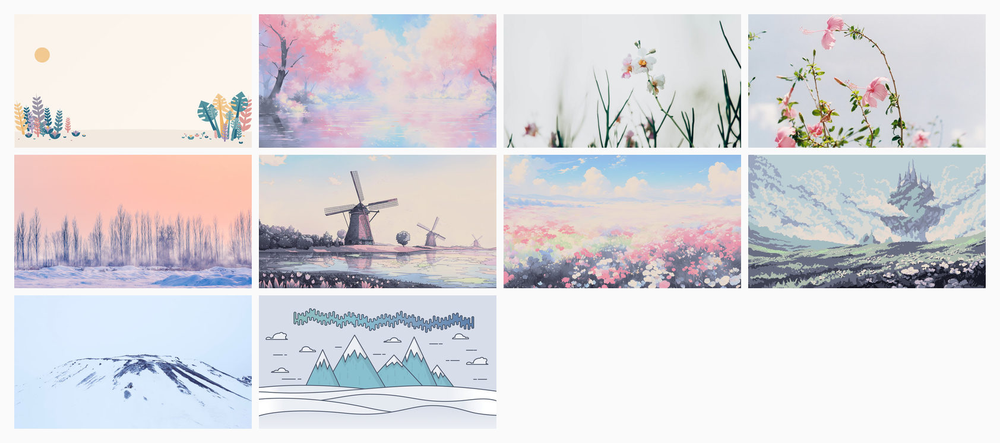
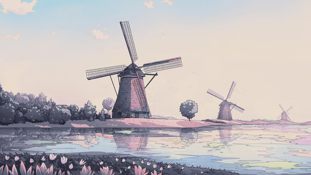
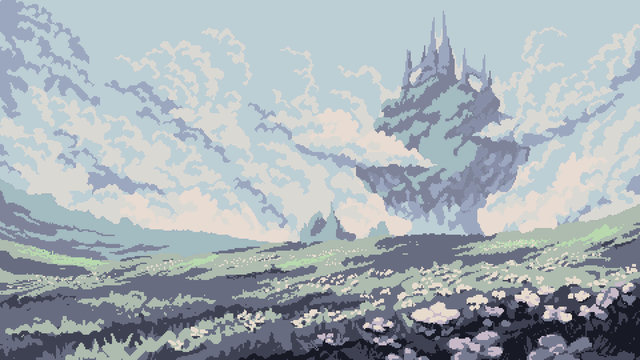
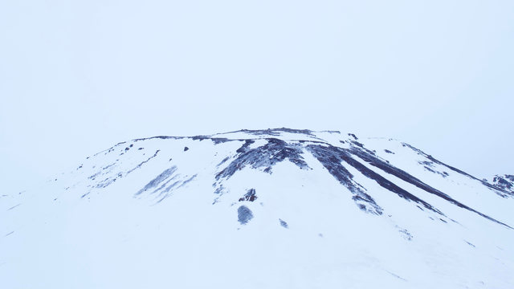

<!-- Generated by `gallery render` from wallpapers.tsv. Do not edit. -->

# Lupine

<a href="https://justcarlson.github.io/omarchy-wallpapers/#lupine"></a>

10 wallpapers picked for Lupine by how closely Aether's palette for each image matches the theme's colours.

Install just this set:

```sh
curl -fsSL https://raw.githubusercontent.com/justcarlson/omarchy-wallpapers/main/install.sh | bash -s -- lupine
```

Then press <kbd>Super</kbd> <kbd>Ctrl</kbd> <kbd>Space</kbd> to pick one. To build a whole new theme from a wallpaper instead, import its Aether blueprint:

```sh
aether --import-blueprint https://raw.githubusercontent.com/justcarlson/omarchy-wallpapers/main/blueprints/lupine/<name>.json --auto-apply
```

<table>
<tr>
<td width="50%" valign="top"><a href="https://raw.githubusercontent.com/rose-pine/wallpapers/ee39a37b24ab7700cc4d52f50b01a5d13df6a865/illustration/leafy-dawn.png"></a><br><b>Leafy Dawn</b><br><sub><a href="https://github.com/rose-pine/wallpapers/blob/ee39a37b24ab7700cc4d52f50b01a5d13df6a865/illustration/leafy-dawn.png">rose-pine/wallpapers</a> · <a href="../blueprints/lupine/rose-pine-leafy-dawn.json">Aether blueprint</a></sub></td>
<td width="50%" valign="top"><a href="https://raw.githubusercontent.com/orangci/walls-catppuccin-mocha/7bfdf10d16ad3a689f9f0cf3a0930da3d1a245a8/sakura-trees-over-river.jpg"></a><br><b>Sakura Trees Over River</b><br><sub><a href="https://github.com/orangci/walls-catppuccin-mocha/blob/7bfdf10d16ad3a689f9f0cf3a0930da3d1a245a8/sakura-trees-over-river.jpg">orangci/walls-catppuccin-mocha</a> · <a href="../blueprints/lupine/orangci-sakura-trees-over-river.json">Aether blueprint</a></sub></td>
</tr>
<tr>
<td width="50%" valign="top"><a href="https://raw.githubusercontent.com/dharmx/walls/6bf4d733ebf2b484a37c17d742eb47e5139e6a14/flowers/a_close_up_of_a_flower_09.jpg"></a><br><b>A Close Up of a Flower 09</b><br><sub><a href="https://github.com/dharmx/walls/blob/6bf4d733ebf2b484a37c17d742eb47e5139e6a14/flowers/a_close_up_of_a_flower_09.jpg">dharmx/walls</a> · <a href="../blueprints/lupine/dharmx-a-close-up-of-a-flower-09.json">Aether blueprint</a></sub></td>
<td width="50%" valign="top"><a href="https://raw.githubusercontent.com/dharmx/walls/6bf4d733ebf2b484a37c17d742eb47e5139e6a14/nature/a_close_up_of_pink_flowers.jpg"></a><br><b>A Close Up of Pink Flowers</b><br><sub><a href="https://github.com/dharmx/walls/blob/6bf4d733ebf2b484a37c17d742eb47e5139e6a14/nature/a_close_up_of_pink_flowers.jpg">dharmx/walls</a> · <a href="../blueprints/lupine/dharmx-a-close-up-of-pink-flowers.json">Aether blueprint</a></sub></td>
</tr>
<tr>
<td width="50%" valign="top"><a href="https://raw.githubusercontent.com/dharmx/walls/6bf4d733ebf2b484a37c17d742eb47e5139e6a14/digital/a_group_of_trees_in_a_snowy_field.jpg"></a><br><b>A Group of Trees in a Snowy Field</b><br><sub><a href="https://github.com/dharmx/walls/blob/6bf4d733ebf2b484a37c17d742eb47e5139e6a14/digital/a_group_of_trees_in_a_snowy_field.jpg">dharmx/walls</a> · <a href="../blueprints/lupine/dharmx-a-group-of-trees-in-a-snowy-field.json">Aether blueprint</a></sub></td>
<td width="50%" valign="top"><a href="https://raw.githubusercontent.com/orangci/walls-catppuccin-mocha/7bfdf10d16ad3a689f9f0cf3a0930da3d1a245a8/voyager-12.jpg"></a><br><b>Voyager 12</b><br><sub><a href="https://github.com/orangci/walls-catppuccin-mocha/blob/7bfdf10d16ad3a689f9f0cf3a0930da3d1a245a8/voyager-12.jpg">orangci/walls-catppuccin-mocha</a> · <a href="../blueprints/lupine/orangci-voyager-12.json">Aether blueprint</a></sub></td>
</tr>
<tr>
<td width="50%" valign="top"><a href="https://raw.githubusercontent.com/orangci/walls-catppuccin-mocha/7bfdf10d16ad3a689f9f0cf3a0930da3d1a245a8/flower-field.jpg"></a><br><b>Flower Field</b><br><sub><a href="https://github.com/orangci/walls-catppuccin-mocha/blob/7bfdf10d16ad3a689f9f0cf3a0930da3d1a245a8/flower-field.jpg">orangci/walls-catppuccin-mocha</a> · <a href="../blueprints/lupine/orangci-flower-field.json">Aether blueprint</a></sub></td>
<td width="50%" valign="top"><a href="https://raw.githubusercontent.com/orangci/walls-catppuccin-mocha/7bfdf10d16ad3a689f9f0cf3a0930da3d1a245a8/pixel-prairie.jpg"></a><br><b>Pixel Prairie</b><br><sub><a href="https://github.com/orangci/walls-catppuccin-mocha/blob/7bfdf10d16ad3a689f9f0cf3a0930da3d1a245a8/pixel-prairie.jpg">orangci/walls-catppuccin-mocha</a> · <a href="../blueprints/lupine/orangci-pixel-prairie.json">Aether blueprint</a></sub></td>
</tr>
<tr>
<td width="50%" valign="top"><a href="https://raw.githubusercontent.com/dharmx/walls/6bf4d733ebf2b484a37c17d742eb47e5139e6a14/cold/a_snow_covered_mountain_top.jpg"></a><br><b>A Snow Covered Mountain Top</b><br><sub><a href="https://github.com/dharmx/walls/blob/6bf4d733ebf2b484a37c17d742eb47e5139e6a14/cold/a_snow_covered_mountain_top.jpg">dharmx/walls</a> · <a href="../blueprints/lupine/dharmx-a-snow-covered-mountain-top.json">Aether blueprint</a></sub></td>
<td width="50%" valign="top"><a href="https://raw.githubusercontent.com/dharmx/walls/6bf4d733ebf2b484a37c17d742eb47e5139e6a14/nord/a_landscape_of_mountains_and_snow.png"></a><br><b>A Landscape of Mountains and Snow</b><br><sub><a href="https://github.com/dharmx/walls/blob/6bf4d733ebf2b484a37c17d742eb47e5139e6a14/nord/a_landscape_of_mountains_and_snow.png">dharmx/walls</a> · <a href="../blueprints/lupine/dharmx-a-landscape-of-mountains-and-snow.json">Aether blueprint</a></sub></td>
</tr>
</table>

[All themes](../README.md#the-collection)
