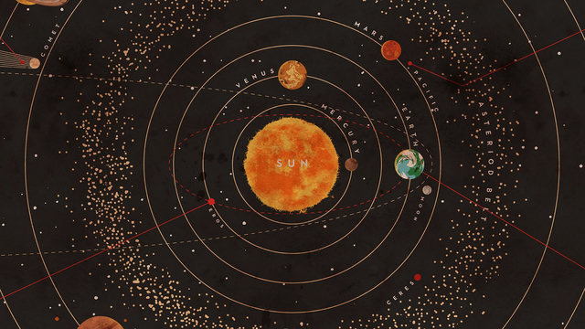
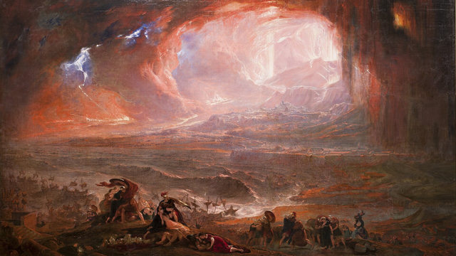
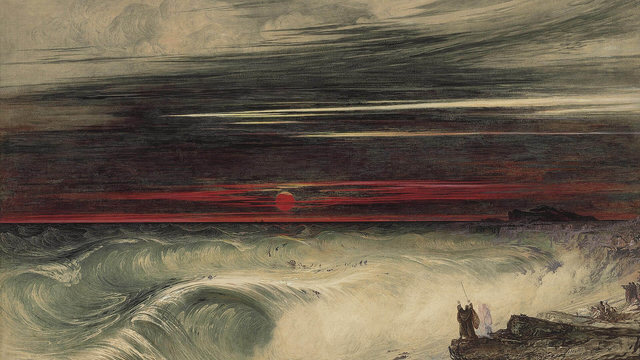

<!-- Generated by `gallery render` from wallpapers.tsv. Do not edit. -->

# Matte Black

<a href="https://justcarlson.github.io/omarchy-wallpapers/#matte-black"></a>

12 wallpapers picked for Matte Black by how closely Aether's palette for each image matches the theme's colours.

Install just this set:

```sh
curl -fsSL https://raw.githubusercontent.com/justcarlson/omarchy-wallpapers/main/install.sh | bash -s -- matte-black
```

Then press <kbd>Super</kbd> <kbd>Ctrl</kbd> <kbd>Space</kbd> to pick one. To build a whole new theme from a wallpaper instead, import its Aether blueprint:

```sh
aether --import-blueprint https://raw.githubusercontent.com/justcarlson/omarchy-wallpapers/main/blueprints/matte-black/<name>.json --auto-apply
```

<table>
<tr>
<td width="50%" valign="top"><a href="https://raw.githubusercontent.com/AngelJumbo/gruvbox-wallpapers/6aa74cbd65973e1a2a8695e83a58ce3ea634dd5e/wallpapers/mix/solar-system.jpg"></a><br><b>Solar System</b><br><sub><a href="https://github.com/AngelJumbo/gruvbox-wallpapers/blob/6aa74cbd65973e1a2a8695e83a58ce3ea634dd5e/wallpapers/mix/solar-system.jpg">AngelJumbo/gruvbox-wallpapers</a> · <a href="../blueprints/matte-black/angeljumbo-solar-system.json">Aether blueprint</a></sub></td>
<td width="50%" valign="top"><a href="https://raw.githubusercontent.com/dharmx/walls/6bf4d733ebf2b484a37c17d742eb47e5139e6a14/flowers/a_bouquet_of_flowers_and_leaves.jpg"></a><br><b>A Bouquet of Flowers and Leaves</b><br><sub><a href="https://github.com/dharmx/walls/blob/6bf4d733ebf2b484a37c17d742eb47e5139e6a14/flowers/a_bouquet_of_flowers_and_leaves.jpg">dharmx/walls</a> · <a href="../blueprints/matte-black/dharmx-a-bouquet-of-flowers-and-leaves.json">Aether blueprint</a></sub></td>
</tr>
<tr>
<td width="50%" valign="top"><a href="https://raw.githubusercontent.com/dharmx/walls/6bf4d733ebf2b484a37c17d742eb47e5139e6a14/architecture/a_bridge_with_lights_on_it.jpg"></a><br><b>A Bridge with Lights on It</b><br><sub><a href="https://github.com/dharmx/walls/blob/6bf4d733ebf2b484a37c17d742eb47e5139e6a14/architecture/a_bridge_with_lights_on_it.jpg">dharmx/walls</a> · <a href="../blueprints/matte-black/dharmx-a-bridge-with-lights-on-it.json">Aether blueprint</a></sub></td>
<td width="50%" valign="top"><a href="https://raw.githubusercontent.com/dharmx/walls/6bf4d733ebf2b484a37c17d742eb47e5139e6a14/flowers/a_white_and_yellow_flowers_in_a_glass_vase.jpg"></a><br><b>A White and Yellow Flowers in a Glass Vase</b><br><sub><a href="https://github.com/dharmx/walls/blob/6bf4d733ebf2b484a37c17d742eb47e5139e6a14/flowers/a_white_and_yellow_flowers_in_a_glass_vase.jpg">dharmx/walls</a> · <a href="../blueprints/matte-black/dharmx-a-white-and-yellow-flowers-in-a-glass-vase.json">Aether blueprint</a></sub></td>
</tr>
<tr>
<td width="50%" valign="top"><a href="https://raw.githubusercontent.com/dharmx/walls/6bf4d733ebf2b484a37c17d742eb47e5139e6a14/gruvbox/a_city_skyline_at_night.jpg"></a><br><b>A City Skyline at Night</b><br><sub><a href="https://github.com/dharmx/walls/blob/6bf4d733ebf2b484a37c17d742eb47e5139e6a14/gruvbox/a_city_skyline_at_night.jpg">dharmx/walls</a> · <a href="../blueprints/matte-black/dharmx-a-city-skyline-at-night.json">Aether blueprint</a></sub></td>
<td width="50%" valign="top"><a href="https://raw.githubusercontent.com/dharmx/walls/6bf4d733ebf2b484a37c17d742eb47e5139e6a14/architecture/a_city_skyline_at_night_01.jpg"></a><br><b>A City Skyline at Night 01</b><br><sub><a href="https://github.com/dharmx/walls/blob/6bf4d733ebf2b484a37c17d742eb47e5139e6a14/architecture/a_city_skyline_at_night_01.jpg">dharmx/walls</a> · <a href="../blueprints/matte-black/dharmx-a-city-skyline-at-night-01.json">Aether blueprint</a></sub></td>
</tr>
<tr>
<td width="50%" valign="top"><a href="https://raw.githubusercontent.com/dharmx/walls/6bf4d733ebf2b484a37c17d742eb47e5139e6a14/flowers/a_group_of_white_flowers_02.jpg"></a><br><b>A Group of White Flowers 02</b><br><sub><a href="https://github.com/dharmx/walls/blob/6bf4d733ebf2b484a37c17d742eb47e5139e6a14/flowers/a_group_of_white_flowers_02.jpg">dharmx/walls</a> · <a href="../blueprints/matte-black/dharmx-a-group-of-white-flowers-02.json">Aether blueprint</a></sub></td>
<td width="50%" valign="top"><a href="https://raw.githubusercontent.com/dharmx/walls/6bf4d733ebf2b484a37c17d742eb47e5139e6a14/lightbulb/a_group_of_light_bulbs_on_a_blanket.jpg"></a><br><b>A Group of Light Bulbs on a Blanket</b><br><sub><a href="https://github.com/dharmx/walls/blob/6bf4d733ebf2b484a37c17d742eb47e5139e6a14/lightbulb/a_group_of_light_bulbs_on_a_blanket.jpg">dharmx/walls</a> · <a href="../blueprints/matte-black/dharmx-a-group-of-light-bulbs-on-a-blanket.json">Aether blueprint</a></sub></td>
</tr>
<tr>
<td width="50%" valign="top"><a href="https://raw.githubusercontent.com/dharmx/walls/6bf4d733ebf2b484a37c17d742eb47e5139e6a14/nature/a_close_up_of_a_bush.jpg"></a><br><b>A Close Up of a Bush</b><br><sub><a href="https://github.com/dharmx/walls/blob/6bf4d733ebf2b484a37c17d742eb47e5139e6a14/nature/a_close_up_of_a_bush.jpg">dharmx/walls</a> · <a href="../blueprints/matte-black/dharmx-a-close-up-of-a-bush.json">Aether blueprint</a></sub></td>
<td width="50%" valign="top"><a href="https://raw.githubusercontent.com/krishna4a6av/Wallpapers/aa01193c864a1c175d3c44d1c0f4c4f62f3c61de/Graphite/road.jpg"></a><br><b>Road</b><br><sub><a href="https://github.com/krishna4a6av/Wallpapers/blob/aa01193c864a1c175d3c44d1c0f4c4f62f3c61de/Graphite/road.jpg">krishna4a6av/Wallpapers</a> · <a href="../blueprints/matte-black/krishna4a6av-road.json">Aether blueprint</a></sub></td>
</tr>
<tr>
<td width="50%" valign="top"><a href="https://upload.wikimedia.org/wikipedia/commons/thumb/d/d1/Destruction_of_Pompeii_and_Herculaneum.jpg/1920px-Destruction_of_Pompeii_and_Herculaneum.jpg"></a><br><b>Destruction of Pompeii</b><br><sub><a href="https://commons.wikimedia.org/wiki/File:Destruction_of_Pompeii_and_Herculaneum.jpg">John Martin, Wikimedia Commons</a> · <a href="../blueprints/matte-black/john-martin-destruction-of-pompeii.json">Aether blueprint</a></sub></td>
<td width="50%" valign="top"><a href="https://upload.wikimedia.org/wikipedia/commons/thumb/e/e5/The_Destruction_of_Pharaoh%E2%80%99s_Host%2C_by_John_Martin.jpg/1920px-The_Destruction_of_Pharaoh%E2%80%99s_Host%2C_by_John_Martin.jpg"></a><br><b>Destruction of Pharaohs Host</b><br><sub><a href="https://commons.wikimedia.org/wiki/File:The_Destruction_of_Pharaoh%E2%80%99s_Host%2C_by_John_Martin.jpg">John Martin, Wikimedia Commons</a> · <a href="../blueprints/matte-black/john-martin-destruction-of-pharaohs-host.json">Aether blueprint</a></sub></td>
</tr>
</table>

[All themes](../README.md#the-collection)
