<!-- Generated by `gallery render` from wallpapers.tsv. Do not edit. -->

# Miasma

<a href="https://justcarlson.github.io/omarchy-wallpapers/#miasma">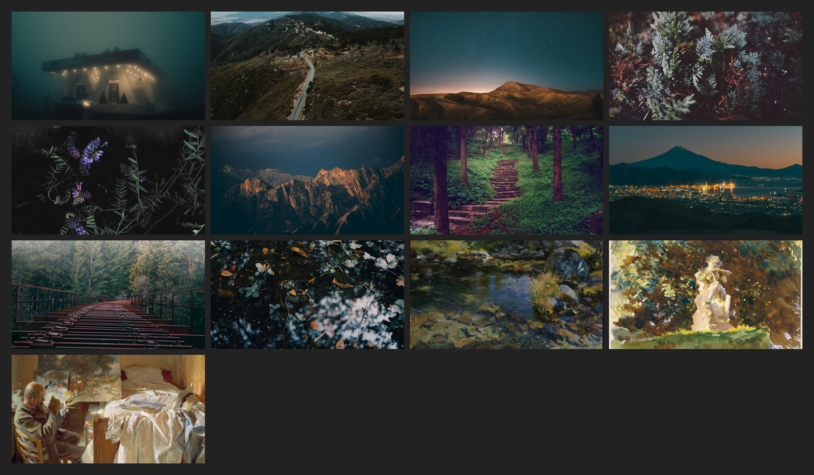</a>

13 wallpapers picked for Miasma by how closely Aether's palette for each image matches the theme's colours.

Install just this set:

```sh
curl -fsSL https://raw.githubusercontent.com/justcarlson/omarchy-wallpapers/main/install.sh | bash -s -- miasma
```

Then press <kbd>Super</kbd> <kbd>Ctrl</kbd> <kbd>Space</kbd> to pick one. To build a whole new theme from a wallpaper instead, import its Aether blueprint:

```sh
aether --import-blueprint https://raw.githubusercontent.com/justcarlson/omarchy-wallpapers/main/blueprints/miasma/<name>.json --auto-apply
```

<table>
<tr>
<td width="50%" valign="top"><a href="https://raw.githubusercontent.com/dharmx/walls/6bf4d733ebf2b484a37c17d742eb47e5139e6a14/dreamcore/a_gas_station_with_lights_on_the_front_and_a_car_parked_in_the_front.jpg">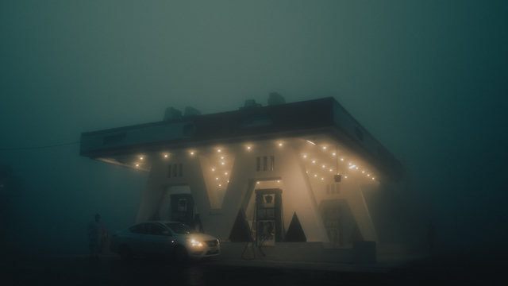</a><br><b>A Gas Station with Lights on the Front and a Car Parked in the Front</b><br><sub><a href="https://github.com/dharmx/walls/blob/6bf4d733ebf2b484a37c17d742eb47e5139e6a14/dreamcore/a_gas_station_with_lights_on_the_front_and_a_car_parked_in_the_front.jpg">dharmx/walls</a> · <a href="../blueprints/miasma/dharmx-a-gas-station-with-lights-on-the-front-and-a-car-parked-in-the-front.json">Aether blueprint</a></sub></td>
<td width="50%" valign="top"><a href="https://raw.githubusercontent.com/dharmx/walls/6bf4d733ebf2b484a37c17d742eb47e5139e6a14/mountain/a_road_going_through_a_valley.jpg">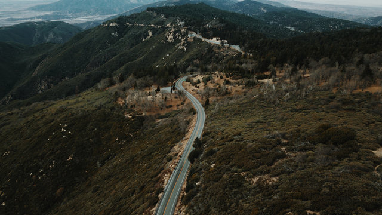</a><br><b>A Road Going Through a Valley</b><br><sub><a href="https://github.com/dharmx/walls/blob/6bf4d733ebf2b484a37c17d742eb47e5139e6a14/mountain/a_road_going_through_a_valley.jpg">dharmx/walls</a> · <a href="../blueprints/miasma/dharmx-a-road-going-through-a-valley.json">Aether blueprint</a></sub></td>
</tr>
<tr>
<td width="50%" valign="top"><a href="https://raw.githubusercontent.com/AngelJumbo/gruvbox-wallpapers/6aa74cbd65973e1a2a8695e83a58ce3ea634dd5e/wallpapers/photography/mohammad-alizade-4wzRuAb-KWs.jpg">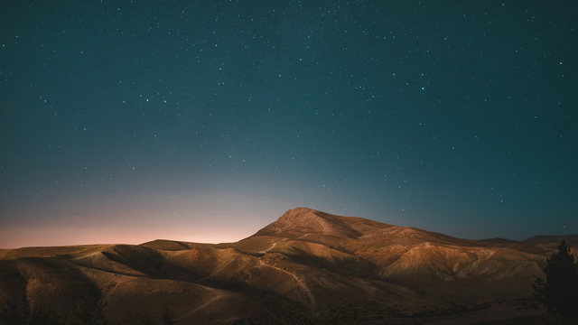</a><br><b>Mohammad Alizade 4wzruab Kws</b><br><sub><a href="https://github.com/AngelJumbo/gruvbox-wallpapers/blob/6aa74cbd65973e1a2a8695e83a58ce3ea634dd5e/wallpapers/photography/mohammad-alizade-4wzRuAb-KWs.jpg">AngelJumbo/gruvbox-wallpapers</a> · <a href="../blueprints/miasma/angeljumbo-mohammad-alizade-4wzruab-kws.json">Aether blueprint</a></sub></td>
<td width="50%" valign="top"><a href="https://raw.githubusercontent.com/krishna4a6av/Wallpapers/aa01193c864a1c175d3c44d1c0f4c4f62f3c61de/Everforest/forest-moss.jpeg">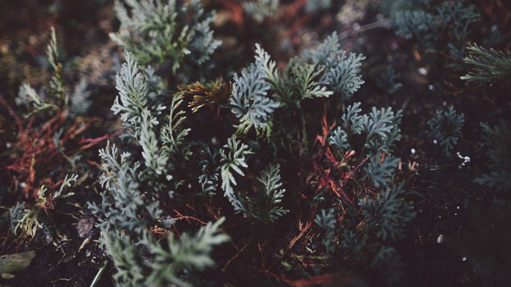</a><br><b>Forest Moss</b><br><sub><a href="https://github.com/krishna4a6av/Wallpapers/blob/aa01193c864a1c175d3c44d1c0f4c4f62f3c61de/Everforest/forest-moss.jpeg">krishna4a6av/Wallpapers</a> · <a href="../blueprints/miasma/krishna4a6av-forest-moss.json">Aether blueprint</a></sub></td>
</tr>
<tr>
<td width="50%" valign="top"><a href="https://raw.githubusercontent.com/dharmx/walls/6bf4d733ebf2b484a37c17d742eb47e5139e6a14/flowers/purple_flowers_on_a_black_background.png">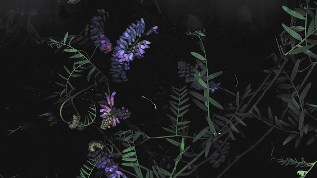</a><br><b>Purple Flowers on a Black Background</b><br><sub><a href="https://github.com/dharmx/walls/blob/6bf4d733ebf2b484a37c17d742eb47e5139e6a14/flowers/purple_flowers_on_a_black_background.png">dharmx/walls</a> · <a href="../blueprints/miasma/dharmx-purple-flowers-on-a-black-background.json">Aether blueprint</a></sub></td>
<td width="50%" valign="top"><a href="https://raw.githubusercontent.com/dharmx/walls/6bf4d733ebf2b484a37c17d742eb47e5139e6a14/mountain/a_mountain_range_with_dark_clouds.jpg">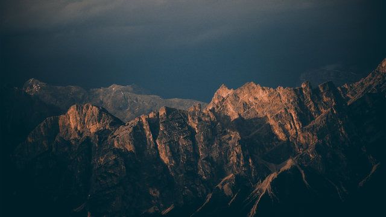</a><br><b>A Mountain Range with Dark Clouds</b><br><sub><a href="https://github.com/dharmx/walls/blob/6bf4d733ebf2b484a37c17d742eb47e5139e6a14/mountain/a_mountain_range_with_dark_clouds.jpg">dharmx/walls</a> · <a href="../blueprints/miasma/dharmx-a-mountain-range-with-dark-clouds.json">Aether blueprint</a></sub></td>
</tr>
<tr>
<td width="50%" valign="top"><a href="https://raw.githubusercontent.com/dharmx/walls/6bf4d733ebf2b484a37c17d742eb47e5139e6a14/nature/a_stone_stairs_in_a_forest.jpg">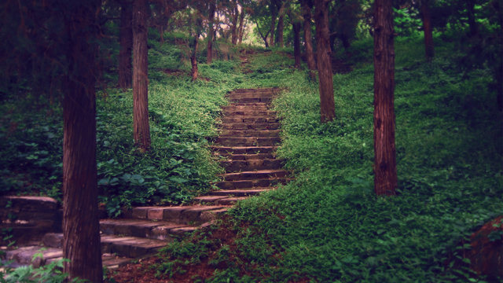</a><br><b>A Stone Stairs in a Forest</b><br><sub><a href="https://github.com/dharmx/walls/blob/6bf4d733ebf2b484a37c17d742eb47e5139e6a14/nature/a_stone_stairs_in_a_forest.jpg">dharmx/walls</a> · <a href="../blueprints/miasma/dharmx-a-stone-stairs-in-a-forest.json">Aether blueprint</a></sub></td>
<td width="50%" valign="top"><a href="https://raw.githubusercontent.com/krishna4a6av/Wallpapers/aa01193c864a1c175d3c44d1c0f4c4f62f3c61de/Autmn/fuji.jpg"></a><br><b>Fuji</b><br><sub><a href="https://github.com/krishna4a6av/Wallpapers/blob/aa01193c864a1c175d3c44d1c0f4c4f62f3c61de/Autmn/fuji.jpg">krishna4a6av/Wallpapers</a> · <a href="../blueprints/miasma/krishna4a6av-fuji.json">Aether blueprint</a></sub></td>
</tr>
<tr>
<td width="50%" valign="top"><a href="https://raw.githubusercontent.com/AngelJumbo/gruvbox-wallpapers/6aa74cbd65973e1a2a8695e83a58ce3ea634dd5e/wallpapers/photography/rails.jpg">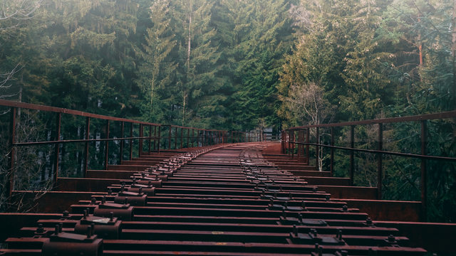</a><br><b>Rails</b><br><sub><a href="https://github.com/AngelJumbo/gruvbox-wallpapers/blob/6aa74cbd65973e1a2a8695e83a58ce3ea634dd5e/wallpapers/photography/rails.jpg">AngelJumbo/gruvbox-wallpapers</a> · <a href="../blueprints/miasma/angeljumbo-rails.json">Aether blueprint</a></sub></td>
<td width="50%" valign="top"><a href="https://raw.githubusercontent.com/dharmx/walls/6bf4d733ebf2b484a37c17d742eb47e5139e6a14/nature/plants_leaves_in_the_water.jpg">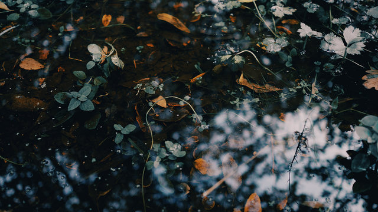</a><br><b>Plants Leaves in the Water</b><br><sub><a href="https://github.com/dharmx/walls/blob/6bf4d733ebf2b484a37c17d742eb47e5139e6a14/nature/plants_leaves_in_the_water.jpg">dharmx/walls</a> · <a href="../blueprints/miasma/dharmx-plants-leaves-in-the-water.json">Aether blueprint</a></sub></td>
</tr>
<tr>
<td width="50%" valign="top"><a href="https://upload.wikimedia.org/wikipedia/commons/4/49/Alpine_Pool_MET_DT5585.jpg">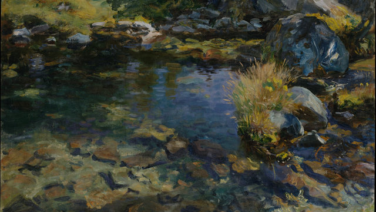</a><br><b>Alpine Pool</b><br><sub><a href="https://commons.wikimedia.org/wiki/File:Alpine_Pool_MET_DT5585.jpg">John Singer Sargent, Wikimedia Commons</a> · <a href="../blueprints/miasma/sargent-alpine-pool.json">Aether blueprint</a></sub></td>
<td width="50%" valign="top"><a href="https://upload.wikimedia.org/wikipedia/commons/e/e7/Boboli_Garden%2C_Florence_MET_DT4568.jpg">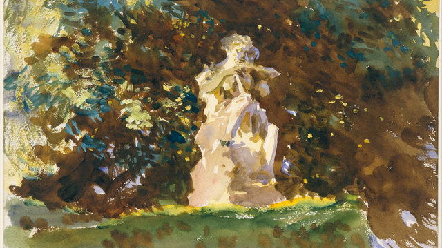</a><br><b>Boboli Garden Florence</b><br><sub><a href="https://commons.wikimedia.org/wiki/File:Boboli_Garden%2C_Florence_MET_DT4568.jpg">John Singer Sargent, Wikimedia Commons</a> · <a href="../blueprints/miasma/sargent-boboli-garden-florence.json">Aether blueprint</a></sub></td>
</tr>
<tr>
<td width="50%" valign="top"><a href="https://upload.wikimedia.org/wikipedia/commons/thumb/3/35/John_Singer_Sargent_-_An_Artist_in_His_Studio_-_Google_Art_Project.jpg/3840px-John_Singer_Sargent_-_An_Artist_in_His_Studio_-_Google_Art_Project.jpg"></a><br><b>An Artist in His Studio</b><br><sub><a href="https://commons.wikimedia.org/wiki/File:John_Singer_Sargent_-_An_Artist_in_His_Studio_-_Google_Art_Project.jpg">John Singer Sargent, Wikimedia Commons</a> · <a href="../blueprints/miasma/sargent-an-artist-in-his-studio.json">Aether blueprint</a></sub></td>
</tr>
</table>

[All themes](../README.md#the-collection)
