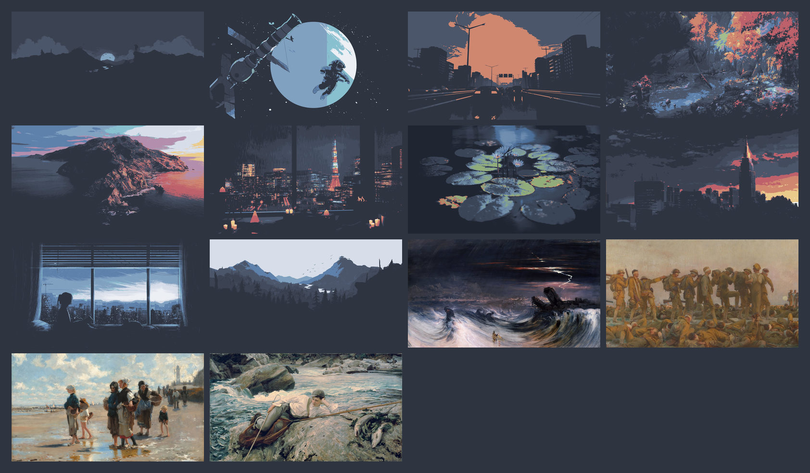
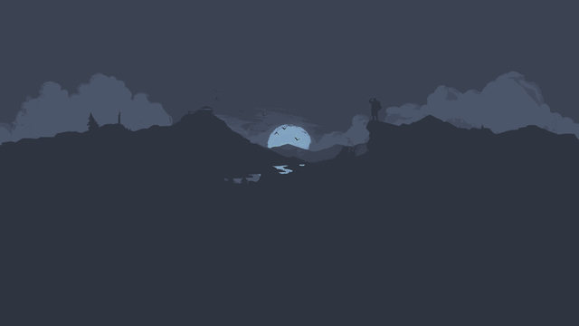
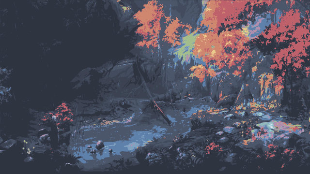
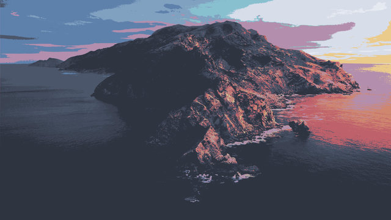
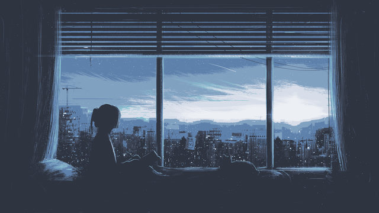
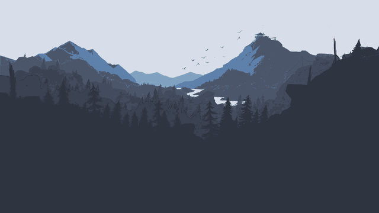
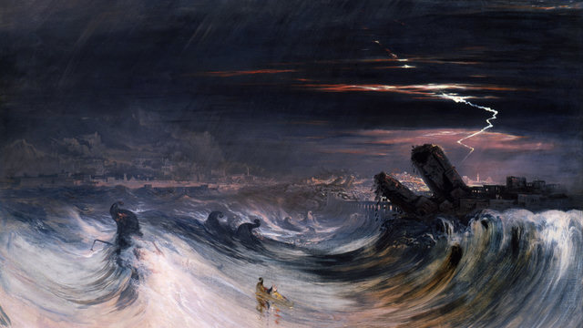

<!-- Generated by `gallery render` from wallpapers.tsv. Do not edit. -->

# Nord

<a href="https://justcarlson.github.io/omarchy-wallpapers/#nord"></a>

14 wallpapers picked for Nord by how closely Aether's palette for each image matches the theme's colours.

Install just this set:

```sh
curl -fsSL https://raw.githubusercontent.com/justcarlson/omarchy-wallpapers/main/install.sh | bash -s -- nord
```

Then press <kbd>Super</kbd> <kbd>Ctrl</kbd> <kbd>Space</kbd> to pick one. To build a whole new theme from a wallpaper instead, import its Aether blueprint:

```sh
aether --import-blueprint https://raw.githubusercontent.com/justcarlson/omarchy-wallpapers/main/blueprints/nord/<name>.json --auto-apply
```

<table>
<tr>
<td width="50%" valign="top"><a href="https://raw.githubusercontent.com/dharmx/walls/6bf4d733ebf2b484a37c17d742eb47e5139e6a14/nord/a_moon_over_mountains_and_clouds.png"></a><br><b>A Moon Over Mountains and Clouds</b><br><sub><a href="https://github.com/dharmx/walls/blob/6bf4d733ebf2b484a37c17d742eb47e5139e6a14/nord/a_moon_over_mountains_and_clouds.png">dharmx/walls</a> · <a href="../blueprints/nord/dharmx-a-moon-over-mountains-and-clouds.json">Aether blueprint</a></sub></td>
<td width="50%" valign="top"><a href="https://raw.githubusercontent.com/dharmx/walls/6bf4d733ebf2b484a37c17d742eb47e5139e6a14/nord/an_astronaut_in_space_with_a_satellite.png"></a><br><b>An Astronaut in Space with a Satellite</b><br><sub><a href="https://github.com/dharmx/walls/blob/6bf4d733ebf2b484a37c17d742eb47e5139e6a14/nord/an_astronaut_in_space_with_a_satellite.png">dharmx/walls</a> · <a href="../blueprints/nord/dharmx-an-astronaut-in-space-with-a-satellite.json">Aether blueprint</a></sub></td>
</tr>
<tr>
<td width="50%" valign="top"><a href="https://raw.githubusercontent.com/dharmx/walls/6bf4d733ebf2b484a37c17d742eb47e5139e6a14/nord/a_road_with_cars_and_buildings_in_the_background.png"></a><br><b>A Road with Cars and Buildings in the Background</b><br><sub><a href="https://github.com/dharmx/walls/blob/6bf4d733ebf2b484a37c17d742eb47e5139e6a14/nord/a_road_with_cars_and_buildings_in_the_background.png">dharmx/walls</a> · <a href="../blueprints/nord/dharmx-a-road-with-cars-and-buildings-in-the-background.json">Aether blueprint</a></sub></td>
<td width="50%" valign="top"><a href="https://raw.githubusercontent.com/dharmx/walls/6bf4d733ebf2b484a37c17d742eb47e5139e6a14/nord/a_video_game_screen_capture.jpg"></a><br><b>A Video Game Screen Capture</b><br><sub><a href="https://github.com/dharmx/walls/blob/6bf4d733ebf2b484a37c17d742eb47e5139e6a14/nord/a_video_game_screen_capture.jpg">dharmx/walls</a> · <a href="../blueprints/nord/dharmx-a-video-game-screen-capture.json">Aether blueprint</a></sub></td>
</tr>
<tr>
<td width="50%" valign="top"><a href="https://raw.githubusercontent.com/dharmx/walls/6bf4d733ebf2b484a37c17d742eb47e5139e6a14/nord/a_large_mountain_with_a_body_of_water.jpg"></a><br><b>A Large Mountain with a Body of Water</b><br><sub><a href="https://github.com/dharmx/walls/blob/6bf4d733ebf2b484a37c17d742eb47e5139e6a14/nord/a_large_mountain_with_a_body_of_water.jpg">dharmx/walls</a> · <a href="../blueprints/nord/dharmx-a-large-mountain-with-a-body-of-water.json">Aether blueprint</a></sub></td>
<td width="50%" valign="top"><a href="https://raw.githubusercontent.com/dharmx/walls/6bf4d733ebf2b484a37c17d742eb47e5139e6a14/nord/a_view_of_a_city_from_a_window.jpg"></a><br><b>A View of a City From a Window</b><br><sub><a href="https://github.com/dharmx/walls/blob/6bf4d733ebf2b484a37c17d742eb47e5139e6a14/nord/a_view_of_a_city_from_a_window.jpg">dharmx/walls</a> · <a href="../blueprints/nord/dharmx-a-view-of-a-city-from-a-window.json">Aether blueprint</a></sub></td>
</tr>
<tr>
<td width="50%" valign="top"><a href="https://raw.githubusercontent.com/dharmx/walls/6bf4d733ebf2b484a37c17d742eb47e5139e6a14/nord/lily_pads_in_a_pond.jpg"></a><br><b>Lily Pads in a Pond</b><br><sub><a href="https://github.com/dharmx/walls/blob/6bf4d733ebf2b484a37c17d742eb47e5139e6a14/nord/lily_pads_in_a_pond.jpg">dharmx/walls</a> · <a href="../blueprints/nord/dharmx-lily-pads-in-a-pond.json">Aether blueprint</a></sub></td>
<td width="50%" valign="top"><a href="https://raw.githubusercontent.com/dharmx/walls/6bf4d733ebf2b484a37c17d742eb47e5139e6a14/nord/a_city_skyline_with_a_tall_tower.jpg"></a><br><b>A City Skyline with a Tall Tower</b><br><sub><a href="https://github.com/dharmx/walls/blob/6bf4d733ebf2b484a37c17d742eb47e5139e6a14/nord/a_city_skyline_with_a_tall_tower.jpg">dharmx/walls</a> · <a href="../blueprints/nord/dharmx-a-city-skyline-with-a-tall-tower.json">Aether blueprint</a></sub></td>
</tr>
<tr>
<td width="50%" valign="top"><a href="https://raw.githubusercontent.com/dharmx/walls/6bf4d733ebf2b484a37c17d742eb47e5139e6a14/nord/a_woman_sitting_on_a_couch_looking_out_a_window.png"></a><br><b>A Woman Sitting on a Couch Looking Out a Window</b><br><sub><a href="https://github.com/dharmx/walls/blob/6bf4d733ebf2b484a37c17d742eb47e5139e6a14/nord/a_woman_sitting_on_a_couch_looking_out_a_window.png">dharmx/walls</a> · <a href="../blueprints/nord/dharmx-a-woman-sitting-on-a-couch-looking-out-a-window.json">Aether blueprint</a></sub></td>
<td width="50%" valign="top"><a href="https://raw.githubusercontent.com/dharmx/walls/6bf4d733ebf2b484a37c17d742eb47e5139e6a14/nord/a_mountain_landscape_with_trees_and_a_building_on_top.png"></a><br><b>A Mountain Landscape with Trees and a Building O</b><br><sub><a href="https://github.com/dharmx/walls/blob/6bf4d733ebf2b484a37c17d742eb47e5139e6a14/nord/a_mountain_landscape_with_trees_and_a_building_on_top.png">dharmx/walls</a> · <a href="../blueprints/nord/dharmx-a-mountain-landscape-with-trees-and-a-building-o.json">Aether blueprint</a></sub></td>
</tr>
<tr>
<td width="50%" valign="top"><a href="https://upload.wikimedia.org/wikipedia/commons/thumb/0/04/John_Martin_-_Destruction_of_Tyre_-_Google_Art_Project.jpg/3840px-John_Martin_-_Destruction_of_Tyre_-_Google_Art_Project.jpg"></a><br><b>Destruction of Tyre</b><br><sub><a href="https://commons.wikimedia.org/wiki/File:John_Martin_-_Destruction_of_Tyre_-_Google_Art_Project.jpg">John Martin, Wikimedia Commons</a> · <a href="../blueprints/nord/john-martin-destruction-of-tyre.json">Aether blueprint</a></sub></td>
<td width="50%" valign="top"><a href="https://upload.wikimedia.org/wikipedia/commons/thumb/d/d3/John_Singer_Sargent_-_Gassed_%281919%29.jpg/3840px-John_Singer_Sargent_-_Gassed_%281919%29.jpg"></a><br><b>Gassed</b><br><sub><a href="https://commons.wikimedia.org/wiki/File:John_Singer_Sargent_-_Gassed_%281919%29.jpg">John Singer Sargent, Wikimedia Commons</a> · <a href="../blueprints/nord/sargent-gassed.json">Aether blueprint</a></sub></td>
</tr>
<tr>
<td width="50%" valign="top"><a href="https://upload.wikimedia.org/wikipedia/commons/thumb/8/8c/John_Singer_Sargent_-_Cancale.jpg/3840px-John_Singer_Sargent_-_Cancale.jpg"></a><br><b>Setting Out to Fish</b><br><sub><a href="https://commons.wikimedia.org/wiki/File:John_Singer_Sargent_-_Cancale.jpg">John Singer Sargent, Wikimedia Commons</a> · <a href="../blueprints/nord/sargent-setting-out-to-fish.json">Aether blueprint</a></sub></td>
<td width="50%" valign="top"><a href="https://upload.wikimedia.org/wikipedia/commons/thumb/1/19/John_Singer_Sargent_-_On_his_Holidays%2C_Norway_%281901%29.jpg/3840px-John_Singer_Sargent_-_On_his_Holidays%2C_Norway_%281901%29.jpg"></a><br><b>On His Holidays Norway</b><br><sub><a href="https://commons.wikimedia.org/wiki/File:John_Singer_Sargent_-_On_his_Holidays%2C_Norway_%281901%29.jpg">John Singer Sargent, Wikimedia Commons</a> · <a href="../blueprints/nord/sargent-on-his-holidays-norway.json">Aether blueprint</a></sub></td>
</tr>
</table>

[All themes](../README.md#the-collection)
