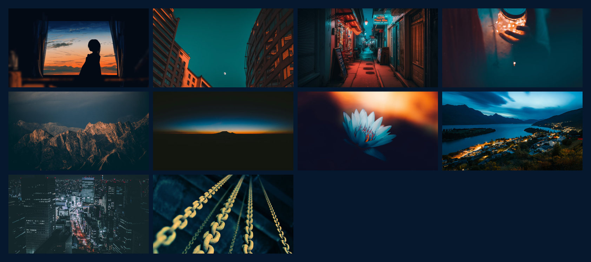
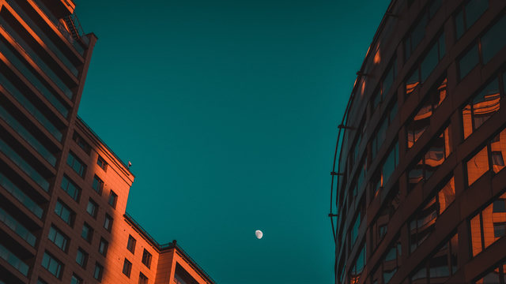
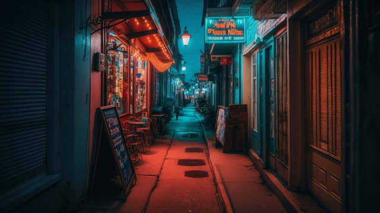
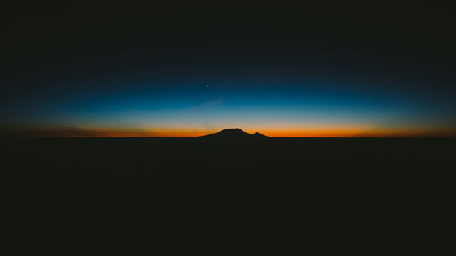

<!-- Generated by `gallery render` from wallpapers.tsv. Do not edit. -->

# Retro 82

<a href="https://justcarlson.github.io/omarchy-wallpapers/#retro-82"></a>

10 wallpapers picked for Retro 82 by how closely Aether's palette for each image matches the theme's colours.

Install just this set:

```sh
curl -fsSL https://raw.githubusercontent.com/justcarlson/omarchy-wallpapers/main/install.sh | bash -s -- retro-82
```

Then press <kbd>Super</kbd> <kbd>Ctrl</kbd> <kbd>Space</kbd> to pick one. To build a whole new theme from a wallpaper instead, import its Aether blueprint:

```sh
aether --import-blueprint https://raw.githubusercontent.com/justcarlson/omarchy-wallpapers/main/blueprints/retro-82/<name>.json --auto-apply
```

<table>
<tr>
<td width="50%" valign="top"><a href="https://raw.githubusercontent.com/krishna4a6av/Wallpapers/aa01193c864a1c175d3c44d1c0f4c4f62f3c61de/.homeless/cls-window.jpg"></a><br><b>Cls Window</b><br><sub><a href="https://github.com/krishna4a6av/Wallpapers/blob/aa01193c864a1c175d3c44d1c0f4c4f62f3c61de/.homeless/cls-window.jpg">krishna4a6av/Wallpapers</a> · <a href="../blueprints/retro-82/krishna4a6av-cls-window.json">Aether blueprint</a></sub></td>
<td width="50%" valign="top"><a href="https://raw.githubusercontent.com/dharmx/walls/6bf4d733ebf2b484a37c17d742eb47e5139e6a14/architecture/a_moon_in_the_sky.jpg"></a><br><b>A Moon in the Sky</b><br><sub><a href="https://github.com/dharmx/walls/blob/6bf4d733ebf2b484a37c17d742eb47e5139e6a14/architecture/a_moon_in_the_sky.jpg">dharmx/walls</a> · <a href="../blueprints/retro-82/dharmx-a-moon-in-the-sky.json">Aether blueprint</a></sub></td>
</tr>
<tr>
<td width="50%" valign="top"><a href="https://raw.githubusercontent.com/dharmx/walls/6bf4d733ebf2b484a37c17d742eb47e5139e6a14/architecture/a_narrow_street_with_shops_and_signs.png"></a><br><b>A Narrow Street with Shops and Signs</b><br><sub><a href="https://github.com/dharmx/walls/blob/6bf4d733ebf2b484a37c17d742eb47e5139e6a14/architecture/a_narrow_street_with_shops_and_signs.png">dharmx/walls</a> · <a href="../blueprints/retro-82/dharmx-a-narrow-street-with-shops-and-signs.json">Aether blueprint</a></sub></td>
<td width="50%" valign="top"><a href="https://raw.githubusercontent.com/dharmx/walls/6bf4d733ebf2b484a37c17d742eb47e5139e6a14/lightbulb/a_person_holding_a_jar_with_lights.jpg"></a><br><b>A Person Holding a Jar with Lights</b><br><sub><a href="https://github.com/dharmx/walls/blob/6bf4d733ebf2b484a37c17d742eb47e5139e6a14/lightbulb/a_person_holding_a_jar_with_lights.jpg">dharmx/walls</a> · <a href="../blueprints/retro-82/dharmx-a-person-holding-a-jar-with-lights.json">Aether blueprint</a></sub></td>
</tr>
<tr>
<td width="50%" valign="top"><a href="https://raw.githubusercontent.com/dharmx/walls/6bf4d733ebf2b484a37c17d742eb47e5139e6a14/mountain/a_mountain_range_with_dark_clouds.jpg"></a><br><b>A Mountain Range with Dark Clouds</b><br><sub><a href="https://github.com/dharmx/walls/blob/6bf4d733ebf2b484a37c17d742eb47e5139e6a14/mountain/a_mountain_range_with_dark_clouds.jpg">dharmx/walls</a> · <a href="../blueprints/retro-82/dharmx-a-mountain-range-with-dark-clouds.json">Aether blueprint</a></sub></td>
<td width="50%" valign="top"><a href="https://raw.githubusercontent.com/AngelJumbo/gruvbox-wallpapers/6aa74cbd65973e1a2a8695e83a58ce3ea634dd5e/wallpapers/photography/elliott-engelmann-DjlKxYFJlTc.jpg"></a><br><b>Elliott Engelmann Djlkxyfjltc</b><br><sub><a href="https://github.com/AngelJumbo/gruvbox-wallpapers/blob/6aa74cbd65973e1a2a8695e83a58ce3ea634dd5e/wallpapers/photography/elliott-engelmann-DjlKxYFJlTc.jpg">AngelJumbo/gruvbox-wallpapers</a> · <a href="../blueprints/retro-82/angeljumbo-elliott-engelmann-djlkxyfjltc.json">Aether blueprint</a></sub></td>
</tr>
<tr>
<td width="50%" valign="top"><a href="https://raw.githubusercontent.com/AngelJumbo/gruvbox-wallpapers/6aa74cbd65973e1a2a8695e83a58ce3ea634dd5e/wallpapers/photography/ameenfahmy-mXpTl4jNKiA.jpg"></a><br><b>Ameenfahmy Mxptl4jnkia</b><br><sub><a href="https://github.com/AngelJumbo/gruvbox-wallpapers/blob/6aa74cbd65973e1a2a8695e83a58ce3ea634dd5e/wallpapers/photography/ameenfahmy-mXpTl4jNKiA.jpg">AngelJumbo/gruvbox-wallpapers</a> · <a href="../blueprints/retro-82/angeljumbo-ameenfahmy-mxptl4jnkia.json">Aether blueprint</a></sub></td>
<td width="50%" valign="top"><a href="https://raw.githubusercontent.com/krishna4a6av/Wallpapers/aa01193c864a1c175d3c44d1c0f4c4f62f3c61de/Autmn/wide-city-shot.jpg"></a><br><b>Wide City Shot</b><br><sub><a href="https://github.com/krishna4a6av/Wallpapers/blob/aa01193c864a1c175d3c44d1c0f4c4f62f3c61de/Autmn/wide-city-shot.jpg">krishna4a6av/Wallpapers</a> · <a href="../blueprints/retro-82/krishna4a6av-wide-city-shot.json">Aether blueprint</a></sub></td>
</tr>
<tr>
<td width="50%" valign="top"><a href="https://raw.githubusercontent.com/dharmx/walls/6bf4d733ebf2b484a37c17d742eb47e5139e6a14/architecture/a_city_at_night_with_many_tall_buildings.jpg"></a><br><b>A City at Night with Many Tall Buildings</b><br><sub><a href="https://github.com/dharmx/walls/blob/6bf4d733ebf2b484a37c17d742eb47e5139e6a14/architecture/a_city_at_night_with_many_tall_buildings.jpg">dharmx/walls</a> · <a href="../blueprints/retro-82/dharmx-a-city-at-night-with-many-tall-buildings.json">Aether blueprint</a></sub></td>
<td width="50%" valign="top"><a href="https://raw.githubusercontent.com/dharmx/walls/6bf4d733ebf2b484a37c17d742eb47e5139e6a14/solarized/a_chain_from_a_ceiling.jpg"></a><br><b>A Chain From a Ceiling</b><br><sub><a href="https://github.com/dharmx/walls/blob/6bf4d733ebf2b484a37c17d742eb47e5139e6a14/solarized/a_chain_from_a_ceiling.jpg">dharmx/walls</a> · <a href="../blueprints/retro-82/dharmx-a-chain-from-a-ceiling.json">Aether blueprint</a></sub></td>
</tr>
</table>

[All themes](../README.md#the-collection)
