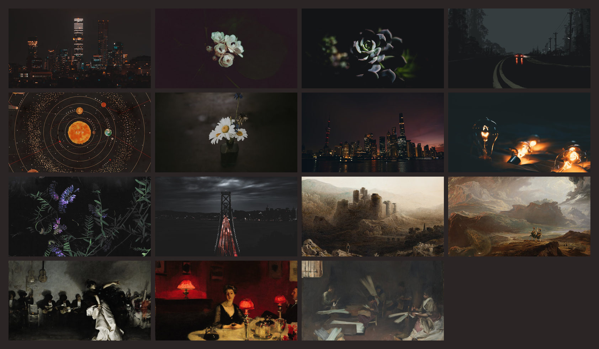
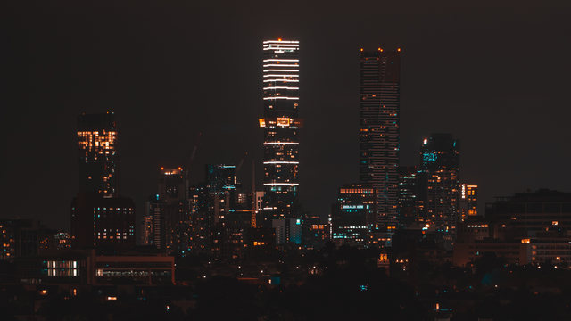
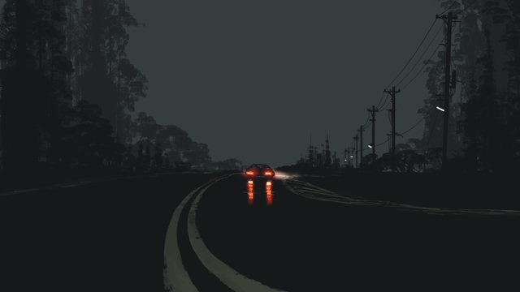
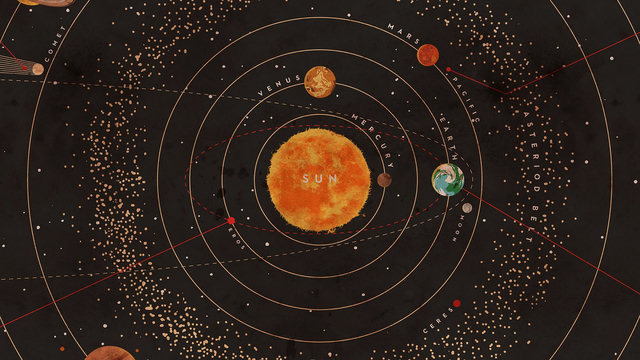
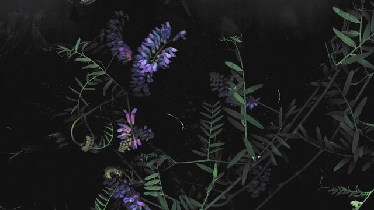
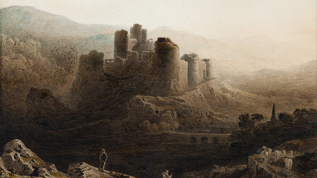
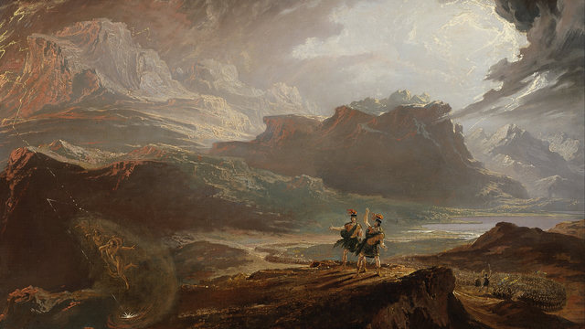
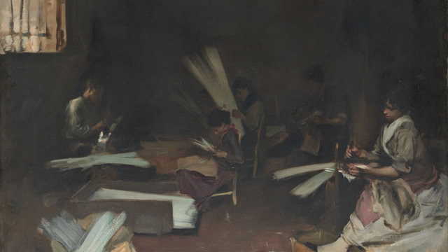

<!-- Generated by `gallery render` from wallpapers.tsv. Do not edit. -->

# Ristretto

<a href="https://justcarlson.github.io/omarchy-wallpapers/#ristretto"></a>

15 wallpapers picked for Ristretto by how closely Aether's palette for each image matches the theme's colours.

Install just this set:

```sh
curl -fsSL https://raw.githubusercontent.com/justcarlson/omarchy-wallpapers/main/install.sh | bash -s -- ristretto
```

Then press <kbd>Super</kbd> <kbd>Ctrl</kbd> <kbd>Space</kbd> to pick one. To build a whole new theme from a wallpaper instead, import its Aether blueprint:

```sh
aether --import-blueprint https://raw.githubusercontent.com/justcarlson/omarchy-wallpapers/main/blueprints/ristretto/<name>.json --auto-apply
```

<table>
<tr>
<td width="50%" valign="top"><a href="https://raw.githubusercontent.com/dharmx/walls/6bf4d733ebf2b484a37c17d742eb47e5139e6a14/gruvbox/a_city_skyline_at_night.jpg"></a><br><b>A City Skyline at Night</b><br><sub><a href="https://github.com/dharmx/walls/blob/6bf4d733ebf2b484a37c17d742eb47e5139e6a14/gruvbox/a_city_skyline_at_night.jpg">dharmx/walls</a> · <a href="../blueprints/ristretto/dharmx-a-city-skyline-at-night.json">Aether blueprint</a></sub></td>
<td width="50%" valign="top"><a href="https://raw.githubusercontent.com/dharmx/walls/6bf4d733ebf2b484a37c17d742eb47e5139e6a14/flowers/a_group_of_white_flowers_02.jpg"></a><br><b>A Group of White Flowers 02</b><br><sub><a href="https://github.com/dharmx/walls/blob/6bf4d733ebf2b484a37c17d742eb47e5139e6a14/flowers/a_group_of_white_flowers_02.jpg">dharmx/walls</a> · <a href="../blueprints/ristretto/dharmx-a-group-of-white-flowers-02.json">Aether blueprint</a></sub></td>
</tr>
<tr>
<td width="50%" valign="top"><a href="https://raw.githubusercontent.com/dharmx/walls/6bf4d733ebf2b484a37c17d742eb47e5139e6a14/flowers/a_close_up_of_a_plant_01.jpg"></a><br><b>A Close Up of a Plant 01</b><br><sub><a href="https://github.com/dharmx/walls/blob/6bf4d733ebf2b484a37c17d742eb47e5139e6a14/flowers/a_close_up_of_a_plant_01.jpg">dharmx/walls</a> · <a href="../blueprints/ristretto/dharmx-a-close-up-of-a-plant-01.json">Aether blueprint</a></sub></td>
<td width="50%" valign="top"><a href="https://raw.githubusercontent.com/krishna4a6av/Wallpapers/aa01193c864a1c175d3c44d1c0f4c4f62f3c61de/Graphite/road.jpg"></a><br><b>Road</b><br><sub><a href="https://github.com/krishna4a6av/Wallpapers/blob/aa01193c864a1c175d3c44d1c0f4c4f62f3c61de/Graphite/road.jpg">krishna4a6av/Wallpapers</a> · <a href="../blueprints/ristretto/krishna4a6av-road.json">Aether blueprint</a></sub></td>
</tr>
<tr>
<td width="50%" valign="top"><a href="https://raw.githubusercontent.com/AngelJumbo/gruvbox-wallpapers/6aa74cbd65973e1a2a8695e83a58ce3ea634dd5e/wallpapers/mix/solar-system.jpg"></a><br><b>Solar System</b><br><sub><a href="https://github.com/AngelJumbo/gruvbox-wallpapers/blob/6aa74cbd65973e1a2a8695e83a58ce3ea634dd5e/wallpapers/mix/solar-system.jpg">AngelJumbo/gruvbox-wallpapers</a> · <a href="../blueprints/ristretto/angeljumbo-solar-system.json">Aether blueprint</a></sub></td>
<td width="50%" valign="top"><a href="https://raw.githubusercontent.com/dharmx/walls/6bf4d733ebf2b484a37c17d742eb47e5139e6a14/flowers/a_white_and_yellow_flowers_in_a_glass_vase.jpg"></a><br><b>A White and Yellow Flowers in a Glass Vase</b><br><sub><a href="https://github.com/dharmx/walls/blob/6bf4d733ebf2b484a37c17d742eb47e5139e6a14/flowers/a_white_and_yellow_flowers_in_a_glass_vase.jpg">dharmx/walls</a> · <a href="../blueprints/ristretto/dharmx-a-white-and-yellow-flowers-in-a-glass-vase.json">Aether blueprint</a></sub></td>
</tr>
<tr>
<td width="50%" valign="top"><a href="https://raw.githubusercontent.com/dharmx/walls/6bf4d733ebf2b484a37c17d742eb47e5139e6a14/architecture/a_city_skyline_at_night_01.jpg"></a><br><b>A City Skyline at Night 01</b><br><sub><a href="https://github.com/dharmx/walls/blob/6bf4d733ebf2b484a37c17d742eb47e5139e6a14/architecture/a_city_skyline_at_night_01.jpg">dharmx/walls</a> · <a href="../blueprints/ristretto/dharmx-a-city-skyline-at-night-01.json">Aether blueprint</a></sub></td>
<td width="50%" valign="top"><a href="https://raw.githubusercontent.com/dharmx/walls/6bf4d733ebf2b484a37c17d742eb47e5139e6a14/lightbulb/a_group_of_light_bulbs_on_a_blanket.jpg"></a><br><b>A Group of Light Bulbs on a Blanket</b><br><sub><a href="https://github.com/dharmx/walls/blob/6bf4d733ebf2b484a37c17d742eb47e5139e6a14/lightbulb/a_group_of_light_bulbs_on_a_blanket.jpg">dharmx/walls</a> · <a href="../blueprints/ristretto/dharmx-a-group-of-light-bulbs-on-a-blanket.json">Aether blueprint</a></sub></td>
</tr>
<tr>
<td width="50%" valign="top"><a href="https://raw.githubusercontent.com/dharmx/walls/6bf4d733ebf2b484a37c17d742eb47e5139e6a14/flowers/purple_flowers_on_a_black_background.png"></a><br><b>Purple Flowers on a Black Background</b><br><sub><a href="https://github.com/dharmx/walls/blob/6bf4d733ebf2b484a37c17d742eb47e5139e6a14/flowers/purple_flowers_on_a_black_background.png">dharmx/walls</a> · <a href="../blueprints/ristretto/dharmx-purple-flowers-on-a-black-background.json">Aether blueprint</a></sub></td>
<td width="50%" valign="top"><a href="https://raw.githubusercontent.com/dharmx/walls/6bf4d733ebf2b484a37c17d742eb47e5139e6a14/architecture/a_bridge_with_lights_on_it.jpg"></a><br><b>A Bridge with Lights on It</b><br><sub><a href="https://github.com/dharmx/walls/blob/6bf4d733ebf2b484a37c17d742eb47e5139e6a14/architecture/a_bridge_with_lights_on_it.jpg">dharmx/walls</a> · <a href="../blueprints/ristretto/dharmx-a-bridge-with-lights-on-it.json">Aether blueprint</a></sub></td>
</tr>
<tr>
<td width="50%" valign="top"><a href="https://upload.wikimedia.org/wikipedia/commons/thumb/c/c7/John_Martin_-_Moonlight_-_Chepstow_Castle_-_Google_Art_Project.jpg/3840px-John_Martin_-_Moonlight_-_Chepstow_Castle_-_Google_Art_Project.jpg"></a><br><b>Moonlight Chepstow Castle</b><br><sub><a href="https://commons.wikimedia.org/wiki/File:John_Martin_-_Moonlight_-_Chepstow_Castle_-_Google_Art_Project.jpg">John Martin, Wikimedia Commons</a> · <a href="../blueprints/ristretto/john-martin-moonlight-chepstow-castle.json">Aether blueprint</a></sub></td>
<td width="50%" valign="top"><a href="https://upload.wikimedia.org/wikipedia/commons/thumb/c/ce/John_Martin_-_Macbeth_-_Google_Art_Project.jpg/3840px-John_Martin_-_Macbeth_-_Google_Art_Project.jpg"></a><br><b>Macbeth</b><br><sub><a href="https://commons.wikimedia.org/wiki/File:John_Martin_-_Macbeth_-_Google_Art_Project.jpg">John Martin, Wikimedia Commons</a> · <a href="../blueprints/ristretto/john-martin-macbeth.json">Aether blueprint</a></sub></td>
</tr>
<tr>
<td width="50%" valign="top"><a href="https://raw.githubusercontent.com/justcarlson/omarchy-wallpapers/main/images/sargent-el-jaleo.jpg"></a><br><b>El Jaleo</b><br><sub><a href="https://commons.wikimedia.org/wiki/File:EL_JALEO-SINGER.jpg">John Singer Sargent, Wikimedia Commons</a> · <a href="../blueprints/ristretto/sargent-el-jaleo.json">Aether blueprint</a></sub></td>
<td width="50%" valign="top"><a href="https://upload.wikimedia.org/wikipedia/commons/thumb/d/d9/John_Singer_Sargent_-_Le_verre_de_porto_%28A_Dinner_Table_at_Night%29_-_Google_Art_Project.jpg/3840px-John_Singer_Sargent_-_Le_verre_de_porto_%28A_Dinner_Table_at_Night%29_-_Google_Art_Project.jpg"></a><br><b>The Glass of Porto</b><br><sub><a href="https://commons.wikimedia.org/wiki/File:John_Singer_Sargent_-_Le_verre_de_porto_%28A_Dinner_Table_at_Night%29_-_Google_Art_Project.jpg">John Singer Sargent, Wikimedia Commons</a> · <a href="../blueprints/ristretto/sargent-the-glass-of-porto.json">Aether blueprint</a></sub></td>
</tr>
<tr>
<td width="50%" valign="top"><a href="https://upload.wikimedia.org/wikipedia/commons/thumb/7/71/John_Singer_Sargent_-_Venetian_Glass_Workers_-_Google_Art_Project.jpg/3840px-John_Singer_Sargent_-_Venetian_Glass_Workers_-_Google_Art_Project.jpg"></a><br><b>Venetian Glass Workers</b><br><sub><a href="https://commons.wikimedia.org/wiki/File:John_Singer_Sargent_-_Venetian_Glass_Workers_-_Google_Art_Project.jpg">John Singer Sargent, Wikimedia Commons</a> · <a href="../blueprints/ristretto/sargent-venetian-glass-workers.json">Aether blueprint</a></sub></td>
</tr>
</table>

[All themes](../README.md#the-collection)
