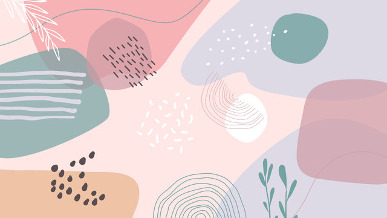
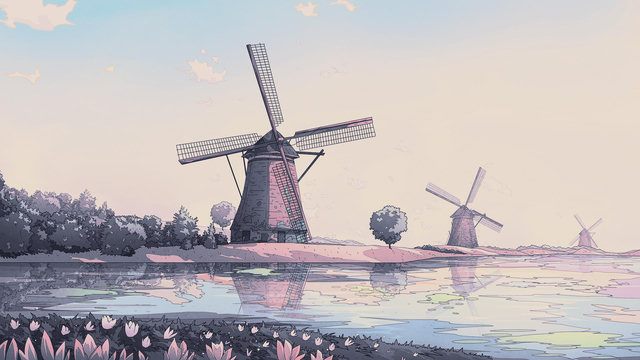
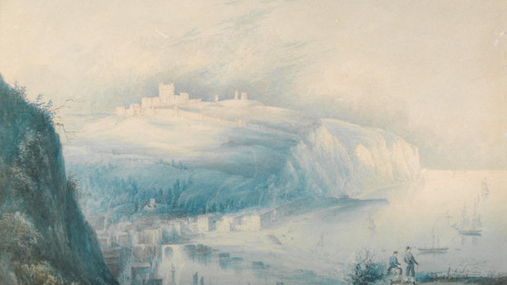
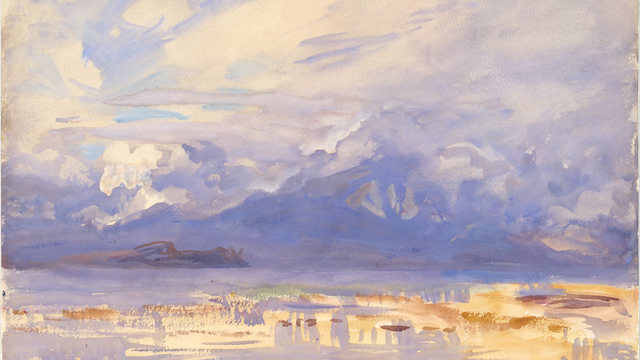
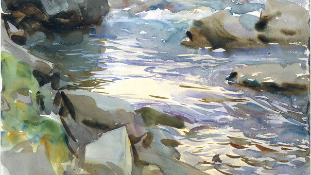

<!-- Generated by `gallery render` from wallpapers.tsv. Do not edit. -->

# Rose Pine

<a href="https://justcarlson.github.io/omarchy-wallpapers/#rose-pine"></a>

14 wallpapers picked for Rose Pine by how closely Aether's palette for each image matches the theme's colours.

Install just this set:

```sh
curl -fsSL https://raw.githubusercontent.com/justcarlson/omarchy-wallpapers/main/install.sh | bash -s -- rose-pine
```

Then press <kbd>Super</kbd> <kbd>Ctrl</kbd> <kbd>Space</kbd> to pick one. To build a whole new theme from a wallpaper instead, import its Aether blueprint:

```sh
aether --import-blueprint https://raw.githubusercontent.com/justcarlson/omarchy-wallpapers/main/blueprints/rose-pine/<name>.json --auto-apply
```

<table>
<tr>
<td width="50%" valign="top"><a href="https://raw.githubusercontent.com/rose-pine/wallpapers/ee39a37b24ab7700cc4d52f50b01a5d13df6a865/illustration/leafy-dawn.png"></a><br><b>Leafy Dawn</b><br><sub><a href="https://github.com/rose-pine/wallpapers/blob/ee39a37b24ab7700cc4d52f50b01a5d13df6a865/illustration/leafy-dawn.png">rose-pine/wallpapers</a> · <a href="../blueprints/rose-pine/rose-pine-leafy-dawn.json">Aether blueprint</a></sub></td>
<td width="50%" valign="top"><a href="https://raw.githubusercontent.com/dharmx/walls/6bf4d733ebf2b484a37c17d742eb47e5139e6a14/abstract/a_colorful_background_with_different_shapes_and_patterns.png"></a><br><b>A Colorful Background with Different Shapes and Patterns</b><br><sub><a href="https://github.com/dharmx/walls/blob/6bf4d733ebf2b484a37c17d742eb47e5139e6a14/abstract/a_colorful_background_with_different_shapes_and_patterns.png">dharmx/walls</a> · <a href="../blueprints/rose-pine/dharmx-a-colorful-background-with-different-shapes-and-patterns.json">Aether blueprint</a></sub></td>
</tr>
<tr>
<td width="50%" valign="top"><a href="https://raw.githubusercontent.com/dharmx/walls/6bf4d733ebf2b484a37c17d742eb47e5139e6a14/architecture/a_lighthouse_in_front_of_a_building.jpg"></a><br><b>A Lighthouse in Front of a Building</b><br><sub><a href="https://github.com/dharmx/walls/blob/6bf4d733ebf2b484a37c17d742eb47e5139e6a14/architecture/a_lighthouse_in_front_of_a_building.jpg">dharmx/walls</a> · <a href="../blueprints/rose-pine/dharmx-a-lighthouse-in-front-of-a-building.json">Aether blueprint</a></sub></td>
<td width="50%" valign="top"><a href="https://raw.githubusercontent.com/dharmx/walls/6bf4d733ebf2b484a37c17d742eb47e5139e6a14/nature/a_close_up_of_pink_flowers.jpg"></a><br><b>A Close Up of Pink Flowers</b><br><sub><a href="https://github.com/dharmx/walls/blob/6bf4d733ebf2b484a37c17d742eb47e5139e6a14/nature/a_close_up_of_pink_flowers.jpg">dharmx/walls</a> · <a href="../blueprints/rose-pine/dharmx-a-close-up-of-pink-flowers.json">Aether blueprint</a></sub></td>
</tr>
<tr>
<td width="50%" valign="top"><a href="https://raw.githubusercontent.com/dharmx/walls/6bf4d733ebf2b484a37c17d742eb47e5139e6a14/flowers/a_close_up_of_a_flower_09.jpg"></a><br><b>A Close Up of a Flower 09</b><br><sub><a href="https://github.com/dharmx/walls/blob/6bf4d733ebf2b484a37c17d742eb47e5139e6a14/flowers/a_close_up_of_a_flower_09.jpg">dharmx/walls</a> · <a href="../blueprints/rose-pine/dharmx-a-close-up-of-a-flower-09.json">Aether blueprint</a></sub></td>
<td width="50%" valign="top"><a href="https://raw.githubusercontent.com/orangci/walls-catppuccin-mocha/7bfdf10d16ad3a689f9f0cf3a0930da3d1a245a8/voyager-12.jpg"></a><br><b>Voyager 12</b><br><sub><a href="https://github.com/orangci/walls-catppuccin-mocha/blob/7bfdf10d16ad3a689f9f0cf3a0930da3d1a245a8/voyager-12.jpg">orangci/walls-catppuccin-mocha</a> · <a href="../blueprints/rose-pine/orangci-voyager-12.json">Aether blueprint</a></sub></td>
</tr>
<tr>
<td width="50%" valign="top"><a href="https://raw.githubusercontent.com/orangci/walls-catppuccin-mocha/7bfdf10d16ad3a689f9f0cf3a0930da3d1a245a8/flower-field.jpg"></a><br><b>Flower Field</b><br><sub><a href="https://github.com/orangci/walls-catppuccin-mocha/blob/7bfdf10d16ad3a689f9f0cf3a0930da3d1a245a8/flower-field.jpg">orangci/walls-catppuccin-mocha</a> · <a href="../blueprints/rose-pine/orangci-flower-field.json">Aether blueprint</a></sub></td>
<td width="50%" valign="top"><a href="https://raw.githubusercontent.com/orangci/walls-catppuccin-mocha/7bfdf10d16ad3a689f9f0cf3a0930da3d1a245a8/sakura-trees-over-river.jpg"></a><br><b>Sakura Trees Over River</b><br><sub><a href="https://github.com/orangci/walls-catppuccin-mocha/blob/7bfdf10d16ad3a689f9f0cf3a0930da3d1a245a8/sakura-trees-over-river.jpg">orangci/walls-catppuccin-mocha</a> · <a href="../blueprints/rose-pine/orangci-sakura-trees-over-river.json">Aether blueprint</a></sub></td>
</tr>
<tr>
<td width="50%" valign="top"><a href="https://raw.githubusercontent.com/krishna4a6av/Wallpapers/aa01193c864a1c175d3c44d1c0f4c4f62f3c61de/Day/blossom.jpg"></a><br><b>Blossom</b><br><sub><a href="https://github.com/krishna4a6av/Wallpapers/blob/aa01193c864a1c175d3c44d1c0f4c4f62f3c61de/Day/blossom.jpg">krishna4a6av/Wallpapers</a> · <a href="../blueprints/rose-pine/krishna4a6av-blossom.json">Aether blueprint</a></sub></td>
<td width="50%" valign="top"><a href="https://raw.githubusercontent.com/krishna4a6av/Wallpapers/aa01193c864a1c175d3c44d1c0f4c4f62f3c61de/Rosepine/flower.jpg"></a><br><b>Flower</b><br><sub><a href="https://github.com/krishna4a6av/Wallpapers/blob/aa01193c864a1c175d3c44d1c0f4c4f62f3c61de/Rosepine/flower.jpg">krishna4a6av/Wallpapers</a> · <a href="../blueprints/rose-pine/krishna4a6av-flower.json">Aether blueprint</a></sub></td>
</tr>
<tr>
<td width="50%" valign="top"><a href="https://upload.wikimedia.org/wikipedia/commons/thumb/6/6a/John_Martin_-_Dover_-_B1986.29.444_-_Yale_Center_for_British_Art.jpg/1920px-John_Martin_-_Dover_-_B1986.29.444_-_Yale_Center_for_British_Art.jpg"></a><br><b>Dover</b><br><sub><a href="https://commons.wikimedia.org/wiki/File:John_Martin_-_Dover_-_B1986.29.444_-_Yale_Center_for_British_Art.jpg">John Martin, Wikimedia Commons</a> · <a href="../blueprints/rose-pine/john-martin-dover.json">Aether blueprint</a></sub></td>
<td width="50%" valign="top"><a href="https://raw.githubusercontent.com/justcarlson/omarchy-wallpapers/main/images/sargent-sunset-at-sea.jpg"></a><br><b>Sunset at Sea</b><br><sub><a href="https://commons.wikimedia.org/wiki/File:Sunset_at_Sea_MET_DT235919.jpg">John Singer Sargent, Wikimedia Commons</a> · <a href="../blueprints/rose-pine/sargent-sunset-at-sea.json">Aether blueprint</a></sub></td>
</tr>
<tr>
<td width="50%" valign="top"><a href="https://raw.githubusercontent.com/justcarlson/omarchy-wallpapers/main/images/sargent-sirmione.jpg"></a><br><b>Sirmione</b><br><sub><a href="https://commons.wikimedia.org/wiki/File:Sirmione_MET_DT243228.jpg">John Singer Sargent, Wikimedia Commons</a> · <a href="../blueprints/rose-pine/sargent-sirmione.json">Aether blueprint</a></sub></td>
<td width="50%" valign="top"><a href="https://raw.githubusercontent.com/justcarlson/omarchy-wallpapers/main/images/sargent-stream-and-rocks.jpg"></a><br><b>Stream and Rocks</b><br><sub><a href="https://commons.wikimedia.org/wiki/File:Stream_and_Rocks_MET_DT235918.jpg">John Singer Sargent, Wikimedia Commons</a> · <a href="../blueprints/rose-pine/sargent-stream-and-rocks.json">Aether blueprint</a></sub></td>
</tr>
</table>

[All themes](../README.md#the-collection)
