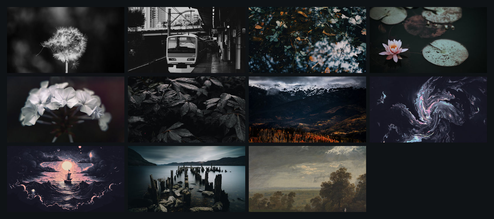
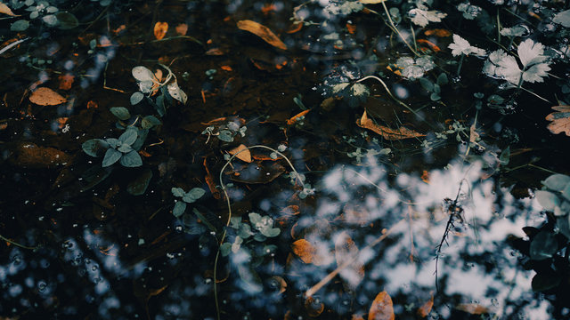
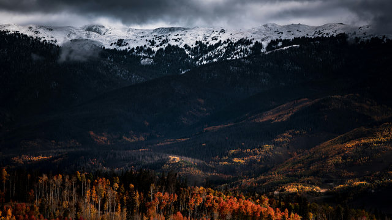

<!-- Generated by `gallery render` from wallpapers.tsv. Do not edit. -->

# Solitude

<a href="https://justcarlson.github.io/omarchy-wallpapers/#solitude"></a>

11 wallpapers picked for Solitude by how closely Aether's palette for each image matches the theme's colours.

Install just this set:

```sh
curl -fsSL https://raw.githubusercontent.com/justcarlson/omarchy-wallpapers/main/install.sh | bash -s -- solitude
```

Then press <kbd>Super</kbd> <kbd>Ctrl</kbd> <kbd>Space</kbd> to pick one. To build a whole new theme from a wallpaper instead, import its Aether blueprint:

```sh
aether --import-blueprint https://raw.githubusercontent.com/justcarlson/omarchy-wallpapers/main/blueprints/solitude/<name>.json --auto-apply
```

<table>
<tr>
<td width="50%" valign="top"><a href="https://raw.githubusercontent.com/dharmx/walls/6bf4d733ebf2b484a37c17d742eb47e5139e6a14/flowers/a_close_up_of_a_dandelion.jpg"></a><br><b>A Close Up of a Dandelion</b><br><sub><a href="https://github.com/dharmx/walls/blob/6bf4d733ebf2b484a37c17d742eb47e5139e6a14/flowers/a_close_up_of_a_dandelion.jpg">dharmx/walls</a> · <a href="../blueprints/solitude/dharmx-a-close-up-of-a-dandelion.json">Aether blueprint</a></sub></td>
<td width="50%" valign="top"><a href="https://raw.githubusercontent.com/krishna4a6av/Wallpapers/aa01193c864a1c175d3c44d1c0f4c4f62f3c61de/Graphite/Dark/trainjp.jpg"></a><br><b>Trainjp</b><br><sub><a href="https://github.com/krishna4a6av/Wallpapers/blob/aa01193c864a1c175d3c44d1c0f4c4f62f3c61de/Graphite/Dark/trainjp.jpg">krishna4a6av/Wallpapers</a> · <a href="../blueprints/solitude/krishna4a6av-trainjp.json">Aether blueprint</a></sub></td>
</tr>
<tr>
<td width="50%" valign="top"><a href="https://raw.githubusercontent.com/dharmx/walls/6bf4d733ebf2b484a37c17d742eb47e5139e6a14/nature/plants_leaves_in_the_water.jpg"></a><br><b>Plants Leaves in the Water</b><br><sub><a href="https://github.com/dharmx/walls/blob/6bf4d733ebf2b484a37c17d742eb47e5139e6a14/nature/plants_leaves_in_the_water.jpg">dharmx/walls</a> · <a href="../blueprints/solitude/dharmx-plants-leaves-in-the-water.json">Aether blueprint</a></sub></td>
<td width="50%" valign="top"><a href="https://raw.githubusercontent.com/dharmx/walls/6bf4d733ebf2b484a37c17d742eb47e5139e6a14/flowers/a_pink_flower_on_a_pond.jpg"></a><br><b>A Pink Flower on a Pond</b><br><sub><a href="https://github.com/dharmx/walls/blob/6bf4d733ebf2b484a37c17d742eb47e5139e6a14/flowers/a_pink_flower_on_a_pond.jpg">dharmx/walls</a> · <a href="../blueprints/solitude/dharmx-a-pink-flower-on-a-pond.json">Aether blueprint</a></sub></td>
</tr>
<tr>
<td width="50%" valign="top"><a href="https://raw.githubusercontent.com/dharmx/walls/6bf4d733ebf2b484a37c17d742eb47e5139e6a14/flowers/a_close_up_of_a_flower_08.jpg"></a><br><b>A Close Up of a Flower 08</b><br><sub><a href="https://github.com/dharmx/walls/blob/6bf4d733ebf2b484a37c17d742eb47e5139e6a14/flowers/a_close_up_of_a_flower_08.jpg">dharmx/walls</a> · <a href="../blueprints/solitude/dharmx-a-close-up-of-a-flower-08.json">Aether blueprint</a></sub></td>
<td width="50%" valign="top"><a href="https://raw.githubusercontent.com/krishna4a6av/Wallpapers/aa01193c864a1c175d3c44d1c0f4c4f62f3c61de/Everforest/leaverain.jpg"></a><br><b>Leaverain</b><br><sub><a href="https://github.com/krishna4a6av/Wallpapers/blob/aa01193c864a1c175d3c44d1c0f4c4f62f3c61de/Everforest/leaverain.jpg">krishna4a6av/Wallpapers</a> · <a href="../blueprints/solitude/krishna4a6av-leaverain.json">Aether blueprint</a></sub></td>
</tr>
<tr>
<td width="50%" valign="top"><a href="https://raw.githubusercontent.com/AngelJumbo/gruvbox-wallpapers/6aa74cbd65973e1a2a8695e83a58ce3ea634dd5e/wallpapers/photography/nathan-anderson-SAB5Y1HS7NY.jpg"></a><br><b>Nathan Anderson Sab5y1hs7ny</b><br><sub><a href="https://github.com/AngelJumbo/gruvbox-wallpapers/blob/6aa74cbd65973e1a2a8695e83a58ce3ea634dd5e/wallpapers/photography/nathan-anderson-SAB5Y1HS7NY.jpg">AngelJumbo/gruvbox-wallpapers</a> · <a href="../blueprints/solitude/angeljumbo-nathan-anderson-sab5y1hs7ny.json">Aether blueprint</a></sub></td>
<td width="50%" valign="top"><a href="https://raw.githubusercontent.com/orangci/walls-catppuccin-mocha/7bfdf10d16ad3a689f9f0cf3a0930da3d1a245a8/abstract-swirls.jpg"></a><br><b>Abstract Swirls</b><br><sub><a href="https://github.com/orangci/walls-catppuccin-mocha/blob/7bfdf10d16ad3a689f9f0cf3a0930da3d1a245a8/abstract-swirls.jpg">orangci/walls-catppuccin-mocha</a> · <a href="../blueprints/solitude/orangci-abstract-swirls.json">Aether blueprint</a></sub></td>
</tr>
<tr>
<td width="50%" valign="top"><a href="https://raw.githubusercontent.com/orangci/walls-catppuccin-mocha/7bfdf10d16ad3a689f9f0cf3a0930da3d1a245a8/yohoho.jpg"></a><br><b>Yohoho</b><br><sub><a href="https://github.com/orangci/walls-catppuccin-mocha/blob/7bfdf10d16ad3a689f9f0cf3a0930da3d1a245a8/yohoho.jpg">orangci/walls-catppuccin-mocha</a> · <a href="../blueprints/solitude/orangci-yohoho.json">Aether blueprint</a></sub></td>
<td width="50%" valign="top"><a href="https://raw.githubusercontent.com/dharmx/walls/6bf4d733ebf2b484a37c17d742eb47e5139e6a14/calm/a_group_of_wooden_posts_in_water.jpg"></a><br><b>A Group of Wooden Posts in Water</b><br><sub><a href="https://github.com/dharmx/walls/blob/6bf4d733ebf2b484a37c17d742eb47e5139e6a14/calm/a_group_of_wooden_posts_in_water.jpg">dharmx/walls</a> · <a href="../blueprints/solitude/dharmx-a-group-of-wooden-posts-in-water.json">Aether blueprint</a></sub></td>
</tr>
<tr>
<td width="50%" valign="top"><a href="https://upload.wikimedia.org/wikipedia/commons/thumb/3/31/John_Martin_-_Landscape%2C_Possibly_the_Isle_of_Wight_or_Richmond_Hill_-_Google_Art_Project.jpg/3840px-John_Martin_-_Landscape%2C_Possibly_the_Isle_of_Wight_or_Richmond_Hill_-_Google_Art_Project.jpg"></a><br><b>Isle of Wight</b><br><sub><a href="https://commons.wikimedia.org/wiki/File:John_Martin_-_Landscape%2C_Possibly_the_Isle_of_Wight_or_Richmond_Hill_-_Google_Art_Project.jpg">John Martin, Wikimedia Commons</a> · <a href="../blueprints/solitude/john-martin-isle-of-wight.json">Aether blueprint</a></sub></td>
</tr>
</table>

[All themes](../README.md#the-collection)
