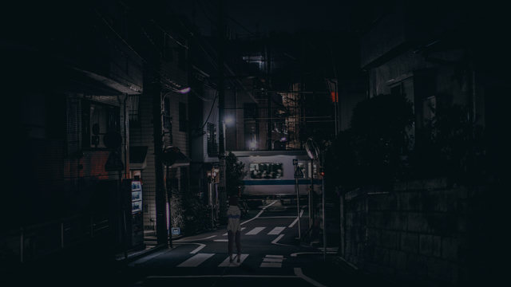
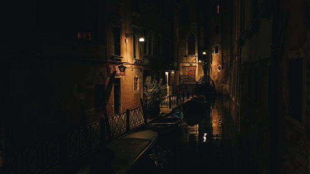

<!-- Generated by `gallery render` from wallpapers.tsv. Do not edit. -->

# Starship

<a href="https://justcarlson.github.io/omarchy-wallpapers/#starship"></a>

12 wallpapers picked for Starship by how closely Aether's palette for each image matches the theme's colours.

Install just this set:

```sh
curl -fsSL https://raw.githubusercontent.com/justcarlson/omarchy-wallpapers/main/install.sh | bash -s -- starship
```

Then press <kbd>Super</kbd> <kbd>Ctrl</kbd> <kbd>Space</kbd> to pick one. To build a whole new theme from a wallpaper instead, import its Aether blueprint:

```sh
aether --import-blueprint https://raw.githubusercontent.com/justcarlson/omarchy-wallpapers/main/blueprints/starship/<name>.json --auto-apply
```

<table>
<tr>
<td width="50%" valign="top"><a href="https://raw.githubusercontent.com/dharmx/walls/6bf4d733ebf2b484a37c17d742eb47e5139e6a14/lightbulb/a_light_bulb_with_a_filament.jpg"></a><br><b>A Light Bulb with a Filament</b><br><sub><a href="https://github.com/dharmx/walls/blob/6bf4d733ebf2b484a37c17d742eb47e5139e6a14/lightbulb/a_light_bulb_with_a_filament.jpg">dharmx/walls</a> · <a href="../blueprints/starship/dharmx-a-light-bulb-with-a-filament.json">Aether blueprint</a></sub></td>
<td width="50%" valign="top"><a href="https://raw.githubusercontent.com/dharmx/walls/6bf4d733ebf2b484a37c17d742eb47e5139e6a14/architecture/a_city_skyline_at_night.jpg"></a><br><b>A City Skyline at Night</b><br><sub><a href="https://github.com/dharmx/walls/blob/6bf4d733ebf2b484a37c17d742eb47e5139e6a14/architecture/a_city_skyline_at_night.jpg">dharmx/walls</a> · <a href="../blueprints/starship/dharmx-a-city-skyline-at-night.json">Aether blueprint</a></sub></td>
</tr>
<tr>
<td width="50%" valign="top"><a href="https://raw.githubusercontent.com/dharmx/walls/6bf4d733ebf2b484a37c17d742eb47e5139e6a14/chillop/a_person_standing_on_a_street_at_night.png"></a><br><b>A Person Standing on a Street at Night</b><br><sub><a href="https://github.com/dharmx/walls/blob/6bf4d733ebf2b484a37c17d742eb47e5139e6a14/chillop/a_person_standing_on_a_street_at_night.png">dharmx/walls</a> · <a href="../blueprints/starship/dharmx-a-person-standing-on-a-street-at-night.json">Aether blueprint</a></sub></td>
<td width="50%" valign="top"><a href="https://raw.githubusercontent.com/dharmx/walls/6bf4d733ebf2b484a37c17d742eb47e5139e6a14/architecture/a_bridge_with_lights_on_it.jpg"></a><br><b>A Bridge with Lights on It</b><br><sub><a href="https://github.com/dharmx/walls/blob/6bf4d733ebf2b484a37c17d742eb47e5139e6a14/architecture/a_bridge_with_lights_on_it.jpg">dharmx/walls</a> · <a href="../blueprints/starship/dharmx-a-bridge-with-lights-on-it.json">Aether blueprint</a></sub></td>
</tr>
<tr>
<td width="50%" valign="top"><a href="https://raw.githubusercontent.com/dharmx/walls/6bf4d733ebf2b484a37c17d742eb47e5139e6a14/unsorted/a_narrow_canal_with_boats_and_buildings_at_night.jpg"></a><br><b>A Narrow Canal with Boats and Buildings at Night</b><br><sub><a href="https://github.com/dharmx/walls/blob/6bf4d733ebf2b484a37c17d742eb47e5139e6a14/unsorted/a_narrow_canal_with_boats_and_buildings_at_night.jpg">dharmx/walls</a> · <a href="../blueprints/starship/dharmx-a-narrow-canal-with-boats-and-buildings-at-night.json">Aether blueprint</a></sub></td>
<td width="50%" valign="top"><a href="https://raw.githubusercontent.com/dharmx/walls/6bf4d733ebf2b484a37c17d742eb47e5139e6a14/flowers/a_group_of_pink_flowers_on_a_bush.jpg"></a><br><b>A Group of Pink Flowers on a Bush</b><br><sub><a href="https://github.com/dharmx/walls/blob/6bf4d733ebf2b484a37c17d742eb47e5139e6a14/flowers/a_group_of_pink_flowers_on_a_bush.jpg">dharmx/walls</a> · <a href="../blueprints/starship/dharmx-a-group-of-pink-flowers-on-a-bush.json">Aether blueprint</a></sub></td>
</tr>
<tr>
<td width="50%" valign="top"><a href="https://raw.githubusercontent.com/dharmx/walls/6bf4d733ebf2b484a37c17d742eb47e5139e6a14/flowers/a_group_of_purple_flowers.jpg"></a><br><b>A Group of Purple Flowers</b><br><sub><a href="https://github.com/dharmx/walls/blob/6bf4d733ebf2b484a37c17d742eb47e5139e6a14/flowers/a_group_of_purple_flowers.jpg">dharmx/walls</a> · <a href="../blueprints/starship/dharmx-a-group-of-purple-flowers.json">Aether blueprint</a></sub></td>
<td width="50%" valign="top"><a href="https://raw.githubusercontent.com/dharmx/walls/6bf4d733ebf2b484a37c17d742eb47e5139e6a14/flowers/a_group_of_pink_flowers_on_a_tree.jpg"></a><br><b>A Group of Pink Flowers on a Tree</b><br><sub><a href="https://github.com/dharmx/walls/blob/6bf4d733ebf2b484a37c17d742eb47e5139e6a14/flowers/a_group_of_pink_flowers_on_a_tree.jpg">dharmx/walls</a> · <a href="../blueprints/starship/dharmx-a-group-of-pink-flowers-on-a-tree.json">Aether blueprint</a></sub></td>
</tr>
<tr>
<td width="50%" valign="top"><a href="https://raw.githubusercontent.com/AngelJumbo/gruvbox-wallpapers/6aa74cbd65973e1a2a8695e83a58ce3ea634dd5e/wallpapers/photography/qJYK2SS.jpeg"></a><br><b>Qjyk2ss</b><br><sub><a href="https://github.com/AngelJumbo/gruvbox-wallpapers/blob/6aa74cbd65973e1a2a8695e83a58ce3ea634dd5e/wallpapers/photography/qJYK2SS.jpeg">AngelJumbo/gruvbox-wallpapers</a> · <a href="../blueprints/starship/angeljumbo-qjyk2ss.json">Aether blueprint</a></sub></td>
<td width="50%" valign="top"><a href="https://raw.githubusercontent.com/orangci/walls-catppuccin-mocha/7bfdf10d16ad3a689f9f0cf3a0930da3d1a245a8/yohoho.jpg"></a><br><b>Yohoho</b><br><sub><a href="https://github.com/orangci/walls-catppuccin-mocha/blob/7bfdf10d16ad3a689f9f0cf3a0930da3d1a245a8/yohoho.jpg">orangci/walls-catppuccin-mocha</a> · <a href="../blueprints/starship/orangci-yohoho.json">Aether blueprint</a></sub></td>
</tr>
<tr>
<td width="50%" valign="top"><a href="https://upload.wikimedia.org/wikipedia/commons/thumb/2/27/Arcadian_Landscape.jpg/1920px-Arcadian_Landscape.jpg"></a><br><b>Arcadian Landscape</b><br><sub><a href="https://commons.wikimedia.org/wiki/File:Arcadian_Landscape.jpg">John Martin, Wikimedia Commons</a> · <a href="../blueprints/starship/john-martin-arcadian-landscape.json">Aether blueprint</a></sub></td>
<td width="50%" valign="top"><a href="https://raw.githubusercontent.com/justcarlson/omarchy-wallpapers/main/images/sargent-at-chioggia.jpg"></a><br><b>At Chioggia</b><br><sub><a href="https://commons.wikimedia.org/wiki/File:John_S._Sargent_-_At_Chioggia_%28c._1903%29_-_Mint_Museum.jpg">John Singer Sargent, Wikimedia Commons</a> · <a href="../blueprints/starship/sargent-at-chioggia.json">Aether blueprint</a></sub></td>
</tr>
</table>

[All themes](../README.md#the-collection)
