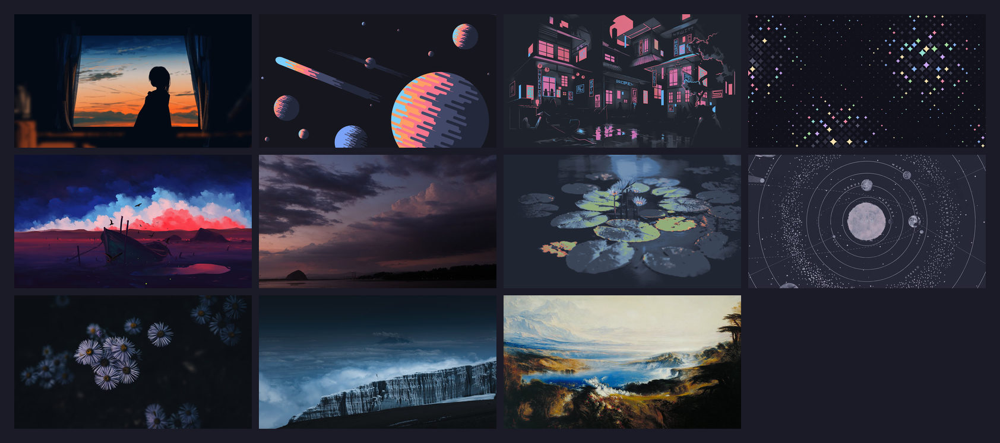
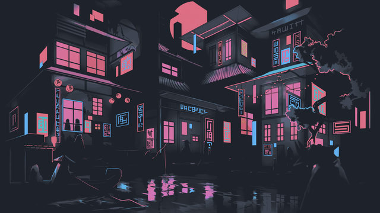
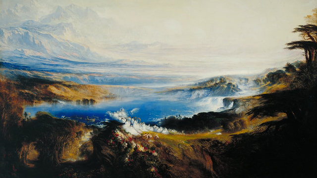

<!-- Generated by `gallery render` from wallpapers.tsv. Do not edit. -->

# Tokyo Night

<a href="https://justcarlson.github.io/omarchy-wallpapers/#tokyo-night"></a>

11 wallpapers picked for Tokyo Night by how closely Aether's palette for each image matches the theme's colours.

Install just this set:

```sh
curl -fsSL https://raw.githubusercontent.com/justcarlson/omarchy-wallpapers/main/install.sh | bash -s -- tokyo-night
```

Then press <kbd>Super</kbd> <kbd>Ctrl</kbd> <kbd>Space</kbd> to pick one. To build a whole new theme from a wallpaper instead, import its Aether blueprint:

```sh
aether --import-blueprint https://raw.githubusercontent.com/justcarlson/omarchy-wallpapers/main/blueprints/tokyo-night/<name>.json --auto-apply
```

<table>
<tr>
<td width="50%" valign="top"><a href="https://raw.githubusercontent.com/krishna4a6av/Wallpapers/aa01193c864a1c175d3c44d1c0f4c4f62f3c61de/.homeless/cls-window.jpg"></a><br><b>Cls Window</b><br><sub><a href="https://github.com/krishna4a6av/Wallpapers/blob/aa01193c864a1c175d3c44d1c0f4c4f62f3c61de/.homeless/cls-window.jpg">krishna4a6av/Wallpapers</a> · <a href="../blueprints/tokyo-night/krishna4a6av-cls-window.json">Aether blueprint</a></sub></td>
<td width="50%" valign="top"><a href="https://raw.githubusercontent.com/D3Ext/aesthetic-wallpapers/e34f05935c5b768f4c016b0893924d18ec1dba61/images/colorful-planets.jpg"></a><br><b>Colorful Planets</b><br><sub><a href="https://github.com/D3Ext/aesthetic-wallpapers/blob/e34f05935c5b768f4c016b0893924d18ec1dba61/images/colorful-planets.jpg">D3Ext/aesthetic-wallpapers</a> · <a href="../blueprints/tokyo-night/d3ext-colorful-planets.json">Aether blueprint</a></sub></td>
</tr>
<tr>
<td width="50%" valign="top"><a href="https://raw.githubusercontent.com/dharmx/walls/6bf4d733ebf2b484a37c17d742eb47e5139e6a14/outrun/a_street_with_buildings_and_signs.png"></a><br><b>A Street with Buildings and Signs</b><br><sub><a href="https://github.com/dharmx/walls/blob/6bf4d733ebf2b484a37c17d742eb47e5139e6a14/outrun/a_street_with_buildings_and_signs.png">dharmx/walls</a> · <a href="../blueprints/tokyo-night/dharmx-a-street-with-buildings-and-signs.json">Aether blueprint</a></sub></td>
<td width="50%" valign="top"><a href="https://raw.githubusercontent.com/D3Ext/aesthetic-wallpapers/e34f05935c5b768f4c016b0893924d18ec1dba61/images/shiny-colors.png"></a><br><b>Shiny Colors</b><br><sub><a href="https://github.com/D3Ext/aesthetic-wallpapers/blob/e34f05935c5b768f4c016b0893924d18ec1dba61/images/shiny-colors.png">D3Ext/aesthetic-wallpapers</a> · <a href="../blueprints/tokyo-night/d3ext-shiny-colors.json">Aether blueprint</a></sub></td>
</tr>
<tr>
<td width="50%" valign="top"><a href="https://raw.githubusercontent.com/krishna4a6av/Wallpapers/aa01193c864a1c175d3c44d1c0f4c4f62f3c61de/Catppuccin/boat-abondoned.jpg"></a><br><b>Boat Abondoned</b><br><sub><a href="https://github.com/krishna4a6av/Wallpapers/blob/aa01193c864a1c175d3c44d1c0f4c4f62f3c61de/Catppuccin/boat-abondoned.jpg">krishna4a6av/Wallpapers</a> · <a href="../blueprints/tokyo-night/krishna4a6av-boat-abondoned.json">Aether blueprint</a></sub></td>
<td width="50%" valign="top"><a href="https://raw.githubusercontent.com/rose-pine/wallpapers/ee39a37b24ab7700cc4d52f50b01a5d13df6a865/photography/kainoa-kanter/bay.jpg"></a><br><b>Bay</b><br><sub><a href="https://github.com/rose-pine/wallpapers/blob/ee39a37b24ab7700cc4d52f50b01a5d13df6a865/photography/kainoa-kanter/bay.jpg">rose-pine/wallpapers</a> · <a href="../blueprints/tokyo-night/rose-pine-bay.json">Aether blueprint</a></sub></td>
</tr>
<tr>
<td width="50%" valign="top"><a href="https://raw.githubusercontent.com/dharmx/walls/6bf4d733ebf2b484a37c17d742eb47e5139e6a14/nord/lily_pads_in_a_pond.jpg"></a><br><b>Lily Pads in a Pond</b><br><sub><a href="https://github.com/dharmx/walls/blob/6bf4d733ebf2b484a37c17d742eb47e5139e6a14/nord/lily_pads_in_a_pond.jpg">dharmx/walls</a> · <a href="../blueprints/tokyo-night/dharmx-lily-pads-in-a-pond.json">Aether blueprint</a></sub></td>
<td width="50%" valign="top"><a href="https://raw.githubusercontent.com/krishna4a6av/Wallpapers/aa01193c864a1c175d3c44d1c0f4c4f62f3c61de/Catppuccin/solar-system.jpg"></a><br><b>Solar System</b><br><sub><a href="https://github.com/krishna4a6av/Wallpapers/blob/aa01193c864a1c175d3c44d1c0f4c4f62f3c61de/Catppuccin/solar-system.jpg">krishna4a6av/Wallpapers</a> · <a href="../blueprints/tokyo-night/krishna4a6av-solar-system.json">Aether blueprint</a></sub></td>
</tr>
<tr>
<td width="50%" valign="top"><a href="https://raw.githubusercontent.com/dharmx/walls/6bf4d733ebf2b484a37c17d742eb47e5139e6a14/flowers/a_group_of_purple_flowers.jpg"></a><br><b>A Group of Purple Flowers</b><br><sub><a href="https://github.com/dharmx/walls/blob/6bf4d733ebf2b484a37c17d742eb47e5139e6a14/flowers/a_group_of_purple_flowers.jpg">dharmx/walls</a> · <a href="../blueprints/tokyo-night/dharmx-a-group-of-purple-flowers.json">Aether blueprint</a></sub></td>
<td width="50%" valign="top"><a href="https://raw.githubusercontent.com/dharmx/walls/6bf4d733ebf2b484a37c17d742eb47e5139e6a14/mountain/a_person_on_a_cliff.jpg"></a><br><b>A Person on a Cliff</b><br><sub><a href="https://github.com/dharmx/walls/blob/6bf4d733ebf2b484a37c17d742eb47e5139e6a14/mountain/a_person_on_a_cliff.jpg">dharmx/walls</a> · <a href="../blueprints/tokyo-night/dharmx-a-person-on-a-cliff.json">Aether blueprint</a></sub></td>
</tr>
<tr>
<td width="50%" valign="top"><a href="https://upload.wikimedia.org/wikipedia/commons/thumb/7/79/John_Martin_-_The_Plains_of_Heaven_-_Google_Art_Project.jpg/1920px-John_Martin_-_The_Plains_of_Heaven_-_Google_Art_Project.jpg"></a><br><b>Plains of Heaven</b><br><sub><a href="https://commons.wikimedia.org/wiki/File:John_Martin_-_The_Plains_of_Heaven_-_Google_Art_Project.jpg">John Martin, Wikimedia Commons</a> · <a href="../blueprints/tokyo-night/john-martin-plains-of-heaven.json">Aether blueprint</a></sub></td>
</tr>
</table>

[All themes](../README.md#the-collection)
