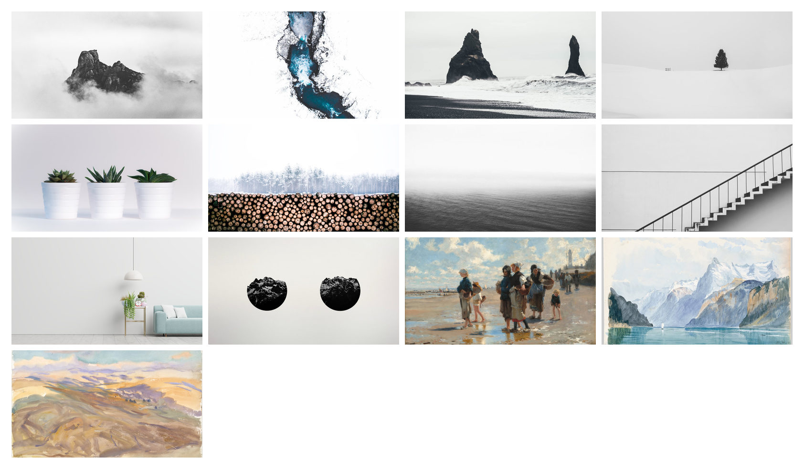
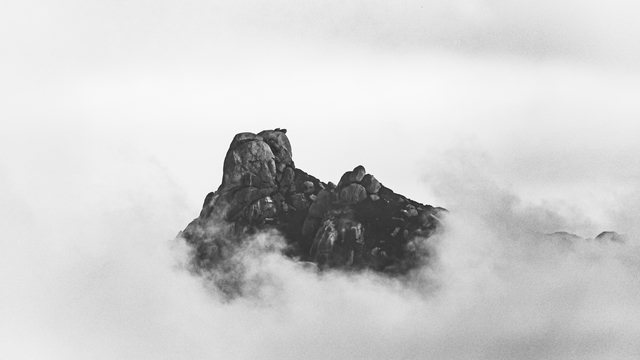
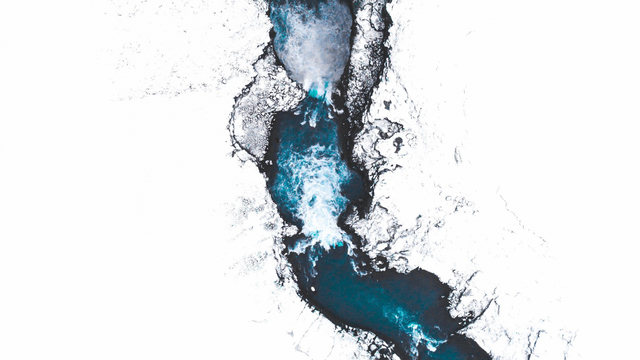
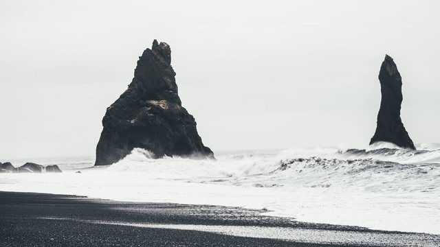
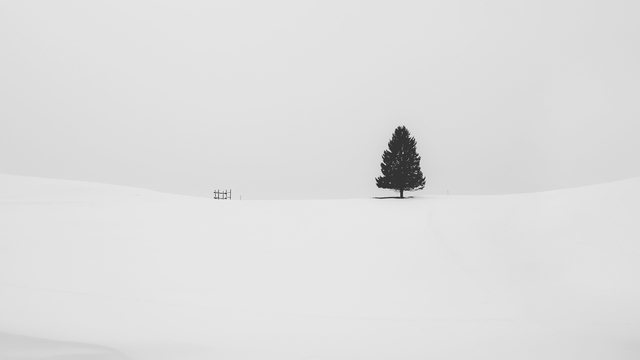
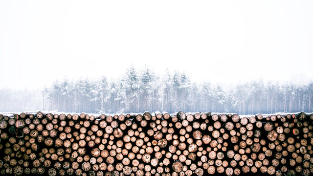
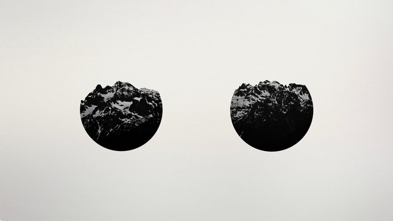
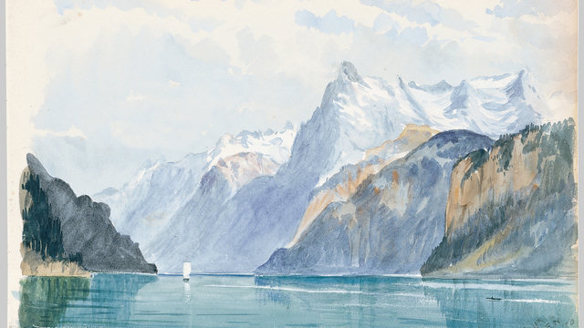
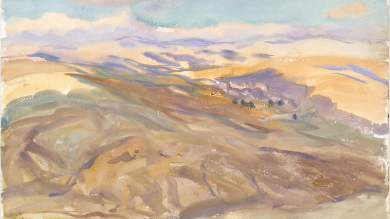

<!-- Generated by `gallery render` from wallpapers.tsv. Do not edit. -->

# White

<a href="https://justcarlson.github.io/omarchy-wallpapers/#white"></a>

13 wallpapers picked for White by how closely Aether's palette for each image matches the theme's colours.

Install just this set:

```sh
curl -fsSL https://raw.githubusercontent.com/justcarlson/omarchy-wallpapers/main/install.sh | bash -s -- white
```

Then press <kbd>Super</kbd> <kbd>Ctrl</kbd> <kbd>Space</kbd> to pick one. To build a whole new theme from a wallpaper instead, import its Aether blueprint:

```sh
aether --import-blueprint https://raw.githubusercontent.com/justcarlson/omarchy-wallpapers/main/blueprints/white/<name>.json --auto-apply
```

<table>
<tr>
<td width="50%" valign="top"><a href="https://raw.githubusercontent.com/dharmx/walls/6bf4d733ebf2b484a37c17d742eb47e5139e6a14/monochrome/a_mountain_with_clouds_in_the_sky.jpg"></a><br><b>A Mountain with Clouds in the Sky</b><br><sub><a href="https://github.com/dharmx/walls/blob/6bf4d733ebf2b484a37c17d742eb47e5139e6a14/monochrome/a_mountain_with_clouds_in_the_sky.jpg">dharmx/walls</a> · <a href="../blueprints/white/dharmx-a-mountain-with-clouds-in-the-sky.json">Aether blueprint</a></sub></td>
<td width="50%" valign="top"><a href="https://raw.githubusercontent.com/dharmx/walls/6bf4d733ebf2b484a37c17d742eb47e5139e6a14/aerial/a_blue_and_white_water.jpg"></a><br><b>A Blue and White Water</b><br><sub><a href="https://github.com/dharmx/walls/blob/6bf4d733ebf2b484a37c17d742eb47e5139e6a14/aerial/a_blue_and_white_water.jpg">dharmx/walls</a> · <a href="../blueprints/white/dharmx-a-blue-and-white-water.json">Aether blueprint</a></sub></td>
</tr>
<tr>
<td width="50%" valign="top"><a href="https://raw.githubusercontent.com/dharmx/walls/6bf4d733ebf2b484a37c17d742eb47e5139e6a14/monochrome/a_large_rock_in_the_ocean.jpg"></a><br><b>A Large Rock in the Ocean</b><br><sub><a href="https://github.com/dharmx/walls/blob/6bf4d733ebf2b484a37c17d742eb47e5139e6a14/monochrome/a_large_rock_in_the_ocean.jpg">dharmx/walls</a> · <a href="../blueprints/white/dharmx-a-large-rock-in-the-ocean.json">Aether blueprint</a></sub></td>
<td width="50%" valign="top"><a href="https://raw.githubusercontent.com/dharmx/walls/6bf4d733ebf2b484a37c17d742eb47e5139e6a14/abstract/a_tree_in_the_snow.jpg"></a><br><b>A Tree in the Snow</b><br><sub><a href="https://github.com/dharmx/walls/blob/6bf4d733ebf2b484a37c17d742eb47e5139e6a14/abstract/a_tree_in_the_snow.jpg">dharmx/walls</a> · <a href="../blueprints/white/dharmx-a-tree-in-the-snow.json">Aether blueprint</a></sub></td>
</tr>
<tr>
<td width="50%" valign="top"><a href="https://raw.githubusercontent.com/dharmx/walls/6bf4d733ebf2b484a37c17d742eb47e5139e6a14/abstract/a_group_of_potted_plants.jpg"></a><br><b>A Group of Potted Plants</b><br><sub><a href="https://github.com/dharmx/walls/blob/6bf4d733ebf2b484a37c17d742eb47e5139e6a14/abstract/a_group_of_potted_plants.jpg">dharmx/walls</a> · <a href="../blueprints/white/dharmx-a-group-of-potted-plants.json">Aether blueprint</a></sub></td>
<td width="50%" valign="top"><a href="https://raw.githubusercontent.com/dharmx/walls/6bf4d733ebf2b484a37c17d742eb47e5139e6a14/nature/a_pile_of_logs_in_a_snowy_field.jpg"></a><br><b>A Pile of Logs in a Snowy Field</b><br><sub><a href="https://github.com/dharmx/walls/blob/6bf4d733ebf2b484a37c17d742eb47e5139e6a14/nature/a_pile_of_logs_in_a_snowy_field.jpg">dharmx/walls</a> · <a href="../blueprints/white/dharmx-a-pile-of-logs-in-a-snowy-field.json">Aether blueprint</a></sub></td>
</tr>
<tr>
<td width="50%" valign="top"><a href="https://raw.githubusercontent.com/dharmx/walls/6bf4d733ebf2b484a37c17d742eb47e5139e6a14/monochrome/a_body_of_water_with_a_white_sky.jpg"></a><br><b>A Body of Water with a White Sky</b><br><sub><a href="https://github.com/dharmx/walls/blob/6bf4d733ebf2b484a37c17d742eb47e5139e6a14/monochrome/a_body_of_water_with_a_white_sky.jpg">dharmx/walls</a> · <a href="../blueprints/white/dharmx-a-body-of-water-with-a-white-sky.json">Aether blueprint</a></sub></td>
<td width="50%" valign="top"><a href="https://raw.githubusercontent.com/dharmx/walls/6bf4d733ebf2b484a37c17d742eb47e5139e6a14/monochrome/a_white_staircase_with_a_handrail.jpg"></a><br><b>A White Staircase with a Handrail</b><br><sub><a href="https://github.com/dharmx/walls/blob/6bf4d733ebf2b484a37c17d742eb47e5139e6a14/monochrome/a_white_staircase_with_a_handrail.jpg">dharmx/walls</a> · <a href="../blueprints/white/dharmx-a-white-staircase-with-a-handrail.json">Aether blueprint</a></sub></td>
</tr>
<tr>
<td width="50%" valign="top"><a href="https://raw.githubusercontent.com/dharmx/walls/6bf4d733ebf2b484a37c17d742eb47e5139e6a14/interior/a_white_wall_with_a_blue_couch_and_a_lamp.jpg"></a><br><b>A White Wall with a Blue Couch and a Lamp</b><br><sub><a href="https://github.com/dharmx/walls/blob/6bf4d733ebf2b484a37c17d742eb47e5139e6a14/interior/a_white_wall_with_a_blue_couch_and_a_lamp.jpg">dharmx/walls</a> · <a href="../blueprints/white/dharmx-a-white-wall-with-a-blue-couch-and-a-lamp.json">Aether blueprint</a></sub></td>
<td width="50%" valign="top"><a href="https://raw.githubusercontent.com/dharmx/walls/6bf4d733ebf2b484a37c17d742eb47e5139e6a14/abstract/two_black_and_white_images_of_mountains.jpg"></a><br><b>Two Black and White Images of Mountains</b><br><sub><a href="https://github.com/dharmx/walls/blob/6bf4d733ebf2b484a37c17d742eb47e5139e6a14/abstract/two_black_and_white_images_of_mountains.jpg">dharmx/walls</a> · <a href="../blueprints/white/dharmx-two-black-and-white-images-of-mountains.json">Aether blueprint</a></sub></td>
</tr>
<tr>
<td width="50%" valign="top"><a href="https://upload.wikimedia.org/wikipedia/commons/thumb/8/8c/John_Singer_Sargent_-_Cancale.jpg/3840px-John_Singer_Sargent_-_Cancale.jpg"></a><br><b>Setting Out to Fish</b><br><sub><a href="https://commons.wikimedia.org/wiki/File:John_Singer_Sargent_-_Cancale.jpg">John Singer Sargent, Wikimedia Commons</a> · <a href="../blueprints/white/sargent-setting-out-to-fish.json">Aether blueprint</a></sub></td>
<td width="50%" valign="top"><a href="https://upload.wikimedia.org/wikipedia/commons/3/30/Bay_of_Uri%2C_Brunnen_%28from_Switzerland_1870_Sketchbook%29_MET_50.130.148l.jpg"></a><br><b>Bay of Uri Brunnen From Switzerland 1870 Sketchb</b><br><sub><a href="https://commons.wikimedia.org/wiki/File:Bay_of_Uri%2C_Brunnen_%28from_Switzerland_1870_Sketchbook%29_MET_50.130.148l.jpg">John Singer Sargent, Wikimedia Commons</a> · <a href="../blueprints/white/sargent-bay-of-uri-brunnen-from-switzerland-1870-sketchb.json">Aether blueprint</a></sub></td>
</tr>
<tr>
<td width="50%" valign="top"><a href="https://upload.wikimedia.org/wikipedia/commons/c/c8/Sunset_MET_DT235916.jpg"></a><br><b>Sunset</b><br><sub><a href="https://commons.wikimedia.org/wiki/File:Sunset_MET_DT235916.jpg">John Singer Sargent, Wikimedia Commons</a> · <a href="../blueprints/white/sargent-sunset.json">Aether blueprint</a></sub></td>
</tr>
</table>

[All themes](../README.md#the-collection)
